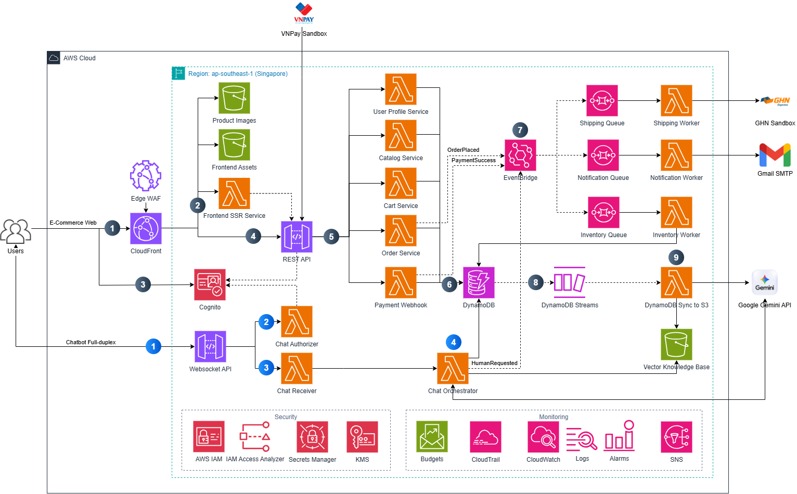

# Motorcycle E-Commerce & RAG Chatbot Platform
## A Serverless Motorcycle Parts Store and Intelligent Advisory Chatbot on AWS

### 1. Problem Overview
This project addresses the challenge of advising on and retailing motorcycle parts online. The hardest part of this industry is the sheer number of part codes and motorcycle models, which makes it very easy for customers to buy the wrong part, while stores spend a lot of staff time answering chats. The system combines a Next.js e-commerce website with a RAG Chatbot (real-time part compatibility advice over WebSocket) on a 100% AWS Serverless platform. The solution automates consulting, processes orders asynchronously, provides strong security, and keeps operating costs extremely low.

### 2. Objectives & Scope
*Project Objectives*
- **Consultation Automation:** Build a real-time RAG AI virtual assistant to verify motorcycle spare parts compatibility across specific vehicle models and production years (response latency < 2s).
- **Cost Optimization & Scalability:** Leverage a 100% Serverless architecture on AWS, completely eliminating EC2 server maintenance overhead while maintaining operational costs below **$6 USD/month**.
- **Asynchronous Business Processing:** Apply Event-Driven Architecture (EDA) to decouple order checkout, inventory deduction, shipping fulfillment, and email notifications.
*Project Scope*
- **In-Scope:**
  - Next.js 14 SSR e-commerce web application and 5 backend Lambda microservices.
  - Customer authentication and administrative Role-Based Access Control (RBAC) via Amazon Cognito JWT.
  - RAG AI Chatbot cluster via WebSocket API Gateway (integrated with S3 Vector Store and Google Gemini 2.0 Flash) alongside an on-duty staff escalation mechanism (Human Handover).
  - Integration with VNPay Sandbox online payment gateway and Giao Hàng Nhanh (GHN) Sandbox logistics fulfillment.
  - Event-driven orchestration utilizing Amazon EventBridge, 3 SQS queues equipped with Dead Letter Queues (DLQ), and 3 background workers (Inventory, Shipping, Notification).
  - Comprehensive Infrastructure as Code (IaC) automation via Terraform and GitHub Actions CI/CD pipelines.
- **Out-of-Scope:** Physical retail Point-of-Sale (POS) systems for offline brick-and-mortar stores and direct international credit card payment processing (Stripe/PayPal).

### 3. Problem Statement
*Current problems*
- Customers without technical knowledge often order the wrong components/parts (wrong motorcycle model, wrong spark plug size, wrong chain and sprockets, etc.), leading to a high return rate.
- Staff spend a lot of time repeatedly answering the same questions: does this part fit my bike, is it in stock, how much does it cost.
- Renting fixed servers (EC2/VPS) incurs monthly maintenance costs even though traffic is uneven between day and night.

*Solution*
- Build the online store with Next.js 14 SSR and 5 Lambda microservices (Catalog, Cart, Order, User, Payment) behind API Gateway.
- Integrate an AI RAG Chatbot through API Gateway WebSocket: it automatically searches for compatible parts in a vector store kept on S3 and answers customers immediately. For difficult cases or complaints, the bot automatically forwards the information (Human Requested) to staff by email.
- Apply an event-driven architecture (EDA): EventBridge and SQS decouple inventory deduction, shipping order creation, and confirmation emails, with a DLQ to prevent the system from clogging.
- Secure online payment through the VNPay gateway with HMAC-SHA512 digital signature verification.

*Benefits and return on investment (ROI)*
- Reduces by more than 60% the time staff spend on chat duty answering basic questions.
- Reduces the wrong-part purchase rate to below 5%, since the bot verifies the correct motorcycle model before the customer orders.
- Extremely low infrastructure cost thanks to the serverless architecture and the pay-as-you-go model. The expected payback period is 3–6 months.

### 4. Solution Architecture
The whole system runs on a Serverless model with no physical servers to manage. Users access the website through the CloudFront CDN; APIs are called through API Gateway REST; real-time chat goes through WebSocket; background tasks are pushed into EventBridge and SQS.

*AWS services used*
- *Amazon CloudFront & Functions*: CDN for delivering the website, injecting security headers, and acting as an Edge WAF that blocks XSS, SQLi, etc.
- *AWS Lambda*: 13 functions: Next.js SSR, 5 backend microservices (Catalog, Cart, Order, User, Payment), the RAG Chatbot cluster (Chat Authorizer, Chat Receiver, Chat Orchestrator, DynamoDB Sync To S3), and 3 background workers (Inventory, Shipping, Notification).
- *Amazon API Gateway*: Provides the REST API for the website and the WebSocket API for the real-time chatbot.
- *Amazon DynamoDB*: Stores 6 data tables (Products, Orders, Carts, Users, StorePolicies, ChatbotSessions); Streams are enabled to automatically sync data to the AI knowledge base, and PITR backup is enabled.
- *Amazon S3*: Stores static website files, product images, and the Chatbot's vector knowledge files.
- *Amazon EventBridge & SQS*: Orchestrates order events and message queues, including a Dead Letter Queue (DLQ).
- *Amazon Cognito*: Manages registration, sign-in, and customer/admin authorization using JWT.
- *Amazon CloudWatch & SNS*: System monitoring and error alerts via email.
- *Amazon CloudTrail*: Audit trail of edits/changes.
- *AWS Secrets Manager*: Securely stores secret keys.

*Component design*
- *Frontend*: S3 (images, static files) and a Next.js SSR Lambda for fast loading, supporting part search and filtering by motorcycle brand (Honda, Yamaha, etc.).
- *Backend Microservices*: Handle adding to cart, placing orders, updating accounts, and the VNPay payment webhook.
- *RAG Chatbot*: Receives messages over WebSocket and matches vectors on S3 to generate accurate advisory answers.
- *Event Workers*: Lambda InventoryWorker (deducts stock), ShippingWorker (creates GHN shipping orders), NotificationWorker (sends Gmail to customers/staff).

### 5. Technical Implementation
*Implementation phases*
1. *Architecture design & Terraform*: design the serverless architecture in draw.io and write IaC code to automate the entire AWS infrastructure (2 weeks).
2. *Core Web & Microservices development*: write 5 backend Lambdas in Python 3.12, build the Next.js frontend, and integrate VNPay sandbox payment (2 weeks).
3. *AI RAG & event-driven integration*: set up the WebSocket channel, connect EventBridge to SQS, write the background worker Lambdas, and integrate GHN sandbox shipping (2 weeks).
4. *Security, testing & go-live*: fix security vulnerabilities, set up CloudWatch Alarms, and run tests (2 weeks).

*Technical requirements*
- Use Terraform to manage infrastructure consistently and make it easy to redeploy when needed.
- Backend written in lightweight Python 3.12 with fast startup (low cold start).
- Apply Zero-Trust principles: verify permissions from the Cognito token, encrypt data at rest (SSE) and in transit (HTTPS/TLS).

### 6. Roadmap & Milestones
- *Weeks 1–2*: Finalize the architecture and complete the base infrastructure with Terraform.
- *Weeks 3–4*: Complete the backend microservices, the shopping website, and VNPay sandbox payment.
- *Weeks 5–6*: Complete the advisory RAG chatbot, the staff handover mechanism, the SQS event queues, and GHN sandbox shipping integration.
- *Weeks 7–8*: Security testing, cost optimization, and production launch.

### 7. Budget Estimation
Costs can be viewed on the [AWS Pricing Calculator](https://calculator.aws/#/estimate?id=a7e8011b4c42dd57ec809519002009910500eb23)
Or see the [budget estimate file](/static/attachments/Cost_Estimate.csv).
*Infrastructure costs (detailed estimate from the AWS spreadsheet for a scale of 1,000 users/month):*
- *AWS Secrets Manager*: USD 1.65/month (securely manages 4 secrets: Gemini Key, VNPay, GHN, Gmail SMTP; 10,000 API calls).
- *Amazon CloudFront*: USD 1.32/month (10 GB data transfer out, 50,000 HTTPS requests, and the Edge WAF filter).
- *Amazon CloudWatch*: USD 1.30/month (1 GB log data ingested, 6 metric alarms, and 1 monitoring dashboard).
- *Amazon DynamoDB*: USD 0.52/month (USD 0.29 for on-demand read/write capacity and USD 0.23 for PITR backup protecting 1 GB of data; Streams are free at USD 0).
- *Amazon API Gateway*: USD 0.23/month (50,000 REST API requests and 20,000 WebSocket messages).
- *S3 Standard*: USD 0.09/month (3 GB of image & vector storage, 1,000 PUT requests, and 15,000 GET requests).
- *AWS Key Management Service (KMS)*: USD 0.03/month (10,000 symmetric requests for encrypting secret keys).
- *AWS Lambda*: USD 0.00/month (500,000 requests, 512 MB memory, fully within the 1 million requests Free Tier allowance).
- *Amazon Cognito*: USD 0.00/month (1,000 monthly active users (MAU), free within the 50,000 MAU Free Tier allowance).
- *Amazon Simple Queue Service (SQS)*: USD 0.00/month (15,000 standard requests, free within the 1 million requests Free Tier).
- *Amazon EventBridge*: USD 0.00/month (3,000 custom events within the Free Tier allowance).
- *Amazon SNS*: USD 0.00/month (100 free email alert requests).
- *AWS CloudTrail*: USD 0.00/month (administrative Event History for 90 days is 100% free).
*Total cost*: **USD 5.14/month**, equivalent to **USD 61.68/12 months** (approximately **~VND 1,540,000** for a full year of operation).

### 8. Risk Assessment
*Risk matrix*
- Web vulnerabilities / data theft: high impact, medium probability.
- AI giving wrong part specifications: high impact, low probability.
- Cost spikes due to API spam: medium impact, low probability.

*Mitigation strategies*
- Block attacks at the edge with Edge WAF, and verify JWT tokens to prevent viewing other people's orders (IDOR protection).
- Strictly constrain the AI prompt: only answer what is in the technical documents and never invent specifications.
- Set rate limits on API Gateway and configure AWS Budgets cost alerts.

*Contingency plans*
- When the bot cannot handle a case, it automatically escalates to a support staff member by email, together with the customer's information.
- The entire infrastructure is defined in Terraform files and can be fully rebuilt in another region within 15 minutes in case of an incident.

### 9. Expected Results
- *Technical improvements*: Successfully build a complete Serverless e-commerce system combined with real-time AI RAG, automatically scaling with load without anyone on duty to operate servers.
- *Practical value*: Helps motorcycle parts stores reduce advisory staffing costs, lower the rate of customers buying wrong parts, and save as much budget as possible for the company/store owner.
