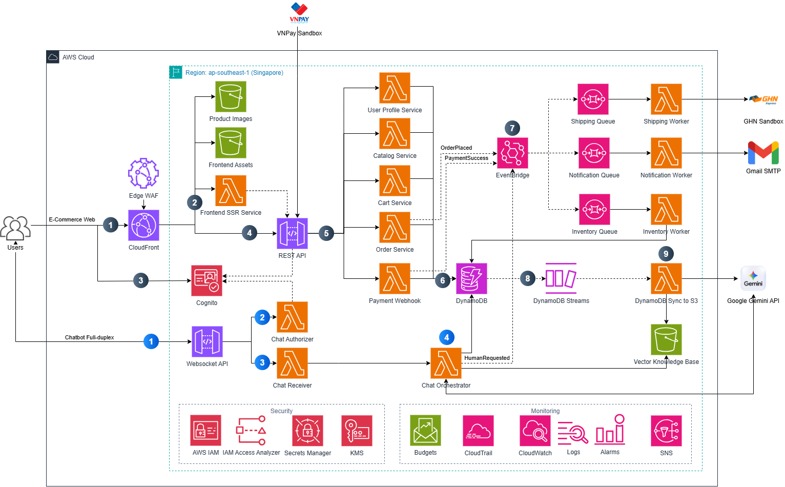

# Motorcycle E-Commerce & RAG Chatbot Platform
## Nền tảng bán phụ tùng xe máy Serverless và Chatbot tư vấn thông minh trên AWS

### 1. Tổng quan bài toán
Dự án được xây dựng nhằm giải quyết bài toán tư vấn và bán lẻ phụ tùng xe máy trực tuyến. Điểm khó nhất của ngành này là có quá nhiều mã linh kiện và đời xe khác nhau, khiến khách hàng rất dễ mua nhầm, còn cửa hàng thì tốn nhiều nhân lực trực chat. Hệ thống kết hợp giữa web bán hàng Next.js và Chatbot RAG (tư vấn tương thích phụ tùng thời gian thực qua WebSocket) trên nền tảng AWS Serverless 100%. Giải pháp giúp tự động hóa khâu tư vấn, xử lý đơn hàng bất đồng bộ, bảo mật cao và chi phí vận hành cực thấp.

### 2. Mục tiêu & phạm vi
*Mục tiêu dự án*
- **Tự động hóa tư vấn:** Xây dựng trợ lý ảo AI RAG tra cứu tương thích phụ tùng theo đúng dòng xe/đời xe theo thời gian thực (độ trễ phản hồi < 2s).
- **Tối ưu chi phí & mở rộng:** Ứng dụng kiến trúc Serverless 100% trên AWS, loại bỏ hoàn toàn chi phí bảo trì máy chủ EC2, chi phí vận hành dưới **6 USD/tháng**.
- **Bất đồng bộ hóa nghiệp vụ:** Áp dụng kiến trúc hướng sự kiện (EDA) để tách rời quy trình đặt hàng, trừ tồn kho, sinh vận đơn và thông báo email.
*Phạm vi thực hiện (Scope)*
- **Trong phạm vi (In-Scope):**
  - Web ứng dụng thương mại điện tử Next.js 14 SSR và 5 microservices backend Lambda.
  - Hệ thống xác thực khách hàng và phân quyền quản trị bằng Amazon Cognito JWT.
  - Cụm Chatbot AI RAG qua WebSocket API Gateway (tích hợp Vector Store S3, Google Gemini 2.0 Flash) kèm cơ chế bàn giao nhân viên trực ca (Human Handover).
  - Tích hợp cổng thanh toán trực tuyến VNPay Sandbox và giao vận Giao Hàng Nhanh (GHN) Sandbox.
  - Quy trình xử lý sự kiện qua EventBridge, 3 hàng đợi SQS có DLQ và 3 worker nền (Inventory, Shipping, Notification).
  - Tự động hóa hạ tầng (IaC) toàn diện bằng Terraform và CI/CD GitHub Actions.
- **Ngoài phạm vi (Out-of-Scope):** Hệ thống máy POS bán lẻ tại cửa hàng offline và cổng thanh toán thẻ quốc tế (Stripe/PayPal).

### 3. Vấn đề cần giải quyết
*Vấn đề hiện tại*
- Khách hàng không rành kỹ thuật nên thường xuyên đặt sai linh kiện/phụ tùng (sai đời xe, sai kích thước bugi, nhông sên dĩa...), dẫn đến tỷ lệ đổi trả hàng cao.
- Nhân viên mất nhiều thời gian trả lời lặp đi lặp lại các câu hỏi: xe này lắp vừa không, còn hàng không, giá bao nhiêu.
- Thuê máy chủ cố định (EC2/VPS) tốn kém chi phí duy trì hàng tháng trong khi lượng truy cập không đều giữa ngày và đêm.

*Giải pháp*
- Xây dựng web bán hàng bằng Next.js 14 SSR và 5 microservices Lambda (Catalog, Cart, Order, User, Payment) qua API Gateway.
- Tích hợp Chatbot AI RAG qua API Gateway WebSocket: tự động tìm kiếm linh kiện tương thích từ kho vector lưu trên S3 và trả lời khách ngay lập tức. Nếu gặp ca khó hoặc khiếu nại, bot tự chuyển tiếp thông tin (Human Requested) qua email cho nhân viên.
- Áp dụng kiến trúc hướng sự kiện (EDA): dùng EventBridge và SQS để tách riêng việc trừ kho, sinh vận đơn giao hàng và gửi email xác nhận, có DLQ giúp hệ thống không bị nghẽn.
- Thanh toán online an toàn qua cổng VNPay với xác thực chữ ký số HMAC-SHA512.

*Lợi ích và hoàn vốn đầu tư (ROI)*
- Giảm hơn 60% thời gian nhân viên phải trực chat trả lời câu hỏi cơ bản.
- Giảm tỷ lệ mua nhầm phụ tùng xuống dưới 5% nhờ bot kiểm tra đúng đời xe trước khi khách đặt.
- Chi phí hạ tầng cực thấp nhờ sử dụng kiến trúc serverless và cơ chế dùng bao nhiêu trả bấy nhiêu (Pay-as-you-go). Thời gian hoàn vốn dự kiến từ 3–6 tháng. 

### 4. Kiến trúc giải pháp
Toàn bộ hệ thống chạy theo mô hình Serverless, không cần quản lý máy chủ vật lý. Người dùng truy cập web qua CloudFront CDN; các API gọi về API Gateway REST; tính năng chat realtime đi qua WebSocket; các tác vụ nền đẩy vào EventBridge và SQS.

*Dịch vụ AWS sử dụng*
- *Amazon CloudFront & Functions*: CDN phân phối web, chèn security headers và đóng vai trò Edge WAF chặn XSS, SQLi...
- *AWS Lambda*: Gồm 13 hàm xử lý: Next.js SSR, 5 microservices backend (Catalog, Cart, Order, User, Payment), cụm Chatbot RAG (Chat Authorizer, Chat Receiver, Chat Orchestrator, DynamoDB Sync To S3) và 3 worker xử lý nền (Inventory, Shipping, Notification).
- *Amazon API Gateway*: Cung cấp REST API cho web và WebSocket API cho chatbot realtime.
- *Amazon DynamoDB*: Lưu trữ 6 bảng dữ liệu (Products, Orders, Carts, Users, StorePolicies, ChatbotSessions); bật Streams để tự động sync dữ liệu sang kho tri thức AI và kích hoạt sao lưu PITR.
- *Amazon S3*: Lưu file web static, ảnh sản phẩm và file vector tri thức của Chatbot.
- *Amazon EventBridge & SQS*: Điều phối sự kiện đơn hàng và hàng đợi tin nhắn có kèm Dead Letter Queue (DLQ).
- *Amazon Cognito*: Quản lý đăng ký, đăng nhập và phân quyền khách hàng / admin bằng JWT.
- *Amazon CloudWatch & SNS*: Giám sát hệ thống, cảnh báo lỗi qua email.
- *Amazon CloudTrail*: Truy vết chỉnh sửa/thay đổi
- *Amazon Secret Manager*: lưu trữ an toàn các secret key.

*Thiết kế thành phần*
- *Frontend*: S3 (ảnh, file tĩnh) và lambda Next.js SSR tải nhanh, hỗ trợ tìm kiếm và lọc phụ tùng theo hãng xe (Honda, Yamaha...).
- *Backend Microservices*: Xử lý thêm giỏ hàng, đặt hàng, cập nhật tài khoản và webhook thanh toán VNPay.
- *Chatbot RAG*: Tiếp nhận tin nhắn qua WebSocket, so khớp vector trên S3 để sinh câu trả lời tư vấn chính xác.
- *Event Workers*: Lambda InventoryWorker (trừ kho), ShippingWorker (tạo đơn GHN), NotificationWorker (gửi gmail cho khách hàng/ nhân viên).

### 5. Triển khai kỹ thuật
*Các giai đoạn triển khai*
1. *Thiết kế kiến trúc & viết Terraform*: thiết kế kiến trúc serverless trên draw.io và viết code IaC để tự động hóa toàn bộ hạ tầng AWS (2 tuần).
2. *Phát triển Core Web & Microservices*: Viết 5 Lambda backend bằng Python 3.12, dựng frontend Next.js và tích hợp thanh toán VNPay sandbox(2 tuần).
3. *Tích hợp AI RAG & Hướng sự kiện*: Dựng kênh WebSocket, kết nối EventBridge sang SQS, viết các lambda worker xử lý nền và tích hợp thanh toán GHN sandbox (2 tuần).
4. *Bảo mật, Kiểm thử & Đưa vào vận hành*: Vá các lỗ hổng bảo mật, thiết lập CloudWatch Alarms và chạy kiểm thử (2 tuần).

*Yêu cầu kỹ thuật*
- Sử dụng Terraform để quản lý hạ tầng đồng nhất, dễ triển khai lại khi cần.
- Backend viết bằng Python 3.12 gọn nhẹ, khởi động nhanh (cold start thấp).
- Áp dụng nguyên tắc Zero-Trust: kiểm tra quyền từ Cognito token, mã hóa dữ liệu tĩnh (SSE) và đường truyền (HTTPS/TLS).

### 6. Kế hoạch & Timeline thực hiện
- *Tuần 1, 2*: Chốt kiến trúc, dựng xong hạ tầng nền tảng bằng Terraform.
- *Tuần 3, 4*: Hoàn thành backend microservices, web mua hàng và thanh toán VNPay sandbox.
- *Tuần 5, 6*: Hoàn thành chatbot RAG tư vấn, cơ chế bàn giao nhân viên, hàng đợi sự kiện SQS và tích hợp thanh toán GHN sandbox.
- *Tuần 7, 8*: Kiểm thử bảo mật, tối ưu chi phí và đưa vào sử dụng thực tế.

### 7. Ước tính chi phí
Có thể xem chi phí trên [AWS Pricing Calculator](https://calculator.aws/#/estimate?id=a7e8011b4c42dd57ec809519002009910500eb23)
Hoặc xem [tệp ước tính ngân sách](/static/attachments/Cost_Estimate.csv).
*Chi phí hạ tầng (Dự toán chi tiết theo bảng tính AWS cho quy mô 1.000 users/tháng):*
- *AWS Secrets Manager*: 1,65 USD/tháng (Quản lý an toàn 4 secrets: Gemini Key, VNPay, GHN, Gmail SMTP; 10.000 lượt gọi API).
- *Amazon CloudFront*: 1,32 USD/tháng (10 GB data transfer out, 50.000 HTTPS requests và bộ lọc Edge WAF).
- *Amazon CloudWatch*: 1,30 USD/tháng (1 GB log data ingested, 6 metric alarms và 1 dashboard giám sát).
- *Amazon DynamoDB*: 0,52 USD/tháng (gồm 0,29 USD dung lượng đọc/ghi on-demand và 0,23 USD sao lưu PITR bảo vệ 1 GB dữ liệu; Streams miễn phí 0 USD).
- *Amazon API Gateway*: 0,23 USD/tháng (50.000 REST API requests và 20.000 WebSocket messages).
- *S3 Standard*: 0,09 USD/tháng (3 GB lưu trữ ảnh & vector, 1.000 PUT requests và 15.000 GET requests).
- *AWS Key Management Service (KMS)*: 0,03 USD/tháng (10.000 symmetric requests mã hóa khóa bí mật).
- *AWS Lambda*: 0,00 USD/tháng (500.000 requests, 512 MB bộ nhớ - nằm trọn trong hạn mức 1 triệu requests Free Tier).
- *Amazon Cognito*: 0,00 USD/tháng (1.000 người dùng hoạt động hàng tháng - MAU, miễn phí trong hạn mức 50.000 MAU Free Tier).
- *Amazon Simple Queue Service (SQS)*: 0,00 USD/tháng (15.000 standard requests, miễn phí trong 1 triệu requests Free Tier).
- *Amazon EventBridge*: 0,00 USD/tháng (3.000 custom events nằm trong hạn mức Free Tier).
- *Amazon SNS*: 0,00 USD/tháng (100 requests cảnh báo email miễn phí).
- *AWS CloudTrail*: 0,00 USD/tháng (Ghi vết lịch sử quản trị Event History trong 90 ngày miễn phí 100%).
*Tổng chi phí*: **5,14 USD/tháng**, tương đương **61,68 USD/12 tháng** (khoảng **~1.540.000 VNĐ** cho cả năm vận hành).

### 8. Đánh giá rủi ro & phương án giảm thiểu
*Ma trận rủi ro*
- Lỗ hổng web / đánh cắp dữ liệu: Tác động cao, xác suất trung bình.
- AI trả lời sai thông số phụ tùng: Tác động cao, xác suất thấp.
- Chi phí tăng đột biến do bị spam gọi API: Tác động trung bình, xác suất thấp.

*Chiến lược giảm thiểu*
- Chặn tấn công từ biên bằng Edge WAF, kiểm tra JWT token chống xem trộm đơn hàng của người khác (chống IDOR).
- Ràng buộc prompt AI chặt chẽ: chỉ trả lời những gì có trong tài liệu kỹ thuật, không tự bịa thông số.
- Đặt giới hạn tốc độ (rate limit) trên API Gateway và cài cảnh báo chi phí AWS Budgets.

*Kế hoạch dự phòng*
- Khi bot không xử lý được, tự động chuyển ca sang nhân viên hỗ trợ kèm thông tin khách hàng qua email.
- Toàn bộ hạ tầng nằm trong file Terraform, có thể dựng lại hoàn chỉnh trên vùng khác trong 15 phút nếu có sự cố.

### 9. Kết quả kỳ vọng
- *Cải tiến kỹ thuật*: Xây dựng thành công hệ thống thương mại điện tử Serverless hoàn chỉnh kết hợp AI RAG thời gian thực, tự động mở rộng theo tải mà không cần trực vận hành máy chủ.
- *Giá trị thực tế*: Giúp cửa hàng phụ tùng xe máy giảm chi phí nhân sự tư vấn, giảm tỷ lệ khách mua nhầm phụ tùng và tiết kiệm tối đa ngân sách cho công ty/ chủ cửa hàng.
