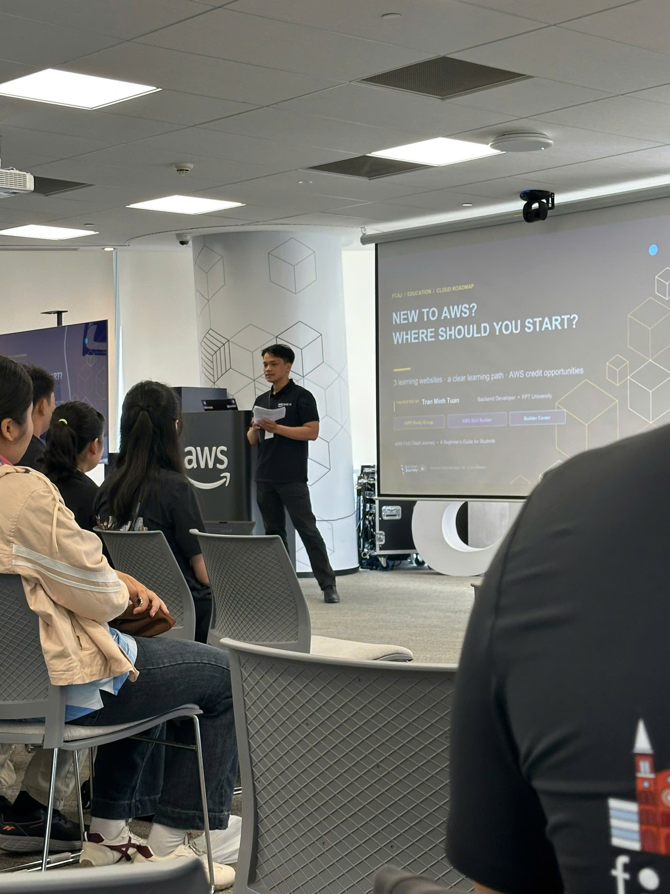

# Summary Report: “AWS First Cloud AI Journey – Community Sharing Session (31/10/2026)”

### Event Objectives

- Share real-world lessons on building AI-driven "software factories" at scale
- Give students a clear starting point and learning path for AWS
- Introduce AWS Lambda Web Functions and the new Active CPU Billing model
- Explain asynchronous system design with Amazon SQS
- Share a real 3-month internship experience at FCAJ
- Encourage students to start and keep contributing to open source

### Speakers

- **Henry (Duc) Bui** – Head of Engineering, CloudThinker
- **Tran Minh Tuan** – Backend Developer, FPT University
- **Thinh Nguyen** – DevSecOps/Cloud Engineer, Styl Solutions – First Cloud AI Journey
- **Khang Duong** – FCAJ member

### Agenda

| Time | Session |
|---|---|
| 9:00 – 9:25 | Lessons Learned from Building Software Factories |
| 9:30 – 9:55 | Education – New to AWS? Where Should You Start? |
| 10:00 – 10:25 | AWS Lambda Web Functions: Rethinking Serverless Web Architecture |
| 10:30 – 11:00 | Amazon SQS: Building Asynchronous Systems |
| 11:00 – 11:25 | My 3-Month AWS Internship Journey |
| 11:30 – 12:00 | Start & Maintain Consistency with Open Source Contributing |

### Key Highlights

#### Lessons Learned from Building Software Factories

- **Scale in practice**: Merges into the `develop` branch grew from **39/month (Dec 2024)** to **2,901/month (Oct 2026)** once AI agents became part of the delivery process
- **One folder runs everything**: Every agent session starts in a single **control folder** holding notes, skills and machine guides; from there the agent reaches the app, infra and docs repos on the laptop, as well as team machines and dev/prod clusters in the cloud
- **Every merge request shows its proof**: The agent captures the change itself — before/after, light/dark mode, wide/narrow screens — so a reviewer can see the result **without running anything**
- **Many sessions, one shared test cache**:
  - Tests are cached by **test + hash of the files it used** → same code reuses the result, changed code runs once and is saved for everyone
  - **2% of cached results are re-run at random** to verify the cache stays trustworthy
  - A **shared check runner** keeps 10 warm copies of the app; 65 checks (type checks, lint, migrations, secret scan, dependency audit, tests) are picked by what changed
  - Result: **76% shorter wait for checks**

#### Education – New to AWS? Where Should You Start?

- **3 websites, 3 complementary purposes** — no single site covers every learning need:
  - **AWS Study Group** (cloudjourney.awsfcaj.com) – hands-on, step-by-step workshops in Vietnamese
  - **AWS Skill Builder** (skillbuilder.aws) – digital courses, exam prep, labs and topic-based resources
  - **AWS Builder Center** (builder.aws.com) – articles, workshops, student verification and badge rewards
- **Suggested learning order**: Foundations (Cloud, Regions/AZs, IAM, security) → Hands-on (IAM, S3, AWS Budgets labs) → Take notes (concepts, errors, solutions) → Connect (community, badges, Student Rewards)
- **AWS Free Tier credits**: $100 at sign-up + up to $100 from exploration tasks = **up to $200** — but credits **do not replace Budgets alerts** or reading the terms
- **Skill Builder subscription** unlocks **AWS Cloud Quest** (learn AWS through a 3D game) and **AWS Builder Labs** (guided step-by-step labs); some content is free, advanced content depends on the plan
- Bridging the gap between universities and businesses: what students should prepare before entering the industry

#### AWS Lambda Web Functions: Rethinking Serverless Web Architecture

- **Native HTTP support**: Lambda handles web requests directly, removing the adapter layer previously needed to run web frameworks
- **Multi-concurrency**: Up to **128 concurrent requests** per execution environment instead of one request per instance
- **Active CPU Billing**:
  - *Traditional model* – billed by wall-clock duration; database wait time is charged at full rate
  - *New model* – billed only for active CPU cycles; CPU cost while waiting on database I/O is $0
  - **40–70% compute cost reduction** for typical I/O-bound web backends and microservices
- Live benchmarks comparing Serverless with **Docker on EC2/ECS**

#### Amazon SQS: Building Asynchronous Systems

- Why modern systems need **asynchronous processing** instead of chaining synchronous calls
- Using **Amazon SQS** as a buffer to **decouple** producers and consumers and scale each side independently
- Design patterns and practical implementation tips for queue-based architectures

#### My 3-Month Internship at FCAJ

- Building a **serverless card game on AWS** as a real internship project
- Applying AWS services to an actual product, not just labs
- Lessons and advice for students about to start their own internship

#### Start & Maintain Consistency with Open Source Contributing

- How to make a **first open source contribution** from scratch
- Building a steady contribution habit and staying motivated
- The impact of open source on skills and career growth

### Key Takeaways

#### AI-Assisted Engineering

- **Verification is the bottleneck, not code generation**: when agents produce thousands of changes, visual proof on every merge request and fast shared checks are what keep quality under control
- **Cache smartly, but keep checking the cache**: hashing test inputs saves time, and a small random re-run keeps the results honest
- **Centralised agent context**: one control folder with notes, skills and guides makes agent sessions consistent across many repos and environments

#### Cloud Architecture & Cost

- **Billing model shapes architecture**: with Active CPU Billing, I/O-heavy APIs on Lambda become much cheaper, which changes the Lambda vs. EC2/ECS trade-off
- **Asynchronous by default where possible**: queues like SQS absorb traffic spikes and prevent one slow service from blocking the whole system

#### Learning Strategy

- **Learn → practise → write it down → share**: follow a clear order instead of jumping randomly between services
- **Cost safety first**: set up AWS Budgets alerts before experimenting, even with free credits
- **Consistency beats intensity**: both the internship and open source talks stressed small, regular progress

### Applying to Work

- **Set up AWS Budgets** alerts on my account before any further lab work
- **Follow the suggested learning path**: finish Skill Builder foundations, then do the IAM, S3 and Budgets labs on AWS Study Group
- **Keep a learning log** of concepts, errors and fixes for every lab
- **Try Lambda for a Node.js API**: compare cost and latency with my current EC2 setup for an I/O-bound backend
- **Introduce SQS** into a project to move slow tasks (emails, notifications, file processing) out of the request path
- **Attach proof to pull requests**: add before/after screenshots to team project PRs so reviewers don't have to run the code
- **Make a first open source contribution**, starting with docs or a small issue

### Event Experience

Attending the **AWS First Cloud AI Journey** sharing session on 31/10 gave me both a practical roadmap for learning AWS and a look at how real teams are building software today.

#### Learning from experienced speakers
- Speakers from CloudThinker, Styl Solutions, FPT University and the FCAJ community shared lessons from real projects rather than theory.
- The **software factories** talk was eye-opening: seeing merges grow from 39 to 2,901 per month showed how much AI agents can change the pace of a team — and how much engineering is needed to keep that pace safe.

#### Hands-on technical exposure
- The **Lambda Web Functions** session made the cost difference concrete: paying for active CPU instead of wall-clock time matters a lot for APIs that spend most of their time waiting on a database.
- The **SQS** session connected well with what I already know about decoupling services and handling work asynchronously.

#### Clear direction for students
- The **Education** session gave a simple, actionable plan: which website to use for what, which order to learn in, and how to get up to $200 in credits without forgetting cost control.
- The **internship talk** showed what a 3-month project on AWS can realistically look like — a serverless card game built end to end.

#### Networking and discussions
- The event was a good chance to meet other students and FCAJ members who are on the same cloud learning journey.

#### Lessons learned
- Speed without verification is risky; good tooling (shared caches, automated checks, visual proof) is what makes fast delivery sustainable.
- Understanding the **billing model** is part of architecture design, not an afterthought.
- Steady, consistent practice — in AWS labs or open source — is the most reliable way to grow.

#### Some event photos

> Overall, the event gave me a practical AWS learning roadmap, a clearer understanding of serverless and asynchronous architecture, and a real picture of how AI agents are changing the way software teams work.
