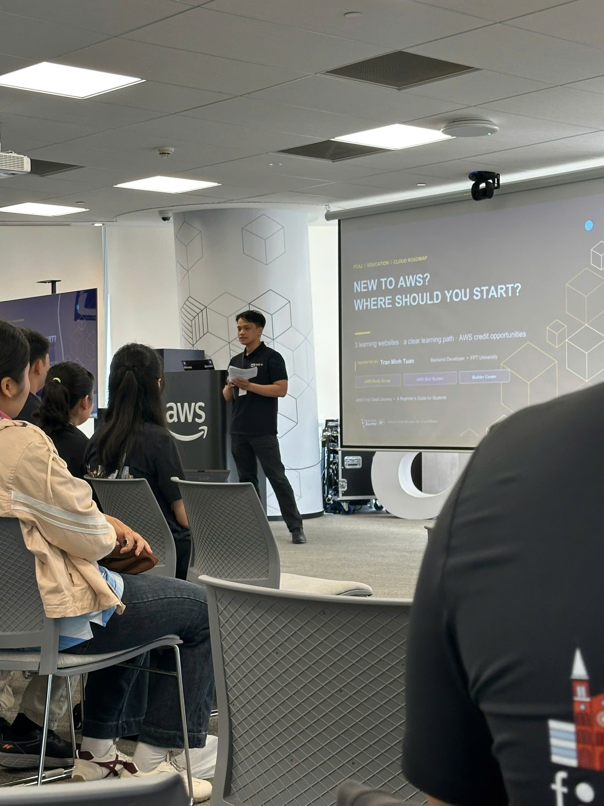

# Bài thu hoạch “AWS First Cloud AI Journey – Community Sharing Session (31/10/2026)”

### Mục Đích Của Sự Kiện

- Chia sẻ bài học thực tế khi xây dựng "software factory" với AI agent ở quy mô lớn
- Định hướng lộ trình bắt đầu học AWS rõ ràng cho sinh viên
- Giới thiệu AWS Lambda Web Functions và mô hình tính phí Active CPU Billing
- Trình bày cách thiết kế hệ thống bất đồng bộ với Amazon SQS
- Chia sẻ trải nghiệm thực tập 3 tháng tại FCAJ
- Khuyến khích sinh viên bắt đầu và duy trì đóng góp mã nguồn mở

### Danh Sách Diễn Giả

- **Henry (Duc) Bui** – Head of Engineering, CloudThinker
- **Tran Minh Tuan** – Backend Developer, FPT University
- **Thinh Nguyen** – DevSecOps/Cloud Engineer, Styl Solutions – First Cloud AI Journey
- **Khang Duong** – Thành viên FCAJ

### Chương Trình

| Thời gian | Phiên chia sẻ |
|---|---|
| 9:00 – 9:25 | Lessons Learned from Building Software Factories |
| 9:30 – 9:55 | Education – New to AWS? Where Should You Start? |
| 10:00 – 10:25 | AWS Lambda Web Functions: Rethinking Serverless Web Architecture |
| 10:30 – 11:00 | Amazon SQS: Building Asynchronous Systems |
| 11:00 – 11:25 | My 3-Month AWS Internship Journey |
| 11:30 – 12:00 | Start & Maintain Consistency with Open Source Contributing |

### Nội Dung Nổi Bật

#### Bài học từ việc xây dựng Software Factories

- **Quy mô thực tế**: Số lần merge vào nhánh `develop` tăng từ **39 lần/tháng (12/2024)** lên **2.901 lần/tháng (10/2026)** khi AI agent trở thành một phần của quy trình phát triển
- **Một thư mục điều khiển tất cả**: Mọi phiên làm việc của agent đều bắt đầu từ một **thư mục control** chứa ghi chú, skill và hướng dẫn máy; từ đó agent truy cập repo app, infra, docs trên laptop cũng như máy của team và cụm dev/prod trên cloud
- **Mỗi merge request đều có bằng chứng**: Agent tự chụp lại thay đổi — trước/sau, chế độ sáng/tối, màn hình rộng/hẹp — để người review thấy kết quả **mà không cần chạy gì**
- **Nhiều phiên, một test cache dùng chung**:
  - Kết quả test được lưu theo **test + hash của các file mà test sử dụng** → code không đổi thì dùng lại kết quả, code thay đổi thì chạy một lần và lưu cho tất cả
  - **Chạy lại ngẫu nhiên 2%** kết quả đã cache để kiểm chứng độ tin cậy
  - **Shared check runner** giữ sẵn 10 bản sao của ứng dụng; 65 bước kiểm tra (type check, lint, migration, quét secret, audit dependency, test) được chọn theo phần code thay đổi
  - Kết quả: **thời gian chờ kiểm tra giảm 76%**

#### Education – Mới học AWS? Nên bắt đầu từ đâu?

- **3 website, 3 mục đích bổ trợ nhau** — không website nào đáp ứng mọi nhu cầu học:
  - **AWS Study Group** (cloudjourney.awsfcaj.com) – thực hành theo workshop từng bước, hướng dẫn bằng tiếng Việt
  - **AWS Skill Builder** (skillbuilder.aws) – khóa học online, ôn thi chứng chỉ, lab và tài liệu theo chủ đề
  - **AWS Builder Center** (builder.aws.com) – bài viết, workshop, xác minh sinh viên và nhận huy hiệu
- **Lộ trình học gợi ý**: Nền tảng (Cloud, Region/AZ, IAM, bảo mật) → Thực hành (lab IAM, S3, AWS Budgets) → Ghi chép (khái niệm, lỗi, cách khắc phục) → Kết nối (cộng đồng, huy hiệu, Student Rewards)
- **Credit AWS Free Tier**: 100 USD khi đăng ký + tối đa 100 USD từ các nhiệm vụ khám phá = **tối đa 200 USD** — nhưng credit **không thay thế cảnh báo Budgets** hay việc đọc kỹ điều khoản
- **Gói Skill Builder** mở khóa **AWS Cloud Quest** (học AWS qua game 3D) và **AWS Builder Labs** (lab có hướng dẫn từng bước); một số nội dung miễn phí, nội dung nâng cao tùy theo gói
- Thu hẹp khoảng cách giữa nhà trường và doanh nghiệp: sinh viên cần chuẩn bị gì trước khi đi làm

#### AWS Lambda Web Functions: Tư duy lại kiến trúc web Serverless

- **Hỗ trợ HTTP gốc**: Lambda xử lý request web trực tiếp, bỏ lớp adapter trước đây cần có để chạy web framework
- **Đa luồng đồng thời**: Tối đa **128 request đồng thời** trên một môi trường thực thi thay vì một request mỗi instance
- **Active CPU Billing**:
  - *Mô hình cũ* – tính phí theo tổng thời gian chạy; thời gian chờ database vẫn bị tính đủ giá
  - *Mô hình mới* – chỉ tính phí theo chu kỳ CPU thực sự xử lý; thời gian chờ I/O database có chi phí CPU là 0 USD
  - **Giảm 40–70% chi phí compute** với các backend web và microservice thiên về I/O
- Benchmark trực tiếp so sánh Serverless với **Docker trên EC2/ECS**

#### Amazon SQS: Xây dựng hệ thống bất đồng bộ

- Vì sao hệ thống hiện đại cần **xử lý bất đồng bộ** thay vì gọi đồng bộ nối tiếp
- Dùng **Amazon SQS** làm hàng đợi trung gian để **tách rời (decouple)** bên gửi và bên xử lý, mở rộng từng bên độc lập
- Các design pattern và mẹo triển khai thực tế cho kiến trúc dựa trên hàng đợi

#### Hành trình thực tập 3 tháng tại FCAJ

- Xây dựng **game bài serverless trên AWS** làm dự án thực tập
- Áp dụng các dịch vụ AWS vào sản phẩm thật, không chỉ dừng ở lab
- Bài học và lời khuyên cho các bạn sắp bắt đầu thực tập

#### Bắt đầu và duy trì đóng góp mã nguồn mở

- Cách thực hiện **đóng góp open source đầu tiên** từ con số 0
- Xây dựng thói quen đóng góp đều đặn và giữ động lực
- Tác động của open source đến kỹ năng và sự nghiệp

### Những Gì Học Được

#### Phát triển phần mềm với AI

- **Nút thắt là kiểm chứng, không phải sinh code**: khi agent tạo ra hàng nghìn thay đổi, bằng chứng trực quan trên mỗi merge request và hệ thống kiểm tra nhanh, dùng chung mới là thứ giữ được chất lượng
- **Cache thông minh nhưng vẫn phải kiểm tra lại cache**: hash đầu vào của test giúp tiết kiệm thời gian, còn việc chạy lại ngẫu nhiên giúp kết quả luôn đáng tin
- **Tập trung ngữ cảnh cho agent**: một thư mục control chứa ghi chú, skill và hướng dẫn giúp các phiên làm việc nhất quán trên nhiều repo và môi trường

#### Kiến trúc Cloud & Chi phí

- **Mô hình tính phí ảnh hưởng đến kiến trúc**: với Active CPU Billing, API thiên về I/O chạy trên Lambda rẻ hơn nhiều, làm thay đổi bài toán chọn Lambda hay EC2/ECS
- **Ưu tiên bất đồng bộ khi có thể**: hàng đợi như SQS hấp thụ lưu lượng tăng đột biến và tránh việc một service chậm làm nghẽn cả hệ thống

#### Chiến lược học tập

- **Học → thực hành → ghi chép → chia sẻ**: đi theo thứ tự rõ ràng thay vì nhảy lung tung giữa các dịch vụ
- **An toàn chi phí là trên hết**: thiết lập cảnh báo AWS Budgets trước khi thử nghiệm, kể cả khi có credit miễn phí
- **Đều đặn quan trọng hơn cường độ**: cả phiên thực tập và phiên open source đều nhấn mạnh tiến bộ nhỏ nhưng đều đặn

### Ứng Dụng Vào Công Việc

- **Thiết lập cảnh báo AWS Budgets** cho tài khoản trước khi làm thêm lab
- **Đi theo lộ trình gợi ý**: hoàn thành phần nền tảng trên Skill Builder, sau đó làm lab IAM, S3 và Budgets trên AWS Study Group
- **Ghi nhật ký học tập** về khái niệm, lỗi và cách sửa cho mỗi lab
- **Thử Lambda cho API Node.js**: so sánh chi phí và độ trễ với cấu hình EC2 hiện tại cho một backend thiên về I/O
- **Đưa SQS vào dự án** để tách các tác vụ chậm (gửi email, thông báo, xử lý file) ra khỏi luồng request
- **Đính kèm bằng chứng vào pull request**: thêm ảnh trước/sau vào PR của dự án nhóm để người review không phải tự chạy code
- **Thực hiện đóng góp open source đầu tiên**, bắt đầu từ tài liệu hoặc một issue nhỏ

### Trải nghiệm trong sự kiện

Tham gia buổi chia sẻ **AWS First Cloud AI Journey** ngày 31/10 giúp tôi có được một lộ trình học AWS thực tế và cái nhìn về cách các đội ngũ thật đang xây dựng phần mềm hiện nay.

#### Học hỏi từ các diễn giả giàu kinh nghiệm
- Các diễn giả từ CloudThinker, Styl Solutions, FPT University và cộng đồng FCAJ chia sẻ bài học từ dự án thực tế thay vì chỉ lý thuyết.
- Phiên **software factories** thực sự mở mang: số merge tăng từ 39 lên 2.901 mỗi tháng cho thấy AI agent có thể thay đổi tốc độ của một team đến mức nào — và cần bao nhiêu công sức kỹ thuật để giữ tốc độ đó an toàn.

#### Trải nghiệm kỹ thuật thực tế
- Phiên **Lambda Web Functions** giúp tôi thấy rõ sự khác biệt về chi phí: trả tiền cho CPU thực sự xử lý thay vì tổng thời gian chạy rất có ý nghĩa với các API phần lớn thời gian chỉ chờ database.
- Phiên **SQS** kết nối tốt với những gì tôi đã biết về tách rời service và xử lý tác vụ bất đồng bộ.

#### Định hướng rõ ràng cho sinh viên
- Phiên **Education** đưa ra kế hoạch đơn giản, dễ làm theo: dùng website nào cho mục đích gì, học theo thứ tự nào, và cách nhận tối đa 200 USD credit mà không quên kiểm soát chi phí.
- Phiên **thực tập** cho thấy một dự án AWS trong 3 tháng có thể trông như thế nào trong thực tế — một game bài serverless được xây dựng hoàn chỉnh.

#### Kết nối và trao đổi
- Sự kiện là cơ hội tốt để gặp gỡ các bạn sinh viên và thành viên FCAJ đang cùng trên hành trình học cloud.

#### Bài học rút ra
- Nhanh mà không kiểm chứng thì rủi ro; công cụ tốt (cache dùng chung, kiểm tra tự động, bằng chứng trực quan) mới giúp việc phát triển nhanh bền vững.
- Hiểu **mô hình tính phí** là một phần của thiết kế kiến trúc, không phải việc tính sau.
- Luyện tập đều đặn — dù là lab AWS hay open source — là cách phát triển chắc chắn nhất.

#### Một số hình ảnh khi tham gia sự kiện

> Tổng thể, sự kiện mang lại cho tôi một lộ trình học AWS thực tế, hiểu rõ hơn về kiến trúc serverless và bất đồng bộ, cùng một bức tranh thực tế về cách AI agent đang thay đổi cách các đội phát triển phần mềm làm việc.
