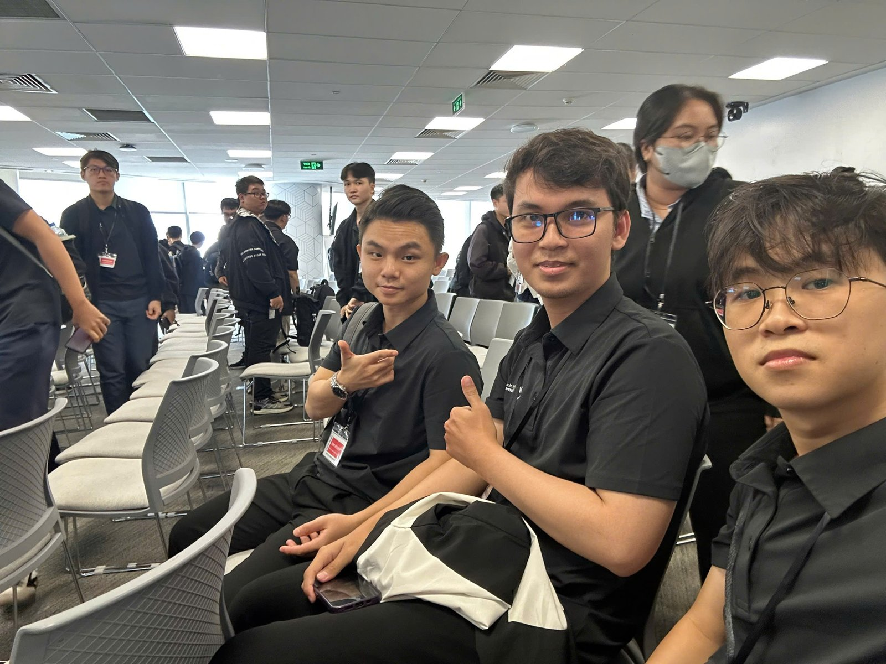

# Summary Report: “AWS First Cloud AI Journey – FPT University Workshop: From Prototype to Production (14/11/2026)”

### Event Objectives

- Clarify the gap between AI in an academic setting and AI running in a real enterprise
- Introduce the four pillars of taking AI to production: security, reliability, cost, and scalability
- Walk through real case studies (Cox Automotive, Mobileye, Duolingo) of deploying AI agents at enterprise scale
- Introduce Amazon Bedrock AgentCore and the Strands Agents SDK for building, running, and operating agents
- Go deep into the core parts of an agent: Identity, Gateway, Memory, and Observability
- Present a sample multi-agent architecture on AWS

### Speakers

- **Khang Duong** – FCAJ member
- **Phuong Huyen** – AI Engineer Fresher, FPT Software
- **Nguyen Lam Anh** – AI Engineer, FCAJ
- **Nguyen Quoc Bao** – Cloud Engineer, AWS First Cloud AI Journey
- **Huynh An Khuong** – AI Engineer, FPT Software

### Event Information

| Item | Details |
|---|---|
| Time | 9:00 – 12:00, 14/11/2026 |
| Venue | 26th floor, Bitexco Financial Tower, Ho Chi Minh City |
| Role | Attendee |

### Agenda

| Part | Session |
|---|---|
| Part 1 | From Prototype to Production: Secure, Reliable, Scalable Enterprise AI on the Cloud |
| Case study | From prototype to production – Cox Automotive, Mobileye |
| Part 2 | AI in Enterprise: Enterprise Challenges and Amazon Bedrock AgentCore |
| Part 3 | The Core of Agent: Identity, Gateway, Memory, Observability |
| Demo | Strands: Controlled Agent Orchestration and the AWS architecture |

### Key Highlights

#### From Prototype to Production – the “one restaurant” story

The opening session used one image throughout: **a prototype is a home kitchen, enterprise AI is a restaurant chain, and the cloud is the central kitchen**.

- In an enterprise, AI is **a feature inside the product**: Data (ingredients) → AI Model (the chef) → Feature (the dish) → Users (customers). Examples: recommendations, support chatbots, fraud detection
- **Academic AI and enterprise AI** differ on every axis:

| | Academic AI | Enterprise AI |
|---|---|---|
| Goal | Accuracy | Business value |
| Data | Clean, fixed dataset | Real, ever-changing data |
| Users | A few people | Millions of users |
| Operation | One run | 24/7, no downtime |

#### Four pillars for taking AI to production

- **Security:** KMS protects data (keeps recipes and customer info secret), IAM controls who enters the storeroom and who cooks, and Guardrails handle AI-specific risk (customers tricking the chef into mistakes)
- **Reliability:** if one oven breaks, a backup is ready – health checks, retries, failover, alarms
- **Cost efficiency:** don't run everything when the restaurant is empty – pay per use, right-size resources, caching
- **Scalability:** infrastructure scales with demand

With **AWS Cloud**, AWS manages the infrastructure and you manage the data and usage. The toolbox covered **Lambda** (seasonal staff), **Bedrock** (hiring a top chef through an API), and **AgentCore** (the restaurant manager: Runtime, Memory, Identity).

**Use AI wisely:** a large model acts as head chef to orchestrate, while small, cheap models handle individual tasks; pick the right model for the right task and cache repeated questions.

#### Case study: three challenges of taking agents to production

- **Security & Scalability** – what can the agent touch, and how much load can it take?
- **Integration & Context** – can the agent work with real systems and keep context?
- **Observability & Evaluation** – do we know what the agent is doing, and is it right?

**Cox Automotive** (Autotrader, Kelley Blue Book, Dealer.com, Manheim, and more) hit two problems while scaling: agents access sensitive data across many brands with no proven security model yet, and there was no standard environment to run and orchestrate agents. The answer was to **standardize the foundation first** with AgentCore: one Runtime for all agents, AgentCore Identity for granular per-agent permissions, Bedrock Guardrails to screen inputs and outputs, AgentCore Memory for context across sessions, and AgentCore Observability to log every interaction.

At **Mobileye**, **66% of support tickets were routine status inquiries**, each taking **about 15 clicks** across several backend systems. Scripts and decision trees handled predictable queries but not the variety of real requests. The solution was a **hybrid design**: the on-premises ticket system connects to a Support agent on AgentCore Runtime, the agent calls the data pipeline through MCP and an LLM Gateway, credentials stay in Secrets Manager, and there is **no inbound path into the on-prem network**.

**Agents don't throw errors, so watch and grade every run:**

- *Observe* – trace every step: inputs, outputs, latency, tokens
- *Evaluate* – code checks (schema, fields, business rules), LLM-as-a-judge against a rubric, and red teaming before users attack
- Mobileye set a 95% target before building and achieved 98%

#### AI in Enterprise and Amazon Bedrock AgentCore

- **Duolingo case:** every team rebuilt the same setup, so a **shared agent platform** reduces repeated work
- **Where AgentCore fits:** the model understands and responds, the agent application coordinates the model and tools, and AgentCore provides managed agent capabilities
- **Build with Strands, run on AgentCore Runtime:** the Strands Agents SDK lives inside your application (for example, an agent answering “Where is my order?” with an order lookup tool); AgentCore Runtime provides managed compute, isolated sessions, and scaling
- **The AgentCore map:** Runtime, Identity, Gateway, Memory, Observability

#### The Core of Agent – Identity, Gateway, Memory, Observability

**Inbound and Outbound Auth are two different doors with two different locks:**

- *Inbound* – who is this user, and may they call this agent?
- *Outbound* – is this agent who it claims to be, and may it access this resource on behalf of the user?

**The universal 5-step skeleton:**

1. **Inbound** – the caller presents a JWT or IAM credential, and the authorizer validates it
2. **Identity capture** – AgentCore Identity records the caller and creates a **Workload Access Token (WAT)** that names two identities at once: the agent and the user it serves
3. **Agent runs** – the agent code executes holding the WAT
4. **Outbound** – the WAT is used to get the resource credential from the vault
5. **Tool call** – the agent calls tools, resources, or tool gateways with that credential

**AgentCore Gateway** handles scale (hundreds of agents, thousands of tools, hundreds of MCP servers, 100k+ tenants and tool policies): tool creation and search, authorization, fine-grained access control, private connectivity, and tool filtering. The authorization flow: the agent (MCP client) sends an inbound OAuth token, authenticated through Amazon Cognito; the Gateway retrieves the workload identity, gets a Workload Access Token, then exchanges it for an outbound OAuth token to call the resource.

**AgentCore Memory:**

- *Short-term:* chat messages and session state (synchronous)
- *Long-term:* semantic, user preferences, summarization, episodic, and custom strategies – extracted automatically and asynchronously, with a Batch API for hydration

**AgentCore Observability – “You cannot fix what you cannot see”:** supports compliance, traceability, cost visibility, explainability, and root-cause analysis in non-deterministic flows. Telemetry follows OpenTelemetry and can go to third-party dashboards; the dashboard shows token usage and latency, filters spans, traces execution step by step, and inspects tool and LLM calls.

#### Demo: Strands Controlled Agent Orchestration and the AWS architecture

- **Orchestration flow:** User → FastAPI → Strands router, split into three agents: `qa_agent` (policy search with FAISS), `ticket_agent` (drafts a ticket, with a FastAPI approval gate), and `research_agent` (web search through Tavily), then returns the API response
- **AWS architecture:** images in Amazon ECR, the Strands Agent on Amazon ECS Fargate in private subnets across two Availability Zones, an ALB and Internet Gateway in front, and NAT gateways for outbound traffic; the agent calls Amazon Bedrock, stores data in DynamoDB, and is monitored with CloudWatch and LangFuse
- **Security and cost:** IAM and Secrets Manager for security, AWS Cost Explorer and AWS Budgets for cost optimization

### Key Takeaways

#### Taking AI to production

- **A working prototype is not yet a product**: production means real data, millions of users, and 24/7 operation
- The four pillars **Security – Reliability – Cost – Scalability** must be designed in from the start, not patched later
- **Picking the right model for the right task** and caching repeated questions cuts cost noticeably

#### Agent architecture

- **Standardize the platform before multiplying agents**, as Cox Automotive and Duolingo did
- Separate **Inbound Auth** from **Outbound Auth**; the Workload Access Token lets an agent act on behalf of a user without exposing credentials
- Gateway, Memory, and Observability become essential as the number of agents and tools grows

#### Evaluation and monitoring

- Agents usually don't raise errors – they answer wrongly – so **tracing and grading every run** is mandatory
- Combine code checks, LLM-as-a-judge, and red teaming to measure quality

### Applying to Work

- **Apply it to the team's RAG chatbot**: try splitting the chatbot into a router and specialized agents (Q&A, ticket creation, search) following the Strands model from the demo
- **Add observability to the chatbot**: trace every step (inputs, outputs, latency, tokens) to see why an answer went wrong
- **Build an evaluation set**: prepare sample questions with expected answers and check them with code and LLM-as-a-judge before each update
- **Optimize model cost**: use small models for simple questions and cache repeated ones
- **Protect credentials**: keep API keys out of code, move them to Secrets Manager, and apply least-privilege IAM
- **Keep learning** Amazon Bedrock AgentCore and the Strands Agents SDK through the official docs and upcoming labs

### Event Experience

Attending the **FPT University Workshop** on **14/11/2026** on the **26th floor of Bitexco Financial Tower** showed me the path from an AI demo to an AI system that actually runs in an enterprise.

#### Learning from the speakers
- Speakers from FCAJ, FPT Software, and AWS First Cloud AI Journey followed a clear arc: from the general mindset, to real case studies, to deep technical detail.
- The “home kitchen versus restaurant chain” image made concepts like guardrails, failover, and right-sizing easy to remember.

#### Content tied to real systems
- The **Mobileye** case gave concrete numbers: 66% of tickets were status inquiries, and accuracy reached 98% with an agent and an evaluation set.
- **The Core of Agent** session explained two-way agent authentication clearly, something I had not considered when building the chatbot in earlier weeks.
- The architecture demo used many services from the program (ECS Fargate, ECR, ALB, DynamoDB, CloudWatch, Secrets Manager, Budgets), showing how they fit together into a full system.

#### Networking
- The event was a chance to meet FCAJ members and FPT University students learning cloud and AI together.

#### Lessons learned
- To run AI for real in an enterprise, security, reliability, and cost must be considered from day one.
- A good agent doesn't just answer correctly – it also needs monitoring, evaluation, and clear permissions.
- A shared, standardized platform lets many teams build agents faster without repeating work.

#### Event photos

> Overall, the workshop helped me understand how to take AI from prototype to production on AWS, learn the core parts of Amazon Bedrock AgentCore, and come away with concrete ideas to improve the team's chatbot.
