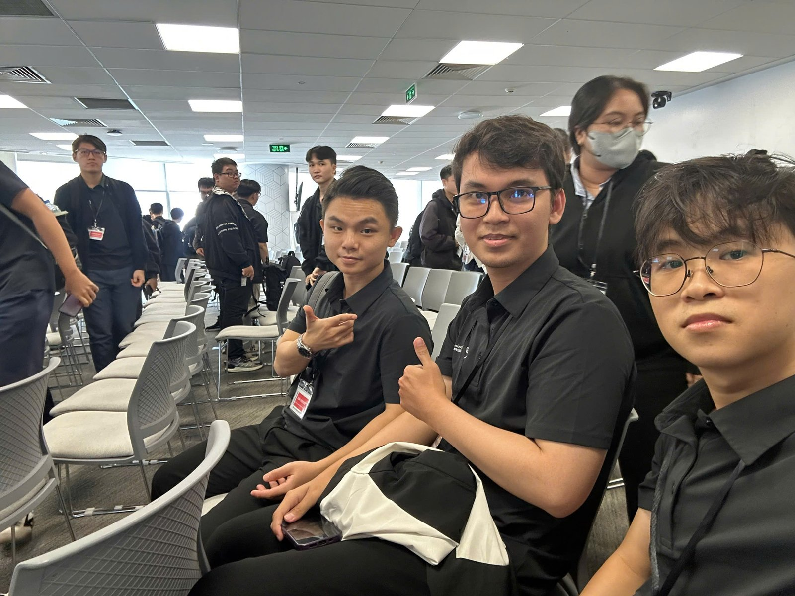

# Bài thu hoạch “AWS First Cloud AI Journey – FPT University Workshop: From Prototype to Production (14/11/2026)”

### Mục Đích Của Sự Kiện

- Làm rõ khoảng cách giữa AI trong môi trường học thuật và AI vận hành thật trong doanh nghiệp
- Giới thiệu bốn trụ cột khi đưa AI lên production: bảo mật, độ tin cậy, chi phí và khả năng mở rộng
- Phân tích case study thực tế (Cox Automotive, Mobileye, Duolingo) khi triển khai AI agent ở quy mô doanh nghiệp
- Giới thiệu Amazon Bedrock AgentCore và Strands Agents SDK để xây dựng, chạy và vận hành agent
- Đi sâu vào các thành phần cốt lõi của agent: Identity, Gateway, Memory và Observability
- Trình bày một kiến trúc multi-agent mẫu chạy trên AWS

### Danh Sách Diễn Giả

- **Khang Duong** – Thành viên FCAJ
- **Phuong Huyen** – AI Engineer Fresher, FPT Software
- **Nguyen Lam Anh** – AI Engineer, FCAJ
- **Nguyen Quoc Bao** – Cloud Engineer, AWS First Cloud AI Journey
- **Huynh An Khuong** – AI Engineer, FPT Software

### Thông Tin Sự Kiện

| Thông tin | Chi tiết |
|---|---|
| Thời gian | 9:00 – 12:00, ngày 14/11/2026 |
| Địa điểm | Tầng 26, tòa nhà Bitexco, TP. Hồ Chí Minh |
| Vai trò | Người tham dự |

### Chương Trình

| Phần | Phiên chia sẻ |
|---|---|
| Phần 1 | From Prototype to Production: Secure, Reliable, Scalable Enterprise AI on the Cloud |
| Case study | From prototype to production – Cox Automotive, Mobileye |
| Phần 2 | AI in Enterprise: Enterprise Challenges and Amazon Bedrock AgentCore |
| Phần 3 | The Core of Agent: Identity, Gateway, Memory, Observability |
| Demo | Strands: Controlled Agent Orchestration và kiến trúc AWS |

### Nội Dung Nổi Bật

#### From Prototype to Production – Câu chuyện “một nhà hàng”

Phiên mở đầu dùng một hình ảnh xuyên suốt: **prototype là bếp ở nhà, Enterprise AI là chuỗi nhà hàng, còn cloud là bếp trung tâm**.

- Trong doanh nghiệp, AI là **một tính năng nằm trong sản phẩm**: Data (nguyên liệu) → AI Model (đầu bếp) → Feature (món ăn) → Users (khách hàng). Ví dụ: gợi ý sản phẩm, chatbot hỗ trợ, phát hiện gian lận
- **Academic AI và Enterprise AI** khác nhau ở mọi mặt:

| | Academic AI | Enterprise AI |
|---|---|---|
| Mục tiêu | Độ chính xác | Giá trị kinh doanh |
| Dữ liệu | Dataset sạch, cố định | Dữ liệu thật, luôn thay đổi |
| Người dùng | Vài người | Hàng triệu người |
| Vận hành | Chạy một lần | 24/7, không downtime |

#### Bốn trụ cột khi đưa AI lên production

- **Security:** KMS bảo vệ dữ liệu (giữ bí mật công thức và thông tin khách hàng), IAM kiểm soát ai được vào kho và ai được nấu, Guardrails xử lý rủi ro riêng của AI (người dùng lừa “đầu bếp” làm sai)
- **Reliability:** một lò hỏng thì luôn có lò dự phòng – health check, retry, failover, alarm
- **Cost efficiency:** không bật mọi thứ khi quán vắng – trả theo mức dùng, chọn đúng cỡ tài nguyên, caching
- **Scalability:** hạ tầng tự mở rộng theo nhu cầu

Với **AWS Cloud**, AWS quản lý hạ tầng, còn người dùng quản lý dữ liệu và cách sử dụng. Bộ công cụ được giới thiệu gồm **Lambda** (nhân viên thời vụ), **Bedrock** (thuê đầu bếp giỏi qua API) và **AgentCore** (quản lý nhà hàng: Runtime, Memory, Identity).

**Dùng AI khôn ngoan:** một model lớn đóng vai bếp trưởng để điều phối, các model nhỏ và rẻ xử lý từng việc riêng; chọn đúng model cho đúng việc và cache các câu hỏi lặp lại.

#### Case study: ba thách thức khi đưa agent lên production

- **Security & Scalability** – agent được chạm vào những gì, chịu được bao nhiêu tải?
- **Integration & Context** – agent có làm việc được với hệ thống thật và giữ được ngữ cảnh không?
- **Observability & Evaluation** – có biết agent đang làm gì, và làm có đúng không?

**Cox Automotive** (Autotrader, Kelley Blue Book, Dealer.com, Manheim…) gặp hai vấn đề khi mở rộng: agent truy cập dữ liệu nhạy cảm của nhiều thương hiệu nhưng chưa có mô hình bảo mật đã kiểm chứng, và chưa có môi trường chuẩn để chạy, điều phối agent. Cách giải là **chuẩn hóa nền tảng trước** bằng AgentCore: một Runtime cho mọi agent, AgentCore Identity phân quyền chi tiết cho từng agent, Bedrock Guardrails lọc đầu vào và đầu ra, AgentCore Memory giữ ngữ cảnh giữa các phiên, AgentCore Observability ghi log từng tương tác.

**Mobileye** có **66% ticket hỗ trợ là câu hỏi trạng thái thường lệ**, mỗi ticket mất **khoảng 15 cú click** qua nhiều hệ thống backend. Script và cây quyết định chỉ xử lý được câu hỏi dự đoán trước, không đủ cho sự đa dạng của yêu cầu thật. Giải pháp là **thiết kế hybrid**: hệ thống ticket on-premises kết nối với Support agent chạy trên AgentCore Runtime, agent gọi data pipeline qua MCP và LLM Gateway, credential giữ trong Secrets Manager, và **không mở đường vào (inbound) mạng on-prem**.

**Agent không ném lỗi, nên phải quan sát và chấm điểm mọi lần chạy:**

- *Observe* – trace từng bước: input, output, độ trễ, token
- *Evaluate* – kiểm tra bằng code (schema, field, business rule), dùng LLM làm giám khảo theo rubric, red teaming trước khi người dùng tấn công
- Mobileye đặt mục tiêu 95% trước khi xây dựng và đạt 98%

#### AI in Enterprise và Amazon Bedrock AgentCore

- **Case Duolingo:** mỗi team tự dựng lại cùng một bộ setup, nên cần một **nền tảng agent dùng chung** để giảm việc lặp lại
- **Vị trí của AgentCore:** Model hiểu và trả lời, Agent application điều phối model và tool, AgentCore cung cấp năng lực agent được quản lý sẵn
- **Xây với Strands, chạy trên AgentCore Runtime:** Strands Agents SDK nằm trong ứng dụng (ví dụ agent trả lời “Where is my order?” bằng tool tra cứu đơn hàng); AgentCore Runtime cung cấp compute được quản lý, mỗi session cô lập và tự scale
- **Bản đồ AgentCore:** Runtime, Identity, Gateway, Memory, Observability

#### The Core of Agent – Identity, Gateway, Memory, Observability

**Inbound và Outbound Auth là hai cửa, hai ổ khóa khác nhau:**

- *Inbound* – user này là ai, và có được gọi agent không?
- *Outbound* – agent có đúng là agent đó không, và có được truy cập tài nguyên thay mặt user không?

**Khung 5 bước chung:**

1. **Inbound** – người gọi gửi JWT hoặc IAM credential, authorizer xác thực
2. **Identity capture** – AgentCore Identity ghi nhận người gọi và tạo **Workload Access Token (WAT)**, mang cùng lúc danh tính agent và danh tính user mà agent đang phục vụ
3. **Agent runs** – code của agent chạy, giữ WAT
4. **Outbound** – dùng WAT để lấy credential của tài nguyên từ vault
5. **Tool call** – agent gọi tool, tài nguyên hoặc tool gateway bằng credential vừa lấy

**AgentCore Gateway** giải bài toán quy mô (hàng trăm agent, hàng nghìn tool, hàng trăm MCP server, hơn 100 nghìn tenant và tool policy): tạo và tìm kiếm tool, phân quyền, kiểm soát truy cập chi tiết, kết nối private, lọc tool. Luồng phân quyền: agent (MCP client) gửi inbound OAuth token, xác thực qua Amazon Cognito, Gateway lấy workload identity, đổi sang Workload Access Token rồi đổi tiếp thành outbound OAuth token để gọi tài nguyên.

**AgentCore Memory:**

- *Ngắn hạn:* tin nhắn chat, trạng thái session (đồng bộ)
- *Dài hạn:* semantic, sở thích người dùng, tóm tắt, episodic, chiến lược tùy chỉnh – được trích xuất tự động và bất đồng bộ, có Batch API để nạp sẵn

**AgentCore Observability – “You cannot fix what you cannot see”:** phục vụ tuân thủ, truy vết, chi phí, giải thích và tìm nguyên nhân lỗi trong luồng không xác định trước. Dữ liệu telemetry theo chuẩn OpenTelemetry, có thể đẩy sang dashboard bên thứ ba; dashboard cho phép xem token, độ trễ, lọc span, theo dõi từng bước, xem lời gọi tool và LLM.

#### Demo: Strands Controlled Agent Orchestration và kiến trúc AWS

- **Luồng điều phối:** User → FastAPI → Strands router, chia sang ba agent: `qa_agent` (tìm chính sách bằng FAISS), `ticket_agent` (soạn ticket, có bước duyệt qua FastAPI approval gate), `research_agent` (tìm kiếm web qua Tavily), rồi trả về API response
- **Kiến trúc AWS:** image lưu trên Amazon ECR, Strands Agent chạy trên Amazon ECS Fargate trong private subnet trải hai Availability Zone, phía trước là ALB và Internet Gateway, NAT gateway cho kết nối ra ngoài; agent gọi Amazon Bedrock, lưu dữ liệu ở DynamoDB, giám sát bằng CloudWatch và LangFuse
- **Bảo mật và chi phí:** IAM và Secrets Manager cho bảo mật, AWS Cost Explorer và AWS Budgets cho tối ưu chi phí

### Những Gì Học Được

#### Tư duy đưa AI lên production

- **Prototype chạy được chưa phải là sản phẩm**: production đòi hỏi dữ liệu thật, hàng triệu người dùng và vận hành 24/7
- Bốn trụ cột **Security – Reliability – Cost – Scalability** phải được thiết kế từ đầu, không vá sau
- **Chọn đúng model cho đúng việc** và cache câu hỏi lặp lại giúp giảm chi phí đáng kể

#### Kiến trúc agent

- **Chuẩn hóa nền tảng trước khi nhân rộng agent**, như cách Cox Automotive và Duolingo đã làm
- Tách **Inbound Auth** và **Outbound Auth**; Workload Access Token giúp agent hành động thay mặt user mà không lộ credential
- Gateway, Memory và Observability là các phần không thể thiếu khi số agent và tool tăng lên

#### Đánh giá và giám sát

- Agent thường không báo lỗi mà trả lời sai, nên **trace và chấm điểm mọi lần chạy** là bắt buộc
- Kết hợp kiểm tra bằng code, LLM-as-a-judge và red teaming để đo chất lượng

### Ứng Dụng Vào Công Việc

- **Áp dụng cho chatbot RAG của nhóm**: thử tách chatbot thành router và các agent chuyên biệt (hỏi đáp, tạo ticket, tìm kiếm) theo mô hình Strands trong demo
- **Thêm observability cho chatbot**: ghi trace từng bước (input, output, độ trễ, token) để biết vì sao một câu trả lời sai
- **Xây bộ đánh giá**: chuẩn bị bộ câu hỏi mẫu kèm đáp án, kiểm tra bằng code và LLM-as-a-judge trước mỗi lần cập nhật
- **Tối ưu chi phí model**: dùng model nhỏ cho câu hỏi đơn giản, cache câu hỏi lặp lại
- **Bảo mật credential**: không để API key trong code, chuyển sang Secrets Manager và phân quyền IAM tối thiểu
- **Tìm hiểu tiếp** Amazon Bedrock AgentCore và Strands Agents SDK qua tài liệu chính thức và các lab tiếp theo

### Trải nghiệm trong sự kiện

Tham gia **FPT University Workshop** ngày **14/11/2026** tại **tầng 26 tòa nhà Bitexco** giúp tôi nhìn rõ con đường từ một bản demo AI đến một hệ thống AI vận hành thật trong doanh nghiệp.

#### Học hỏi từ các diễn giả
- Các diễn giả từ FCAJ, FPT Software và AWS First Cloud AI Journey trình bày theo một mạch rõ ràng: từ tư duy chung, đến case study thực tế, rồi đi sâu vào kỹ thuật.
- Hình ảnh “bếp nhà và chuỗi nhà hàng” giúp các khái niệm như guardrails, failover, right-size trở nên rất dễ nhớ.

#### Nội dung gắn với thực tế
- Case **Mobileye** cho thấy con số cụ thể: 66% ticket là câu hỏi trạng thái và độ chính xác đạt 98% sau khi có agent và bộ đánh giá.
- Phần **The Core of Agent** giải thích rõ cách agent xác thực hai chiều, điều mà tôi chưa nghĩ tới khi làm chatbot ở các tuần trước.
- Phần demo kiến trúc dùng nhiều dịch vụ đã học trong chương trình (ECS Fargate, ECR, ALB, DynamoDB, CloudWatch, Secrets Manager, Budgets), giúp tôi thấy cách ghép chúng thành một hệ thống hoàn chỉnh.

#### Kết nối và trao đổi
- Sự kiện là dịp gặp gỡ các bạn trong FCAJ và sinh viên FPT University đang cùng học về cloud và AI.

#### Bài học rút ra
- Muốn AI chạy thật trong doanh nghiệp, phải tính đến bảo mật, độ tin cậy và chi phí ngay từ đầu.
- Một agent tốt không chỉ trả lời đúng mà còn phải được giám sát, đánh giá và phân quyền rõ ràng.
- Chuẩn hóa nền tảng dùng chung giúp nhiều team xây agent nhanh hơn mà không lặp lại công sức.

#### Một số hình ảnh khi tham gia sự kiện

> Tổng thể, workshop giúp tôi hiểu cách đưa AI từ prototype lên production trên AWS, nắm các thành phần cốt lõi của Amazon Bedrock AgentCore và có thêm ý tưởng cụ thể để cải thiện chatbot của nhóm.
