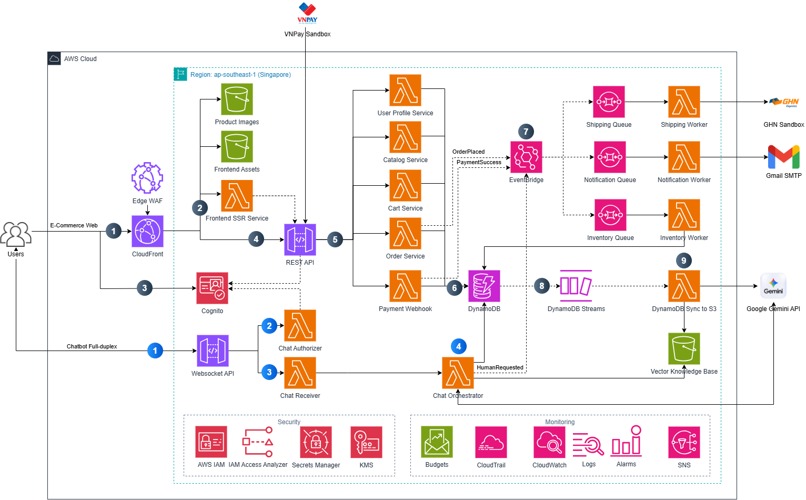

#### Workshop Overview
This workshop builds a **Serverless E-Commerce Website** integrated with a **Full-Duplex AI RAG Chatbot** on AWS, deployed in the **ap-southeast-1 (Singapore)** region. The architecture consists of two primary execution flows alongside dedicated **Security** and **Monitoring** layers.

#### Flow 1: Serverless E-Commerce Website
1. **CDN:** Users access the website through **Amazon CloudFront**, protected at the edge by **Edge WAF** (CloudFront Function).
2. **Frontend Delivery:** CloudFront distributes **Product Images** (S3), **Frontend Assets** (S3), and **Frontend SSR Service** (Lambda).
3. **Authentication:** **Amazon Cognito** handles user registration, sign-in, and password recovery.
4. **REST API Gateway:** Business API requests pass through **Amazon API Gateway (REST API)**.
5. **Business Logic Lambdas:** **User Profile** (customer details), **Catalog** (products), **Cart** (shopping cart), **Order** (order placement), and **Payment Webhook** (online payment via VNPay Sandbox).
6. **Data Persistence:** Application data is stored in **Amazon DynamoDB**.
7. **Event-Driven Processing:** **Amazon EventBridge** receives domain events such as `OrderPlaced` and `PaymentSuccess`, routing them to three SQS + Lambda worker pairs:
   + **Inventory Queue** + **Inventory Worker**: deducts product stock.
   + **Notification Queue** + **Notification Worker**: sends email notifications via Gmail SMTP.
   + **Shipping Queue** + **Shipping Worker**: creates shipping orders with GHN Sandbox.
8. **Change Data Capture (CDC):** **DynamoDB Streams** captures real-time data modifications in DynamoDB.
9. **Knowledge Synchronization:** The **DynamoDB Sync to S3** Lambda uses the **Google Gemini API** to generate embeddings and stores them in the **Vector Knowledge Base** (S3).

#### Flow 2: Full-Duplex RAG Chatbot
1. **WebSocket API Gateway:** Users connect to **Amazon API Gateway (WebSocket API)** for real-time two-way chat.
2. **Session Authorization:** The **Chat Authorizer** Lambda authenticates sessions for both guest visitors and logged-in customers via Cognito.
3. **Message Ingestion:** The **Chat Receiver** Lambda receives incoming frames and asynchronously dispatches them to Chat Orchestrator, preventing the 29-second WebSocket timeout limit.
4. **Chat Orchestrator:** Persists chat sessions to DynamoDB, retrieves embeddings from the Vector Knowledge Base (S3), and uses **Gemini 2.0 Flash** to answer customer inquiries. When a customer requests human assistance, the Lambda publishes a `HumanRequested` event to EventBridge.

#### Security Group
+ **AWS IAM:** Manages access permissions following the principle of least privilege.
+ **IAM Access Analyzer:** Detects unintended public access and overly permissive policies.
+ **AWS Secrets Manager:** Securely stores secrets including API keys, VNPay, GHN, and SMTP credentials.
+ **AWS KMS:** Manages cryptographic keys for data encryption.

#### Monitoring Group
+ **AWS Budgets:** Tracks monthly cloud spending thresholds.
+ **AWS CloudTrail:** Audits account activity via Event History.
+ **Amazon CloudWatch Logs:** Captures runtime logs and errors from Lambda functions.
+ **Amazon CloudWatch Alarms:** Triggers alerts when metrics breach thresholds or errors occur.
+ **Amazon SNS:** Delivers CloudWatch Alarm notifications to Gmail.
