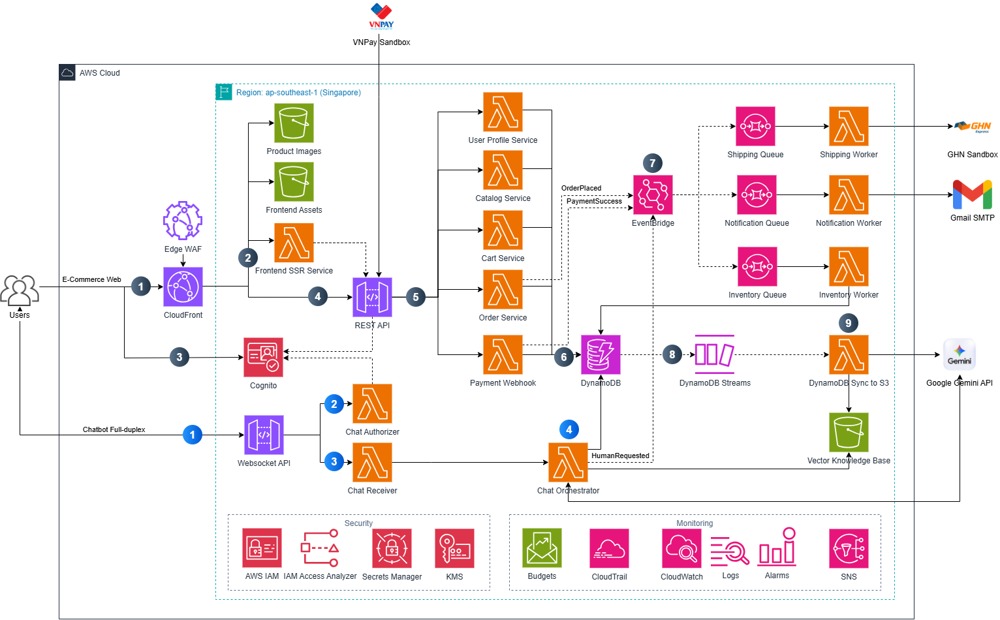

#### Tổng quan về workshop
Workshop này xây dựng một **website thương mại điện tử serverless** kết hợp **chatbot AI (RAG, full-duplex)** trên AWS, triển khai tại region **ap-southeast-1 (Singapore)**. Kiến trúc gồm hai luồng chạy chính, cùng **nhóm Security** và **nhóm Monitoring**.

#### Luồng 1: Serverless E-Commerce Website
1. **CDN:** Người dùng truy cập website qua **Amazon CloudFront**, được bảo vệ bởi **Edge WAF**(Cloudfront Function).
2. **Tải frontend:** CloudFront phân phối **Product Images** (S3), **Frontend Assets** (S3) và **Frontend SSR Service** (Lambda).
3. **Xác thực:** **Amazon Cognito** xử lý đăng ký, đăng nhập và quên mật khẩu.
4. **Cổng REST API:** Request đi qua **Amazon API Gateway (REST API)**.
5. **Các Lambda xử lý nghiệp vụ:** **User Profile** (thông tin khách hàng), **Catalog** (sản phẩm), **Cart** (giỏ hàng), **Order** (đặt hàng) và **Payment Webhook** (thanh toán qua VNPay Sandbox).
6. **Lưu dữ liệu:** Dữ liệu được lưu vào **Amazon DynamoDB**.
7. **Xử lý sự kiện:** **Amazon EventBridge** nhận các sự kiện như `OrderPlaced`, `PaymentSuccess` và chuyển tới ba cặp SQS + Lambda:
   + **Inventory Queue** + **Inventory Worker**: trừ kho.
   + **Notification Queue** + **Notification Worker**: gửi thông báo qua Gmail SMTP.
   + **Shipping Queue** + **Shipping Worker**: tạo đơn vận chuyển với GHN Sandbox.
8. **Cập nhật khi có thay đổi:** **DynamoDB Streams** ghi nhận mọi thay đổi trong DynamoDB.
9. **Đồng bộ tri thức:** Lambda **DynamoDB Sync to S3** dùng **Google Gemini API** để tạo embedding, sau đó lưu vào **Vector Knowledge Base** (S3).

#### Luồng 2: Chatbot RAG Full-Duplex
1. **Cổng WebSocket API:** Người dùng kết nối vào **Amazon API Gateway (WebSocket API)** để chat hai chiều theo thời gian thực.
2. **Xác thực phiên:** Lambda **Chat Authorizer** xác thực phiên cho cả khách vãng lai và khách đã đăng nhập bằng Cognito.
3. **Nhận tin nhắn:** Lambda **Chat Receiver** nhận tin nhắn và chuyển đến Chat Orchestrator, giúp giải quyết vấn đề timeout 29s của WebSocket.
4. **Chat Orchestrator:** Lambda lưu phiên chat vào DynamoDB, đọc embedding từ Vector Knowledge Base (S3) và dùng **Gemini 2.0 Flash** để trả lời câu hỏi. Khi khách yêu cầu gặp nhân viên, Lambda gửi sự kiện `HumanRequested` tới EventBridge.

#### Nhóm Security
+ **AWS IAM:** quản lý quyền truy cập theo nguyên tắc đặc quyền tối thiểu.
+ **IAM Access Analyzer:** phát hiện quyền thừa và truy cập public.
+ **AWS Secrets Manager:** lưu các secrets: API key, VNPay, GHN, SMTP.
+ **AWS KMS:** quản lý khóa mã hóa dữ liệu.

#### Nhóm giám sát
+ **AWS Budgets:** ngân sách chi phí theo tháng.
+ **AWS CloudTrail:** truy vết hoạt động bằng Event history.
+ **Amazon CloudWatch Logs:** quan sát lỗi từ các Lambda.
+ **Amazon CloudWatch Alarms:** cảnh báo khi chỉ số bất thường/lỗi.
+ **Amazon SNS:** gửi cảnh báo của CloudWatch Alarms về Gmail.