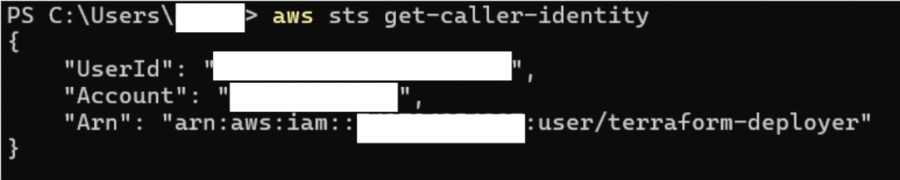
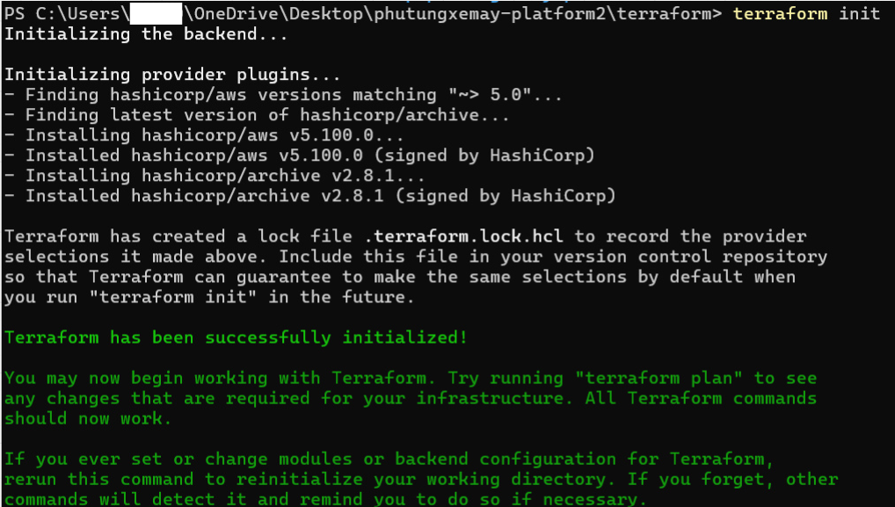
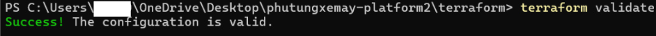
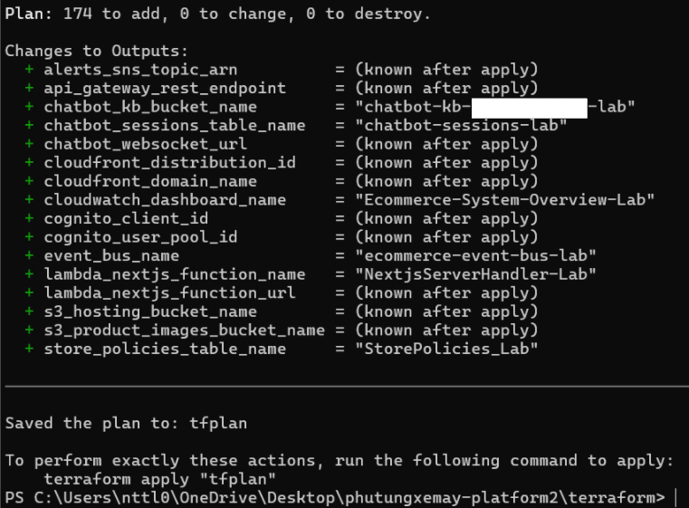
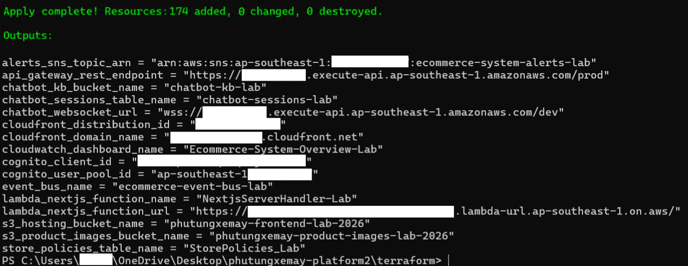

In this section, we will **install Terraform and AWS CLI** on your terminal, **create Access Keys (Security Credentials)** following the principle of least privilege, and **provision the entire AWS Serverless infrastructure via Terraform IaC**.

---

### Part 1: Install Terraform and AWS CLI

#### 1. Install Terraform (Recommended Version >= 1.9.0)
* **Windows**:
  - *Option 1 (Recommended - Windows Package Manager)*: Open PowerShell (Run as Administrator) and run:
    ```powershell
    winget install HashiCorp.Terraform
    ```
  - *Option 2 (Direct Download)*:
    1. Visit [Terraform Downloads](https://developer.hashicorp.com/terraform/install).
    2. Download the `.zip` package for **Windows AMD64**.
    3. Extract `terraform.exe` to a directory (e.g., `C:\terraform`) and add it to your system `Path` environment variable.

* **macOS** (via Homebrew):
  ```bash
  brew tap hashicorp/tap
  brew install hashicorp/tap/terraform
  ```
* **Linux (Ubuntu/Debian)**:
  ```bash
  sudo apt-get update && sudo apt-get install -y gnupg software-properties-common
  wget -O- https://apt.releases.hashicorp.com/gpg | sudo gpg --dearmor -o /usr/share/keyrings/hashicorp-archive-keyring.gpg
  echo "deb [signed-by=/usr/share/keyrings/hashicorp-archive-keyring.gpg] https://apt.releases.hashicorp.com $(lsb_release -cs) main" | sudo tee /etc/apt/sources.list.d/hashicorp.list
  sudo apt update && sudo apt install terraform
  ```
* **Verify Installation**:
  ```bash
  terraform version
  ```

#### 2. Install AWS CLI (Version 2)
* **Windows**: Download and run the [AWS CLI v2 MSI Installer](https://awscli.amazonaws.com/AWSCLIV2.msi), or run:
  ```powershell
  winget install Amazon.AWSCLI
  ```
* **macOS / Linux**: Follow the official instructions on the AWS CLI documentation page.
* **Verify Installation**:
  ```bash
  aws --version
  ```

---

### Part 2: Generate Access Keys with Least Privilege

To comply with the AWS Well-Architected Security Pillar, we **avoid using `AdministratorAccess`**. Instead, we create a dedicated custom IAM Policy for our IAM User (`terraform-deployer`).

#### Step 1: Create the Deployment IAM Policy
1. Sign in to the **AWS Management Console** -> Navigate to **IAM**.
2. In the left navigation pane, select **Policies** -> Click **Create policy**.
3. Switch to the **JSON** tab, clear the placeholder text, and paste the policy document below:

```json
{
    "Version": "2012-10-17",
    "Statement": [
        {
            "Sid": "TerraformDeploymentPermissions",
            "Effect": "Allow",
            "Action": [
                "access-analyzer:CreateAnalyzer",
                "access-analyzer:DeleteAnalyzer",
                "access-analyzer:GetAnalyzer",
                "access-analyzer:ListAnalyzers",
                "access-analyzer:TagResource",
                "apigateway:*",
                "budgets:CreateBudgetAction",
                "budgets:ModifyBudget",
                "budgets:ViewBudget",
                "budgets:TagResource",
                "budgets:ListTagsForResource",
                "cloudfront:*",
                "cloudwatch:*",
                "cognito-idp:*",
                "dynamodb:*",
                "events:*",
                "iam:AttachRolePolicy",
                "iam:CreatePolicy",
                "iam:CreateRole",
                "iam:DeletePolicy",
                "iam:DeleteRole",
                "iam:DeleteRolePolicy",
                "iam:DetachRolePolicy",
                "iam:GetPolicy",
                "iam:GetPolicyVersion",
                "iam:GetRole",
                "iam:GetRolePolicy",
                "iam:ListAttachedRolePolicies",
                "iam:ListInstanceProfilesForRole",
                "iam:ListPolicyVersions",
                "iam:ListRolePolicies",
                "iam:PutRolePolicy",
                "iam:TagPolicy",
                "iam:TagRole",
                "kms:CreateAlias",
                "kms:CreateKey",
                "kms:Decrypt",
                "kms:DescribeKey",
                "kms:EnableKeyRotation",
                "kms:GetKeyPolicy",
                "kms:GetKeyRotationStatus",
                "kms:ListAliases",
                "kms:ListResourceTags",
                "kms:PutKeyPolicy",
                "kms:ScheduleKeyDeletion",
                "kms:TagResource",
                "lambda:*",
                "logs:*",
                "s3:*",
                "secretsmanager:*",
                "sns:*",
                "sqs:*"
            ],
            "Resource": "*"
        },
        {
            "Sid": "IamPassRoleScoped",
            "Effect": "Allow",
            "Action": "iam:PassRole",
            "Resource": "arn:aws:iam::*:role/*"
        }
    ]
}
```

4. Click **Next**. Enter the Policy name: `MotorcycleEcommerceTerraformPolicy`.
5. Click **Create policy**.

#### Step 2: Create IAM User and Attach the Policy
1. In the IAM console, select **Users** -> Click **Create user**.
2. Specify the User name: `terraform-deployer`.
3. Under *Set permissions*, select **Attach policies directly**.
4. Search for and select: `MotorcycleEcommerceTerraformPolicy`.
5. Click **Next** -> Review details and click **Create user**.

#### Step 3: Create Access Key & Configure Local AWS CLI
1. Click on the newly created user `terraform-deployer`.
2. Open the **Security credentials** tab -> Scroll to *Access keys* -> Click **Create access key**.
3. Select **Command Line Interface (CLI)**, acknowledge the security notice -> Click **Next** -> **Create access key**.
4. **Important**: Copy and safely store your **Access Key ID** and **Secret Access Key** (you can also download the `.csv` file).
5. Open Terminal / PowerShell and run:
   ```bash
   aws configure
   ```
6. Enter the required values:
   - **AWS Access Key ID**: *(Paste your Access Key ID)*
   - **AWS Secret Access Key**: *(Paste your Secret Access Key)*
   - **Default region name**: `ap-southeast-1` *(Singapore Region)*
   - **Default output format**: `json`
7. Verify your authenticated identity:
   ```bash
   aws sts get-caller-identity
   ```

**Expected Result:**



---

### Part 3: Provision AWS Infrastructure via Terraform IaC

#### Step 1: Clone the Infrastructure Repository
Open Terminal / PowerShell and clone the repository:
```bash
git clone https://github.com/lointt/phutungxemay-platform.git
cd phutungxemay-platform/terraform
```
> **Note:** I will rename services ending in "replica" to "lab" for this workshop tutorial, as the term "replica" is already in use within my project.

#### Step 2: Initialize Workspace (Terraform Init)
Automatically download the required AWS and Archive providers:
```bash
terraform init
```

**Expected Result:**



#### Step 3: Validate Configuration (Terraform Validate)
Ensure all `.tf` files have valid syntax and structure:
```bash
terraform validate
```

**Expected Result:**



#### Step 4: Preview Deployment Plan (Terraform Plan)
Inspect all AWS resources (S3, CloudFront, Lambda, API Gateway, DynamoDB, Cognito, etc.) that will be created:
```bash
terraform plan -out=tfplan
```

**Expected Result:**



#### Step 5: Deploy Infrastructure (Terraform Apply)
Provision the complete Serverless infrastructure onto AWS:
```bash
terraform apply tfplan
```
*Provisioning takes approximately 3 to 5 minutes. Upon completion, the terminal displays all important **Outputs** as shown below:*


