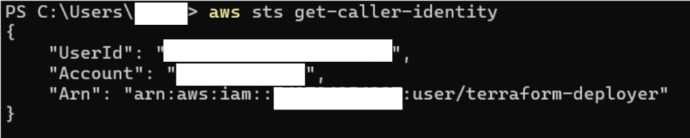
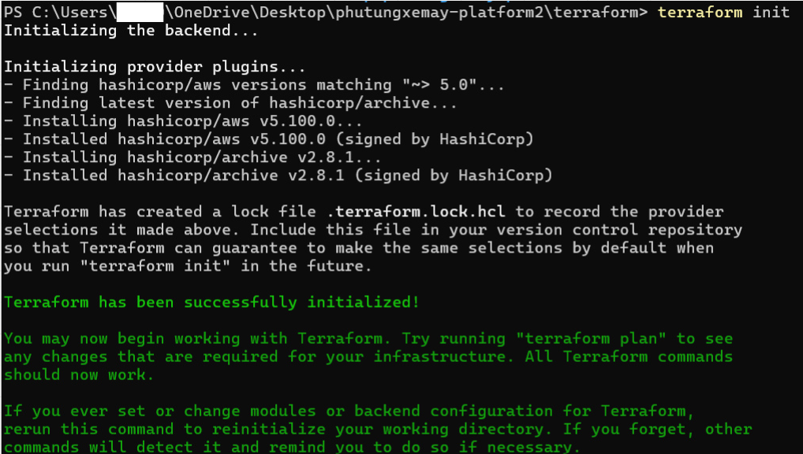
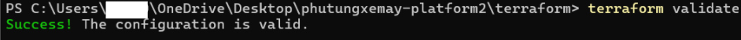
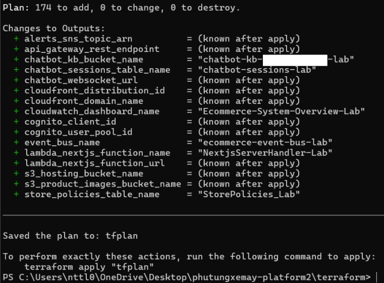
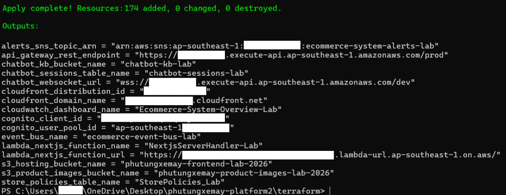

---
title : "Điều kiện tiên quyết"
date : 2026-11-18
weight : 2
chapter : false
pre : " <b> 5.2. </b> "
---

Trong phần này, chúng ta sẽ **cài đặt Terraform, AWS CLI** trên terminal, **tạo Access Key (Security Credentials)** với quyền tối thiểu và **cấu hình hạ tầng bằng Terraform IaC** cho tất cả dịch vụ AWS sử dụng trong dự án này.

---

### Phần 1: Cài đặt Terraform và AWS CLI

#### 1. Cài đặt Terraform (Phiên bản khuyến nghị >= 1.9.0)
* **Windows**:
  - *Cách 1 (Khuyên dùng - Windows Package Manager)*: Mở PowerShell (Run as Administrator) và chạy:
    ```powershell
    winget install HashiCorp.Terraform
    ```
  - *Cách 2 (Tải trực tiếp)*:
    1. Truy cập [Trang tải xuống Terraform](https://developer.hashicorp.com/terraform/install).
    2. Tải bản nén `.zip` dành cho **Windows AMD64**.
    3. Giải nén file `terraform.exe` vào một thư mục (ví dụ `C:\terraform`) và thêm đường dẫn này vào biến môi trường `Path` của hệ thống.

* **macOS** (qua Homebrew):
  ```bash
  brew tap hashicorp/tap
  brew install hashicorp/tap/terraform
  ```
* **Linux (Ubuntu/Debian)**:
  ```bash
  sudo apt-get update && sudo apt-get install -y gnupg software-properties-common
  wget -O- https://apt.releases.hashicorp.com/gpg | sudo gpg --dearmor -o /usr/share/keyrings/hashicorp-archive-keyring.gpg
  echo "deb [signed-by=/usr/share/keyrings/hashicorp-archive-keyring.gpg] https://apt.releases.hashicorp.com $(lsb_release -cs) main" | sudo tee /etc/apt/sources.list.d/hashicorp.list
  sudo apt update && sudo apt install terraform
  ```
* **Kiểm tra phiên bản đã cài đặt thành công**:
  ```bash
  terraform version
  ```

#### 2. Cài đặt AWS CLI (Phiên bản v2)
* **Windows**: Tải và chạy file cài đặt [AWS CLI v2 MSI Installer](https://awscli.amazonaws.com/AWSCLIV2.msi), hoặc chạy lệnh:
  ```powershell
  winget install Amazon.AWSCLI
  ```
* **macOS / Linux**: Tham khảo hướng dẫn chính thức tại trang chủ AWS CLI.
* **Kiểm tra cài đặt**:
  ```bash
  aws --version
  ```

---

### Phần 2: Hướng dẫn tạo Access Key với quyền tối thiểu (Least Privilege)

Để đảm bảo an toàn tuyệt đối theo chuẩn bảo mật AWS Well-Architected Framework, chúng ta **không sử dụng quyền `AdministratorAccess`**. Thay vào đó, chúng ta tạo một IAM Policy tùy chỉnh cho IAM User (`terraform-deployer`).

#### Bước 1: Tạo IAM Policy cấp quyền triển khai
1. Đăng nhập vào **AWS Management Console** -> Tìm kiếm dịch vụ **IAM**.
2. Ở thanh điều hướng bên trái, chọn **Policies** -> Bấm **Create policy**.
3. Chọn tab **JSON**, xóa toàn bộ nội dung mẫu và dán khối JSON phân quyền bên dưới:

```json
{
    "Version": "2012-10-17",
    "Statement": [
        {
            "Sid": "TerraformDeploymentPermissions",
            "Effect": "Allow",
            "Action": [
                "access-analyzer:CreateAnalyzer",
                "access-analyzer:DeleteAnalyzer",
                "access-analyzer:GetAnalyzer",
                "access-analyzer:ListAnalyzers",
                "access-analyzer:TagResource",
                "apigateway:*",
                "budgets:CreateBudgetAction",
                "budgets:ModifyBudget",
                "budgets:ViewBudget",
                "budgets:TagResource",
                "budgets:ListTagsForResource",
                "cloudfront:*",
                "cloudwatch:*",
                "cognito-idp:*",
                "dynamodb:*",
                "events:*",
                "iam:AttachRolePolicy",
                "iam:CreatePolicy",
                "iam:CreateRole",
                "iam:DeletePolicy",
                "iam:DeleteRole",
                "iam:DeleteRolePolicy",
                "iam:DetachRolePolicy",
                "iam:GetPolicy",
                "iam:GetPolicyVersion",
                "iam:GetRole",
                "iam:GetRolePolicy",
                "iam:ListAttachedRolePolicies",
                "iam:ListInstanceProfilesForRole",
                "iam:ListPolicyVersions",
                "iam:ListRolePolicies",
                "iam:PutRolePolicy",
                "iam:TagPolicy",
                "iam:TagRole",
                "kms:CreateAlias",
                "kms:CreateKey",
                "kms:Decrypt",
                "kms:DescribeKey",
                "kms:EnableKeyRotation",
                "kms:GetKeyPolicy",
                "kms:GetKeyRotationStatus",
                "kms:ListAliases",
                "kms:ListResourceTags",
                "kms:PutKeyPolicy",
                "kms:ScheduleKeyDeletion",
                "kms:TagResource",
                "lambda:*",
                "logs:*",
                "s3:*",
                "secretsmanager:*",
                "sns:*",
                "sqs:*"
            ],
            "Resource": "*"
        },
        {
            "Sid": "IamPassRoleScoped",
            "Effect": "Allow",
            "Action": "iam:PassRole",
            "Resource": "arn:aws:iam::*:role/*"
        }
    ]
}
```

4. Bấm **Next**. Đặt tên Policy: `MotorcycleEcommerceTerraformPolicy`.
5. Bấm **Create policy**.

#### Bước 2: Tạo IAM User và gắn Policy
1. Trong giao diện IAM, chọn **Users** -> Bấm **Create user**.
2. Nhập User name: `terraform-deployer`.
3. Tại phần *Set permissions*, chọn **Attach policies directly**.
4. Tìm kiếm và tích chọn policy vừa tạo: `MotorcycleEcommerceTerraformPolicy`.
5. Bấm **Next** -> Kiểm tra lại và chọn **Create user**.

#### Bước 3: Khởi tạo Access Key & cấu hình CLI
1. Nhấp vào tên user `terraform-deployer` vừa tạo.
2. Chuyển sang tab **Security credentials** -> Kéo xuống mục *Access keys* -> Chọn **Create access key**.
3. Chọn mục đích sử dụng là **Command Line Interface (CLI)**, tích vào ô xác nhận cam kết bảo mật -> Chọn **Next** -> **Create access key**.
4. **Lưu ý quan trọng**: Sao chép và lưu trữ an toàn **Access Key ID** và **Secret Access Key** (bạn có thể tải file `.csv` về máy).
5. Mở Terminal / PowerShell trên máy tính của bạn và nhập lệnh cấu hình:
   ```bash
   aws configure
   ```
6. Điền thông tin khi được hỏi:
   - **AWS Access Key ID**: *(Dán Access Key ID của bạn)*
   - **AWS Secret Access Key**: *(Dán Secret Access Key của bạn)*
   - **Default region name**: `ap-southeast-1` *(Singapore - Vùng triển khai của hệ thống)*
   - **Default output format**: `json`
7. Kiểm tra xác thực thông tin tài khoản:
   ```bash
   aws sts get-caller-identity
   ```

**Kết quả mong đợi:**



---

### Phần 3: Cấu hình hạ tầng Terraform IaC cho tất cả dịch vụ AWS

#### Bước 1: Tải mã nguồn hạ tầng về máy tính
Mở Terminal / PowerShell và tải repository:
```bash
git clone https://github.com/lointt/phutungxemay-platform.git
cd phutungxemay-platform/terraform
```
> **Lưu ý:** Tôi sẽ đổi các tên dịch vụ có đuôi "replica" thành "lab" trong bài hướng dẫn workshop này vì tên "replica" đã tồn tại trong dự án của tôi.

#### Bước 2: Khởi tạo môi trường làm việc (Terraform Init)
Lệnh này sẽ tự động tải các AWS Provider và Archive Provider cần thiết:
```bash
terraform init
```

**Kết quả mong đợi:**



#### Bước 3: Kiểm tra tính hợp lệ của mã nguồn (Terraform Validate)
Đảm bảo cú pháp và cấu trúc các file `.tf` không có lỗi cú pháp:
```bash
terraform validate
```

**Kết quả mong đợi:**



#### Bước 4: Xem trước kế hoạch triển khai (Terraform Plan)
Lệnh này kiểm tra trạng thái thực tế trên tài khoản AWS và hiển thị danh sách các tài nguyên sẽ được tạo mới (S3, CloudFront, Lambda, API Gateway, DynamoDB, Cognito...):
```bash
terraform plan -out=tfplan
```

**Kết quả mong đợi:**



#### Bước 5: Thực thi triển khai hạ tầng tự động (Terraform Apply)
Tiến hành khởi tạo toàn bộ hạ tầng tài nguyên lên AWS:
```bash
terraform apply tfplan
```
*Thời gian triển khai khoảng từ 3 đến 5 phút. Khi hoàn tất, terminal sẽ hiển thị danh sách các **Outputs** như trong ảnh:*


