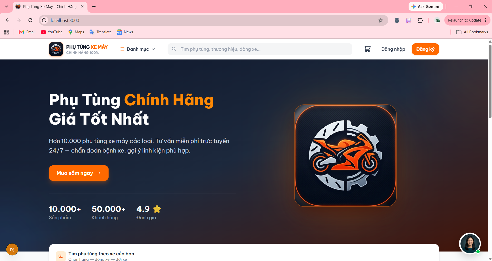
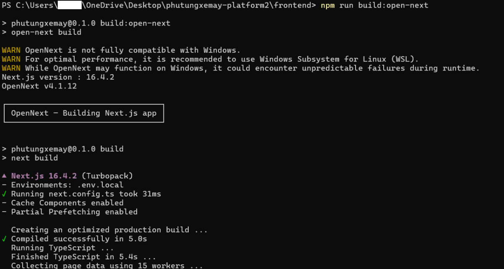
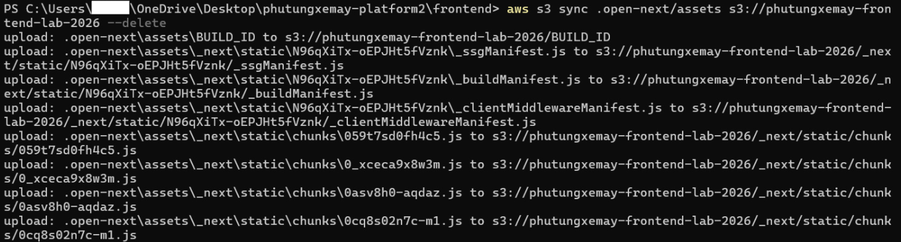
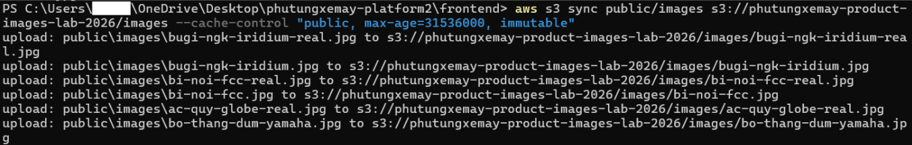
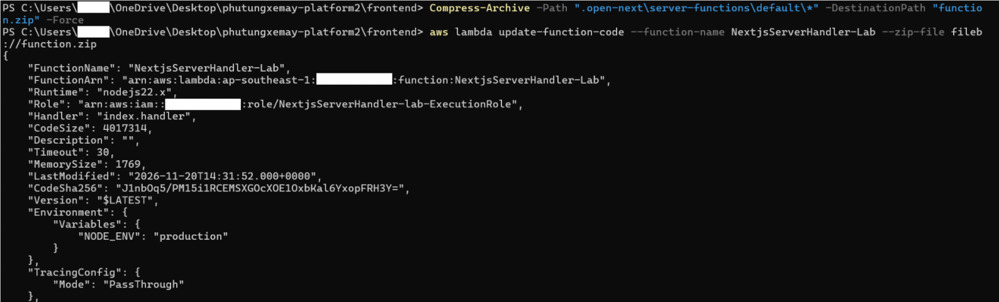
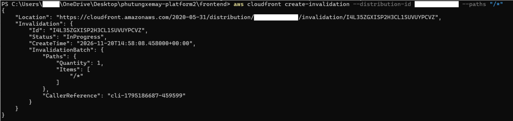
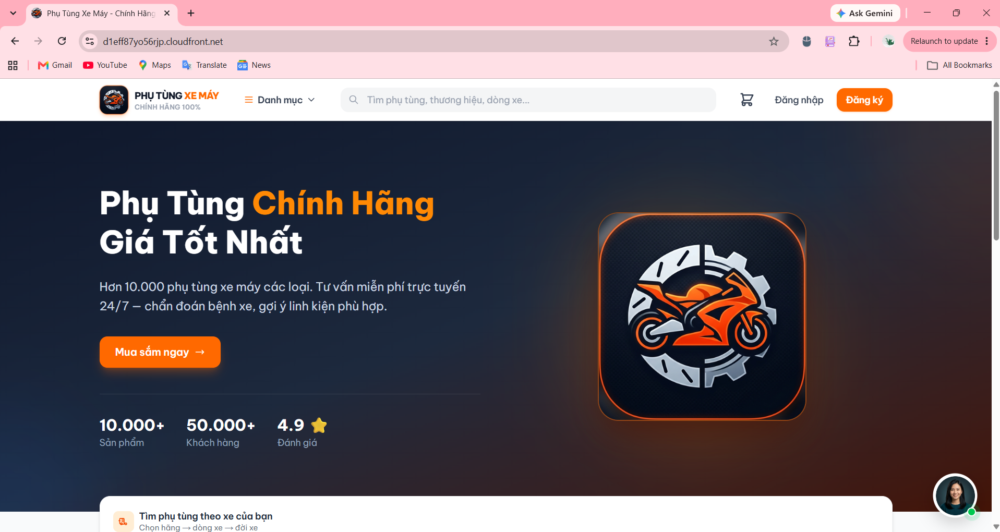

In this section, you will download the **Frontend (Next.js)** source code from GitHub, configure it to connect with the AWS infrastructure provisioned via Terraform, test it **Locally**, and deploy it to **AWS (S3 + Lambda SSR + CloudFront)** using **OpenNext**.

---

### Environment Prerequisites

* Before starting, ensure you have completed provisioning the AWS infrastructure with Terraform in [5.2-Prerequiste](../../5.2-prerequiste/).
* Install **Node.js** version **20 or higher** (Recommended: **Node.js 22 LTS**) from [nodejs.org](https://nodejs.org/).

Verify your Node.js installation in Terminal / PowerShell:
```bash
node -v
npm -v
```

---

### Step 1: Clone the Frontend Source Code

The Frontend source code is located in the `frontend` directory on GitHub: [https://github.com/lointt/phutungxemay-platform/tree/main/frontend](https://github.com/lointt/phutungxemay-platform/tree/main/frontend).

* **Option 1: Clone the entire repository (if not cloned during the Terraform step)**
  ```bash
  git clone https://github.com/lointt/phutungxemay-platform.git
  cd phutungxemay-platform/frontend
  ```

* **Option 2: Already cloned the repository**
  Simply navigate into the `frontend` directory:
  ```bash
  cd <project-path>/phutungxemay-platform/frontend
  ```

---

### Step 2: Install Dependencies

Run the following command inside the `frontend` folder to install all required packages (Next.js, React, Tailwind CSS, Cognito SDK, OpenNext):
```bash
npm ci
```
*(Alternatively, you can run `npm install`.)*

---

### Step 3: Configure Environment Variables (`.env.local`)

Create a file named **`.env.local`** inside the `frontend/` folder and populate it with the values from your **Terraform Outputs**:

```env
NEXT_PUBLIC_CDN_BASE_URL=https://<cloudfront_domain_name>
NEXT_PUBLIC_API_BASE_URL=https://<cloudfront_domain_name>
NEXT_PUBLIC_COGNITO_USER_POOL_ID=<cognito_user_pool_id>
NEXT_PUBLIC_COGNITO_CLIENT_ID=<cognito_client_id>
NEXT_PUBLIC_WEBSOCKET_URL=<chatbot_websocket_url>
```

---

### Step 4: Run TypeScript Check and Local Testing

1. Verify TypeScript code validity:
   ```bash
   npx tsc --noEmit
   ```
   *(No output means the codebase has zero TypeScript errors.)*

2. Start the local development server:
   ```bash
   npm run dev
   ```

3. Open your browser and navigate to: **`http://localhost:3000`**
   * Verify the homepage layout, product catalog, login/register flow, and the AI Chatbot widget at the bottom-right corner.
   * Once verified, press **`Ctrl + C`** in the Terminal to stop the local server.

**Expected Result:**



---

### Step 5: Build and Deploy Frontend to AWS (OpenNext + S3 + Lambda + CloudFront)

To run the website completely Serverless on AWS, we use **OpenNext** to bundle Next.js into two parts: **Static Assets** (uploaded to S3) and **SSR Server Function** (deployed to AWS Lambda).

#### 5.1. Build the Application with OpenNext
```bash
npm run build:open-next
```
Once completed, the `.open-next/` directory will be generated containing the optimized build artifacts.

**Expected Result:**



#### 5.2. Sync Static Assets to S3 Hosting Bucket
Replace `<s3_hosting_bucket_name>` with the bucket name from Terraform Outputs (e.g., `phutungxemay-frontend-lab-2026`):
```bash
aws s3 sync .open-next/assets s3://<s3_hosting_bucket_name> --delete
```

**Expected Result:**



#### 5.3. Sync Product Images to S3 Images Bucket
Replace `<s3_product_images_bucket_name>` with the product images bucket name (e.g., `phutungxemay-product-images-lab-2026`):
```bash
aws s3 sync public/images s3://<s3_product_images_bucket_name>/images --cache-control "public, max-age=31536000, immutable"
```

**Expected Result:**



#### 5.4. Package and Update the Next.js SSR Lambda Function
* **On Windows (PowerShell):**
  ```powershell
  Compress-Archive -Path ".open-next\server-functions\default\*" -DestinationPath "function.zip" -Force
  aws lambda update-function-code --function-name <lambda_nextjs_function_name> --zip-file fileb://function.zip
  ```
* **On macOS / Linux (Bash):**
  ```bash
  cd .open-next/server-functions/default
  zip -rq ../../../../function.zip .
  cd ../../../..
  aws lambda update-function-code --function-name <lambda_nextjs_function_name> --zip-file fileb://function.zip
  ```
  *(Replace `<lambda_nextjs_function_name>` with the Lambda function name from Outputs, e.g., `NextjsServerHandler-Lab`.)*

**Expected Result:**



#### 5.5. Invalidate CloudFront Cache
Replace `<cloudfront_distribution_id>` with your CloudFront distribution ID from Outputs:
```bash
aws cloudfront create-invalidation --distribution-id <cloudfront_distribution_id> --paths "/*"
```

**Expected Result:**



---

### Step 6: Verify Deployment

1. Wait approximately **30 – 60 seconds** for CloudFront to propagate the cache invalidation.
2. Open your browser and navigate directly to **`https://<cloudfront_domain_name>`**.
3. Your Serverless Motorcycle E-Commerce website and AI Chatbot are now live on AWS!

**Expected Result:**


