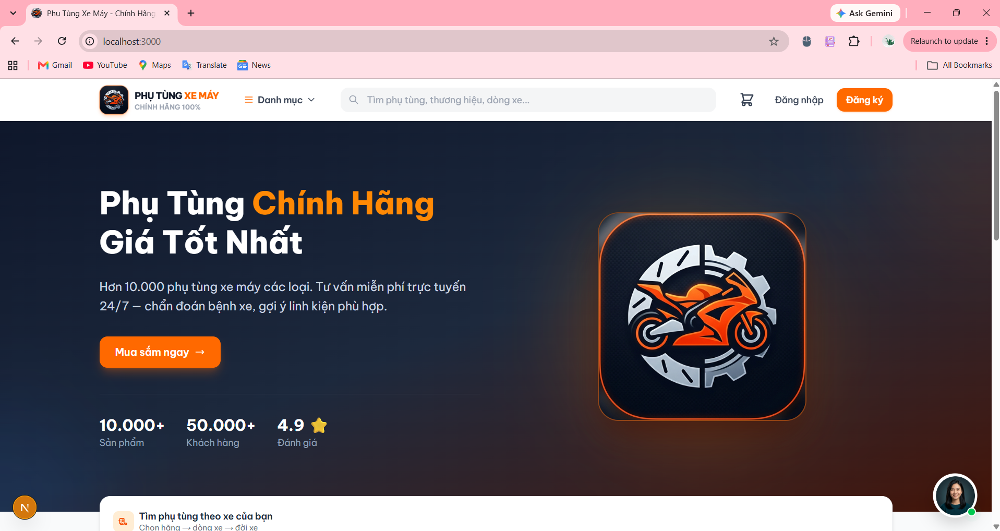
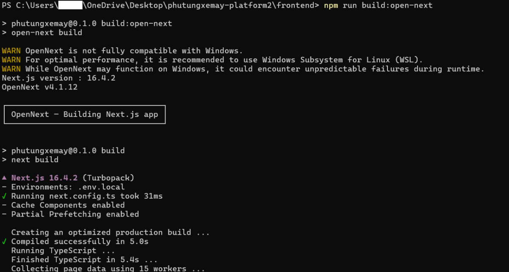
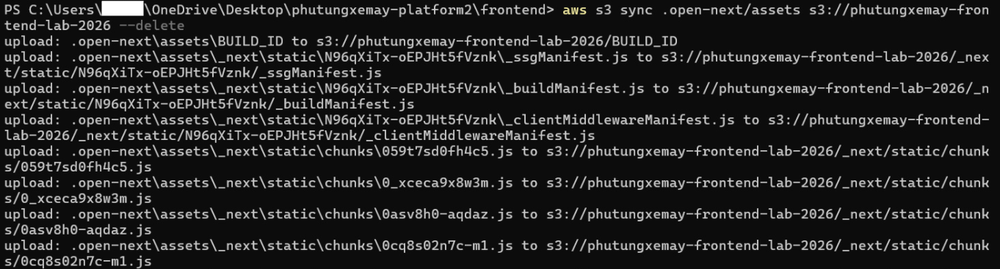
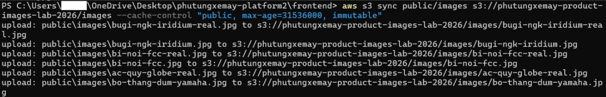
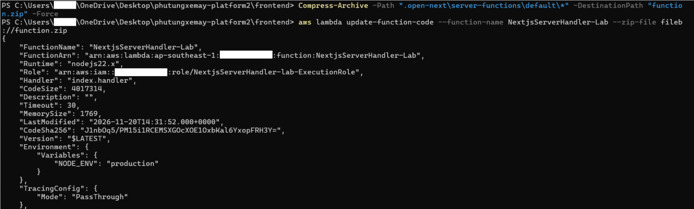
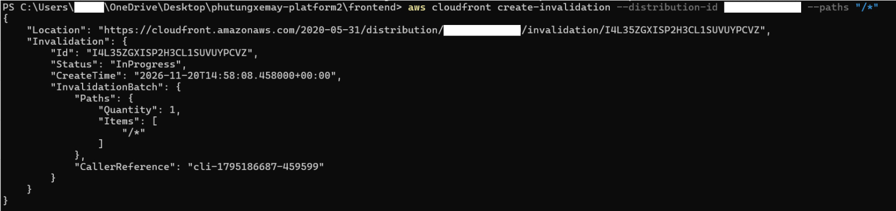
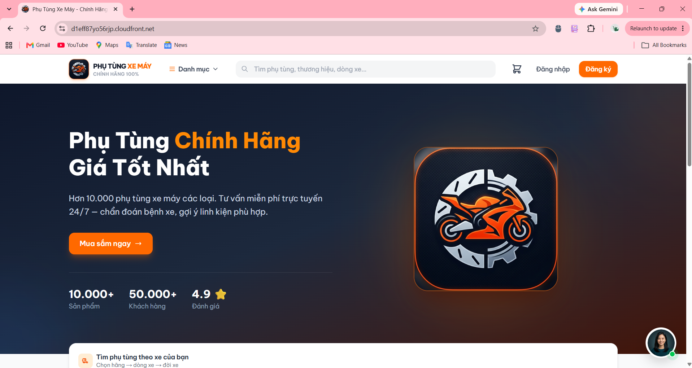

Trong phần này, bạn sẽ tải mã nguồn **Frontend (Next.js)** từ GitHub, cấu hình kết nối với hạ tầng AWS vừa khởi tạo bằng Terraform, chạy kiểm thử trên **Local** và triển khai lên **AWS (S3 + Lambda SSR + CloudFront)** bằng **OpenNext**.

---

### Chuẩn bị môi trường

* Trước khi bắt đầu, hãy đảm bảo bạn đã hoàn tất cấu hình hạ tầng AWS bằng Terraform tại [5.2-Prerequiste](../../5.2-prerequiste/).
* Cài đặt **Node.js** phiên bản **20 trở lên** (Khuyến nghị **Node.js 22 LTS**): Tải tại [nodejs.org](https://nodejs.org/).

Kiểm tra phiên bản Node.js trên Terminal / PowerShell:
```bash
node -v
npm -v
```

---

### Bước 1: Clone mã nguồn Frontend về máy tính

Mã nguồn Frontend nằm tại thư mục `frontend` trên GitHub: [https://github.com/lointt/phutungxemay-platform/tree/main/frontend](https://github.com/lointt/phutungxemay-platform/tree/main/frontend).

* **Cách 1: Clone toàn bộ repository (Nếu bạn chưa clone ở bước Terraform)**
  ```bash
  git clone https://github.com/lointt/phutungxemay-platform.git
  cd phutungxemay-platform/frontend
  ```

* **Cách 2: Đã clone sẵn dự án ở bước trước**
  Chỉ cần di chuyển vào thư mục `frontend`:
  ```bash
  cd <duong-dan-du-an>/phutungxemay-platform/frontend
  ```

---

### Bước 2: Cài đặt thư viện (Dependencies)

Chạy lệnh sau bên trong thư mục `frontend` để cài đặt toàn bộ các gói thư viện (Next.js, React, Tailwind CSS, Cognito SDK, OpenNext):
```bash
npm ci
```
*(Nếu không dùng `npm ci`, bạn có thể chạy `npm install`.)*

---

### Bước 3: Cấu hình biến môi trường (`.env.local`)

Tạo một file tên **`.env.local`** ngay trong thư mục `frontend/` và điền các giá trị lấy từ **Terraform Outputs** của bạn:

```env
NEXT_PUBLIC_CDN_BASE_URL=https://<cloudfront_domain_name>
NEXT_PUBLIC_API_BASE_URL=https://<cloudfront_domain_name>
NEXT_PUBLIC_COGNITO_USER_POOL_ID=<cognito_user_pool_id>
NEXT_PUBLIC_COGNITO_CLIENT_ID=<cognito_client_id>
NEXT_PUBLIC_WEBSOCKET_URL=<chatbot_websocket_url>
```

---

### Bước 4: Kiểm tra lỗi TypeScript và chạy thử trên máy Local

1. Kiểm tra tính hợp lệ của mã nguồn TypeScript:
   ```bash
   npx tsc --noEmit
   ```
   *(Nếu không có thông báo lỗi nào in ra nghĩa là mã nguồn hợp lệ 100%.)*

2. Khởi chạy máy chủ phát triển (Development Server):
   ```bash
   npm run dev
   ```

3. Mở trình duyệt và truy cập địa chỉ: **`http://localhost:3000`**
   * Kiểm tra giao diện trang chủ, danh mục sản phẩm, tính năng đăng nhập/đăng ký và khung chat AI ở góc dưới bên phải màn hình.
   * Sau khi kiểm tra xong, bấm **`Ctrl + C`** trên Terminal để dừng server local.

**Kết quả mong đợi:**



---

### Bước 5: Build và Triển khai Frontend lên AWS (OpenNext + S3 + Lambda + CloudFront)

Để website chạy hoàn toàn Serverless trên AWS, ta sử dụng **OpenNext** để đóng gói Next.js thành 2 phần: **Static Assets** (đẩy lên S3) và **SSR Server Function** (đẩy lên AWS Lambda).

#### 5.1. Build ứng dụng với OpenNext
```bash
npm run build:open-next
```
Sau khi lệnh chạy xong, thư mục `.open-next/` sẽ được tạo ra chứa toàn bộ mã nguồn đã tối ưu.

**Kết quả mong đợi:**



#### 5.2. Đồng bộ Static Assets lên S3 Hosting Bucket
Thay `<s3_hosting_bucket_name>` bằng tên bucket từ Terraform Outputs (ví dụ: `phutungxemay-frontend-lab-2026`):
```bash
aws s3 sync .open-next/assets s3://<s3_hosting_bucket_name> --delete
```

**Kết quả mong đợi:**



#### 5.3. Đồng bộ hình ảnh sản phẩm lên S3 Images Bucket
Thay `<s3_product_images_bucket_name>` bằng tên bucket ảnh sản phẩm (ví dụ: `phutungxemay-product-images-lab-2026`):
```bash
aws s3 sync public/images s3://<s3_product_images_bucket_name>/images --cache-control "public, max-age=31536000, immutable"
```

**Kết quả mong đợi:**



#### 5.4. Đóng gói và cập nhật code cho Lambda Next.js SSR
* **Trên Windows (PowerShell):**
  ```powershell
  Compress-Archive -Path ".open-next\server-functions\default\*" -DestinationPath "function.zip" -Force
  aws lambda update-function-code --function-name <lambda_nextjs_function_name> --zip-file fileb://function.zip
  ```
* **Trên macOS / Linux (Bash):**
  ```bash
  cd .open-next/server-functions/default
  zip -rq ../../../../function.zip .
  cd ../../../..
  aws lambda update-function-code --function-name <lambda_nextjs_function_name> --zip-file fileb://function.zip
  ```
  *(Thay `<lambda_nextjs_function_name>` bằng tên hàm Lambda từ Outputs, ví dụ: `NextjsServerHandler-Lab`.)*

**Kết quả mong đợi:**



#### 5.5. Xóa bộ nhớ đệm CloudFront (Cache Invalidation)
Thay `<cloudfront_distribution_id>` bằng ID phân phối CloudFront từ Outputs:
```bash
aws cloudfront create-invalidation --distribution-id <cloudfront_distribution_id> --paths "/*"
```

**Kết quả mong đợi:**



---

### Bước 6: Kiểm tra kết quả

1. Chờ khoảng **30 – 60 giây** để CloudFront cập nhật cache mới.
2. Mở trình duyệt và truy cập trực tiếp vào đường dẫn **`https://<cloudfront_domain_name>`**.
3. Website thương mại điện tử phụ tùng xe máy và Chatbot AI của bạn đã sẵn sàng hoạt động trên nền tảng AWS Serverless!

**Kết quả mong đợi:**


