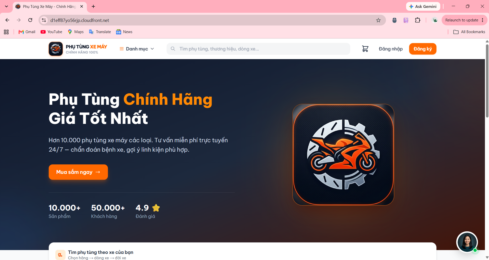
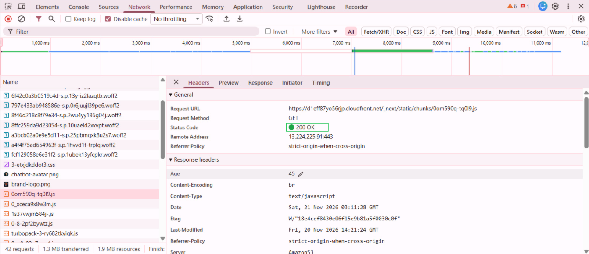
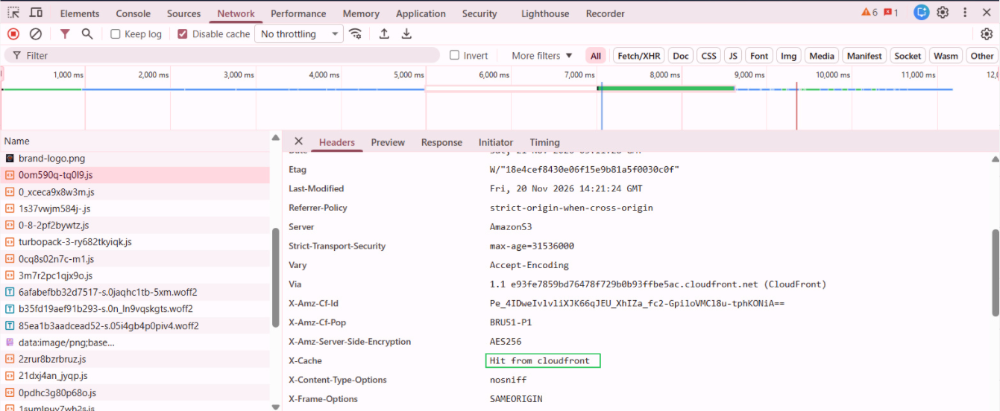
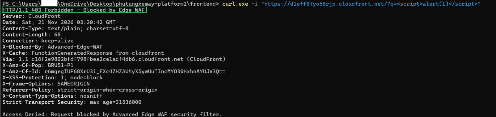
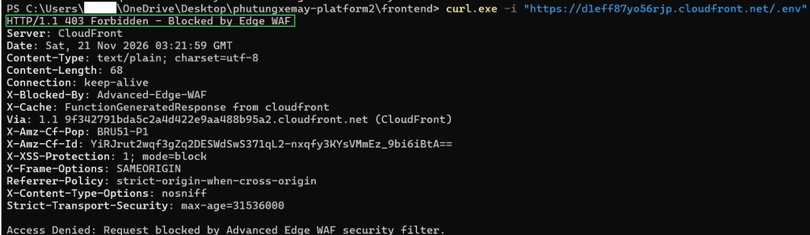
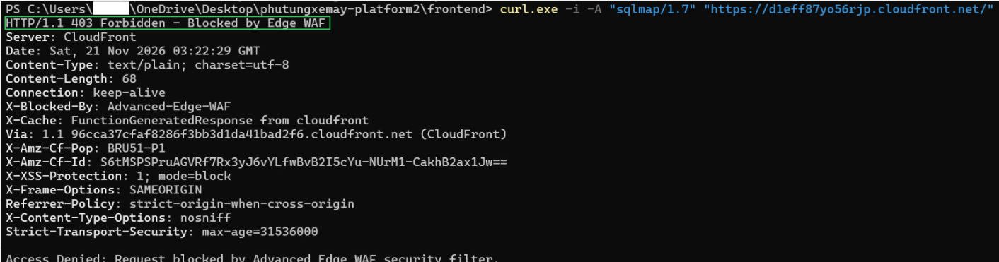
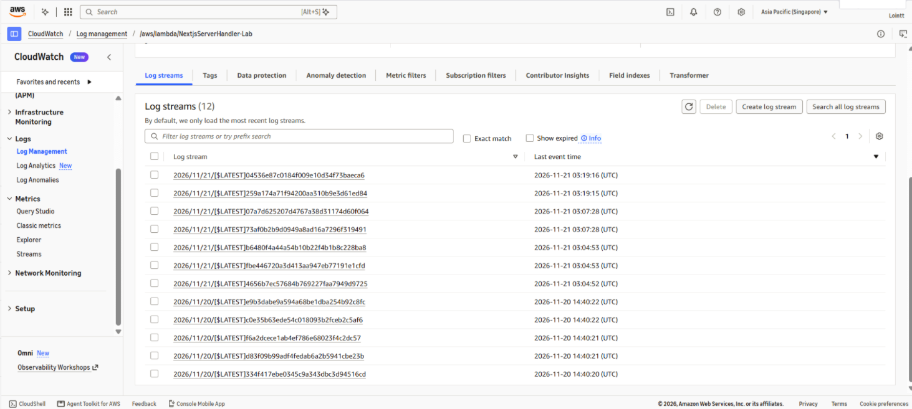

After deploying the Frontend to **S3 + Lambda Next.js SSR + CloudFront**, we will verify 4 key aspects: **UI & SSR Rendering**, **CDN Caching**, **Edge WAF Security**, and **API / WebSocket Connectivity**.

---

### 1. Verify Website Access & Next.js SSR over HTTPS

1. Open your browser and navigate to the CloudFront domain from Terraform Outputs:
   ```text
   https://<cloudfront_domain_name>
   ```
2. **Expected Result:**
   * The motorcycle spare parts storefront loads completely with full styling (no `403 Forbidden` or `502 Bad Gateway` errors).
   * The browser address bar displays a valid **HTTPS** padlock icon.
   * The **AI Assistant Chatbot** widget appears at the bottom-right corner.



---

### 2. Verify Static Assets & CloudFront Cache (S3 Integration)

1. Press **`F12`** (or Right-click -> **Inspect**) to open **Developer Tools**, switch to the **Network** tab, and check **Disable cache**.
2. Reload the page twice (`Ctrl + R`).
3. Click any static asset (`/_next/static/...` or `/images/...`) and inspect its **Response Headers**:
   * **Status Code:** `200 OK`
   * **`x-cache` Header:** First load shows `Miss from cloudfront`; subsequent reloads show **`Hit from cloudfront`** (confirming S3 assets are cached at Edge locations).





---

### 3. Verify Edge WAF Security (CloudFront Function)

The distribution includes an **Advanced Edge WAF** running at CloudFront Edge to block malicious requests before reaching Lambda. Test it via `curl` (on Windows PowerShell, use `curl.exe`):

1. **Test XSS Attack Blocking:**
   ```bash
   curl.exe -i "https://<cloudfront_domain_name>/?q=<script>alert(1)</script>"
   ```
   **Expected Result (`403 Forbidden - Blocked by Edge WAF`):**

   

2. **Test Sensitive File Scanning Blocking (`.env`, `.git`):**
   ```bash
   curl.exe -i "https://<cloudfront_domain_name>/.env"
   ```
   **Expected Result (`403 Forbidden - Blocked by Edge WAF`):**

   

3. **Test Malicious User-Agent Blocking (`sqlmap`):**
   ```bash
   curl.exe -i -A "sqlmap/1.7" "https://<cloudfront_domain_name>/"
   ```
   **Expected Result (`403 Forbidden - Blocked by Edge WAF`):**

   

---

### 4. Verify Cognito Auth, API Proxy & Chatbot Widget

1. **Check Login / Register Page (Cognito):**
   * Click **Sign In** on the navigation bar.
   * Confirm the page renders cleanly with zero **CORS** errors in the DevTools **Console** tab (`F12`).
2. **Check AI Chatbot Widget (WebSocket):**
   * Click the Chatbot icon at the bottom-right corner.
   * Confirm the welcome message renders properly and the WebSocket connection is established.

---

### 5. Inspect SSR Logs in AWS CloudWatch (Optional)

To confirm the SSR Lambda is actively serving requests from CloudFront:
1. Open **AWS Console** -> **CloudWatch** -> **Log groups**.
2. Select the SSR Lambda log group (e.g., `/aws/lambda/NextjsServerHandler-Lab`).
3. Verify the latest log streams show successful invocations without runtime exceptions.


