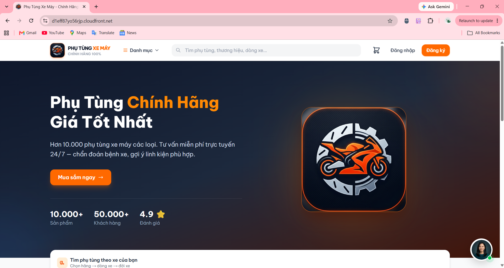
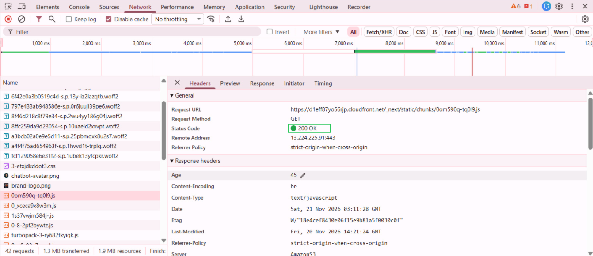
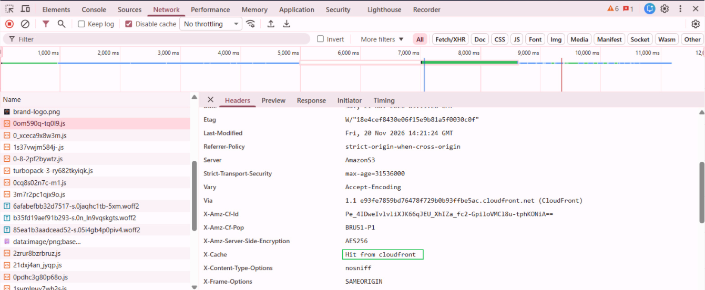
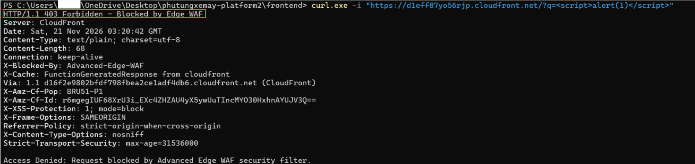
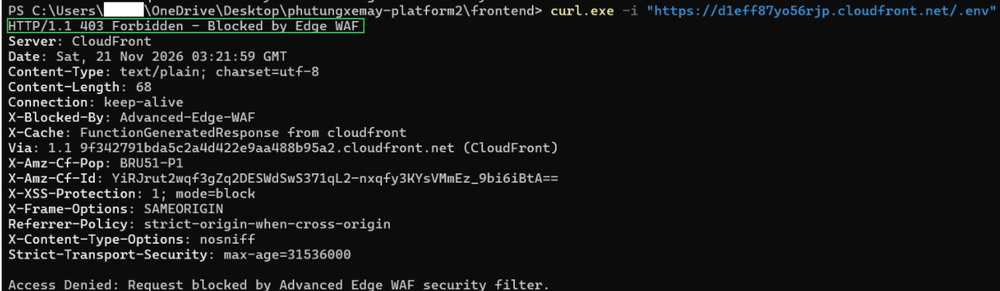
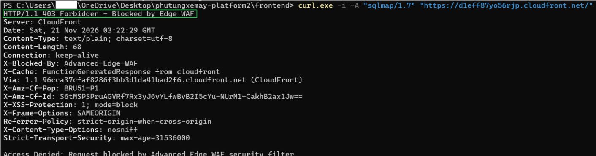
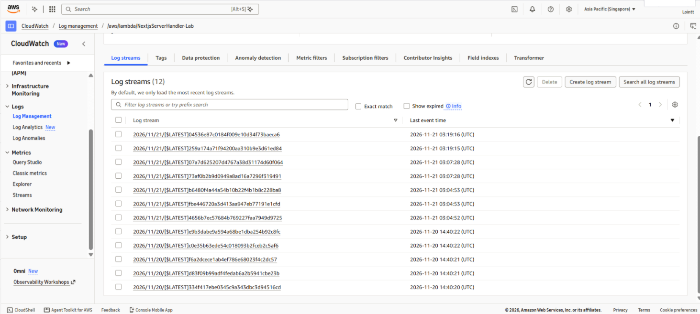

Sau khi triển khai hoàn tất Frontend lên **S3 + Lambda Next.js SSR + CloudFront**, trong phần này chúng ta sẽ tiến hành kiểm thử toàn diện 4 khía cạnh: **Giao diện & SSR**, **Tốc độ Cache CDN**, **Bảo mật Edge WAF**, và **Kết nối API / WebSocket**.

---

### 1. Kiểm tra truy cập Website & Next.js SSR qua HTTPS

1. Mở trình duyệt và truy cập đường dẫn CloudFront từ Terraform Outputs:
   ```text
   https://<cloudfront_domain_name>
   ```
2. **Kết quả mong đợi:**
   * Trang chủ cửa hàng phụ tùng xe máy hiển thị đầy đủ bố cục, font chữ và màu sắc (không bị lỗi `403 Forbidden` hoặc `502 Bad Gateway`).
   * Thanh địa chỉ hiển thị biểu tượng ổ khóa **HTTPS** hợp lệ.
   * Khung **Trợ lý tư vấn phụ tùng AI** hiển thị ở góc dưới bên phải màn hình.



---

### 2. Kiểm tra Static Assets & CloudFront Cache (S3 Integration)

1. Tại trang chủ, nhấn **`F12`** (hoặc chuột phải -> **Inspect**) để mở **Developer Tools**, chọn tab **Network** và tích vào ô **Disable cache**.
2. Tải lại trang 2 lần (`Ctrl + R`).
3. Chọn một tệp tĩnh bất kỳ trong danh sách (ví dụ file `.css`, `.js` có đường dẫn `/_next/static/...` hoặc ảnh sản phẩm `/images/...`) và xem mục **Response Headers**:
   * **Status Code:** `200 OK`
   * **Header `x-cache`:** Lần tải đầu tiên là `Miss from cloudfront`, từ lần tải thứ 2 trở đi chuyển thành **`Hit from cloudfront`** (chứng tỏ CloudFront đã lưu đệm thành công từ S3).





---

### 3. Kiểm tra tường lửa biên Edge WAF (CloudFront Function)

Hệ thống đã tích hợp **Advanced Edge WAF** chạy trực tiếp tại biên CloudFront để chặn các cuộc tấn công phổ biến trước khi request kịp chạm tới Lambda. Hãy kiểm thử bằng lệnh `curl` (trên Windows PowerShell dùng `curl.exe`):

1. **Kiểm thử chặn tấn công XSS:**
   ```bash
   curl.exe -i "https://<cloudfront_domain_name>/?q=<script>alert(1)</script>"
   ```
   **Kết quả mong đợi (`403 Forbidden - Blocked by Edge WAF`):**

   

2. **Kiểm thử chặn dò quét tệp nhạy cảm (`.env`, `.git`):**
   ```bash
   curl.exe -i "https://<cloudfront_domain_name>/.env"
   ```
   **Kết quả mong đợi (`403 Forbidden - Blocked by Edge WAF`):**

   

3. **Kiểm thử chặn công cụ quét lỗ hổng (Bad User-Agent như `sqlmap`):**
   ```bash
   curl.exe -i -A "sqlmap/1.7" "https://<cloudfront_domain_name>/"
   ```
   **Kết quả mong đợi (`403 Forbidden - Blocked by Edge WAF`):**

   

---

### 4. Kiểm tra kết nối Cognito, API Proxy & Khung Chat AI

1. **Kiểm tra trang Đăng nhập / Đăng ký (Cognito):**
   * Nhấn vào nút **Đăng nhập** trên thanh điều hướng.
   * Đảm bảo giao diện tải mượt mà và không có lỗi **CORS** trong tab **Console** của DevTools (`F12`).
2. **Kiểm tra khung Chatbot AI (WebSocket):**
   * Nhấn mở biểu tượng Chatbot ở góc dưới bên phải.
   * Xác nhận lời chào mặc định của trợ lý tư vấn phụ tùng hiển thị đúng và trạng thái kết nối ổn định.

---

### 5. Kiểm tra Log hoạt động trên AWS CloudWatch (Tùy chọn)

Để xác nhận hàm Lambda SSR thực sự đang xử lý request từ CloudFront:
1. Truy cập **AWS Console** -> **CloudWatch** -> **Log groups**.
2. Mở Log group của hàm SSR (ví dụ: `/aws/lambda/NextjsServerHandler-Lab`).
3. Kiểm tra các dòng log mới nhất để chắc chắn không có lỗi runtime (`ERROR` / `Exception`).


