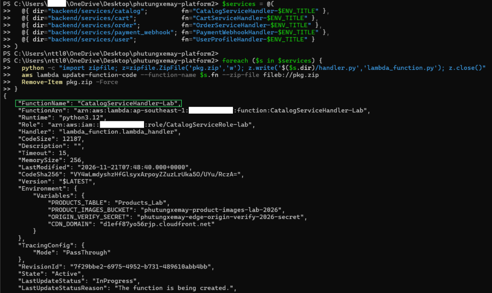
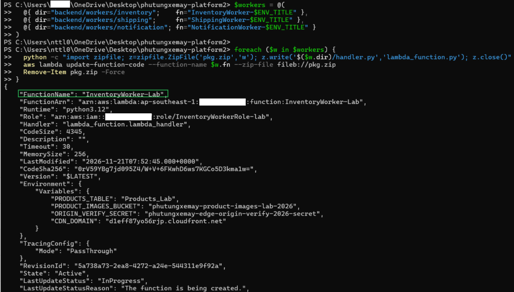
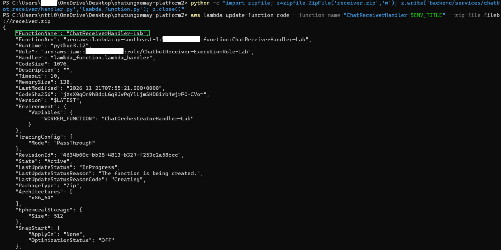
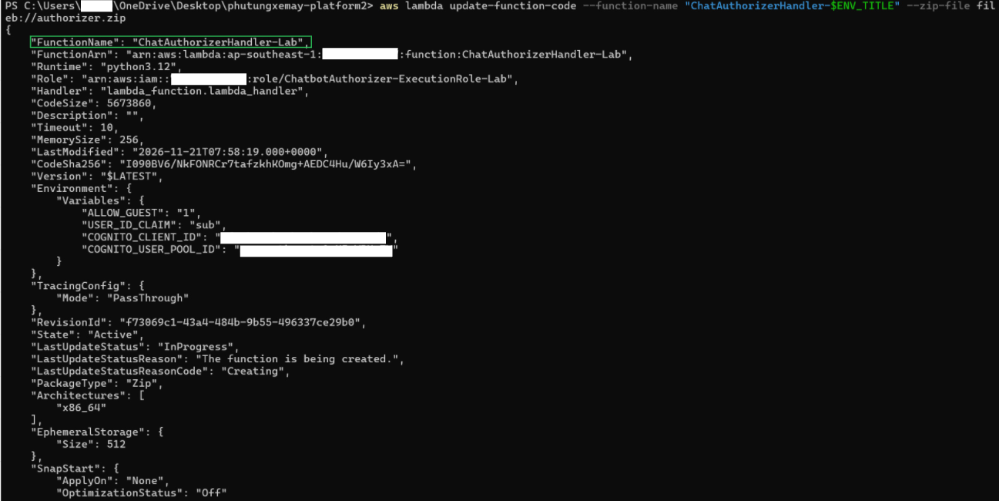
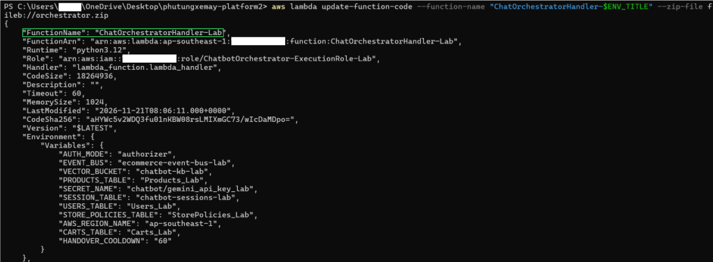
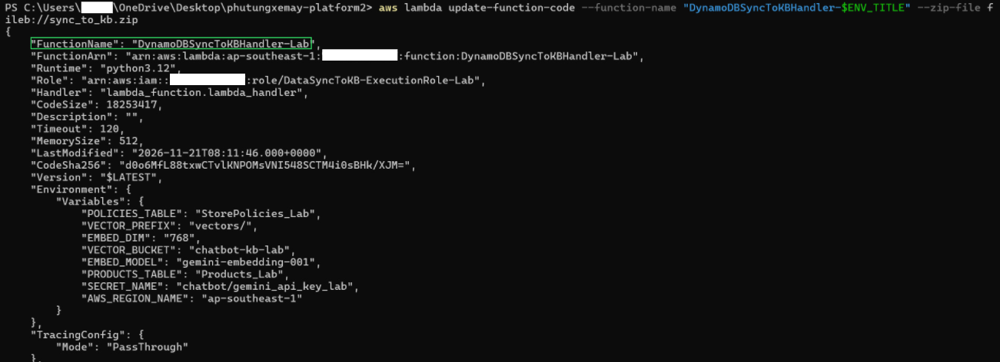
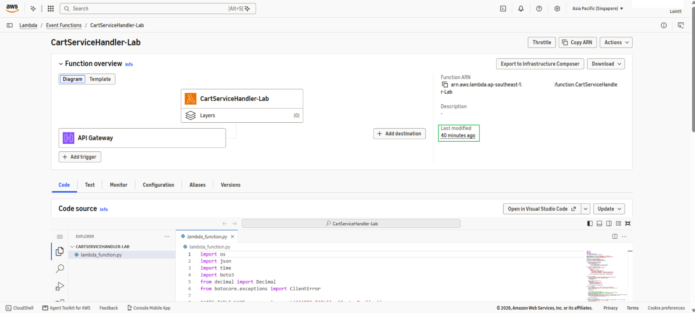

In this section, we will package and deploy all **12 AWS Lambda Backend functions** (5 REST API Microservices, 3 Event-Driven Workers, and 4 RAG Chatbot Lambdas) onto the AWS infrastructure provisioned via Terraform, and configure secret keys in **AWS Secrets Manager**.

---

### Prerequisites

* **Python 3.12**, **pip**, and **AWS CLI v2** installed and configured (`aws configure`).
* Cloned project repository: [https://github.com/lointt/phutungxemay-platform](https://github.com/lointt/phutungxemay-platform).
* Open Terminal / PowerShell and navigate to the project root:
  ```powershell
  cd <project-path>/phutungxemay-platform
  ```
* Set the environment suffix variable (default `Lab` if following Section 5.2):
  ```powershell
  # Windows PowerShell
  $ENV_TITLE = "Lab"
  ```
  ```bash
  # macOS / Linux
  export ENV_TITLE="Lab"
  ```

---

### Step 1: Update Secrets in AWS Secrets Manager

Before testing the backend, populate your **Google Gemini API Key** (and VNPay / GHN / SMTP credentials if applicable) in Secrets Manager:

1. Open **AWS Console** -> Navigate to **Secrets Manager** (`ap-southeast-1`).
2. Select **`chatbot/gemini_api_key_lab`** -> Click **Retrieve secret value** -> **Edit**.
3. Replace `GEMINI_API_KEY` with your real API Key from [Google AI Studio](https://aistudio.google.com/apikey) -> Click **Save**.
4. *(Optional)* Review or update the remaining secrets:
   * `ecommerce/vnpay_lab` (`VNPAY_TMN_CODE`, `VNPAY_HASH_SECRET`)
   * `ecommerce/shipping_api_key_lab` (`SHIPPING_API_KEY` - GHN Token)
   * `ecommerce/smtp_password_lab` (`SMTP_PASSWORD` - Gmail App Password)

---

### Step 2: Package & Deploy 5 REST API Microservices

The 5 core services (`catalog`, `cart`, `order`, `payment_webhook`, `user`) rely solely on Python standard libraries and `boto3` (built into AWS Lambda Runtime), so we package `handler.py` directly as `lambda_function.py`:

* **On Windows (PowerShell):**
  ```powershell
  $services = @(
    @{ dir="backend/services/catalog";         fn="CatalogServiceHandler-$ENV_TITLE" },
    @{ dir="backend/services/cart";            fn="CartServiceHandler-$ENV_TITLE" },
    @{ dir="backend/services/order";           fn="OrderServiceHandler-$ENV_TITLE" },
    @{ dir="backend/services/payment_webhook"; fn="PaymentWebhookHandler-$ENV_TITLE" },
    @{ dir="backend/services/user";            fn="UserProfileHandler-$ENV_TITLE" }
  )

  foreach ($s in $services) {
    python -c "import zipfile; z=zipfile.ZipFile('pkg.zip','w'); z.write('$($s.dir)/handler.py','lambda_function.py'); z.close()"
    aws lambda update-function-code --function-name $s.fn --zip-file fileb://pkg.zip
    Remove-Item pkg.zip -Force
  }
  ```

* **On macOS / Linux (Bash):**
  ```bash
  for item in "catalog:CatalogServiceHandler" "cart:CartServiceHandler" "order:OrderServiceHandler" "payment_webhook:PaymentWebhookHandler" "user:UserProfileHandler"; do
    dir="${item%%:*}"
    fn="${item##*:}-${ENV_TITLE}"
    python3 -c "import zipfile; z=zipfile.ZipFile('pkg.zip','w'); z.write('backend/services/${dir}/handler.py','lambda_function.py'); z.close()"
    aws lambda update-function-code --function-name "$fn" --zip-file fileb://pkg.zip
    rm -f pkg.zip
  done
  ```

**Expected Result:**



---

### Step 3: Package & Deploy 3 Event-Driven Workers

Deploy the 3 background workers (`InventoryWorker`, `ShippingWorker`, `NotificationWorker`):

* **On Windows (PowerShell):**
  ```powershell
  $workers = @(
    @{ dir="backend/workers/inventory";    fn="InventoryWorker-$ENV_TITLE" },
    @{ dir="backend/workers/shipping";     fn="ShippingWorker-$ENV_TITLE" },
    @{ dir="backend/workers/notification"; fn="NotificationWorker-$ENV_TITLE" }
  )

  foreach ($w in $workers) {
    python -c "import zipfile; z=zipfile.ZipFile('pkg.zip','w'); z.write('$($w.dir)/handler.py','lambda_function.py'); z.close()"
    aws lambda update-function-code --function-name $w.fn --zip-file fileb://pkg.zip
    Remove-Item pkg.zip -Force
  }
  ```

**Expected Result:**



---

### Step 4: Package & Deploy RAG Chatbot Cluster (4 Lambdas)

The Chatbot cluster requires bundling Linux x86_64 compatible dependencies (`PyJWT`, `cryptography` for the Authorizer, and `google-genai` for Orchestrator & Sync-to-KB).

#### 4.1. Deploy `ChatReceiverHandler` (Zero external dependencies)
```powershell
python -c "import zipfile; z=zipfile.ZipFile('receiver.zip','w'); z.write('backend/services/chatbot_receiver/handler.py','lambda_function.py'); z.close()"
aws lambda update-function-code --function-name "ChatReceiverHandler-$ENV_TITLE" --zip-file fileb://receiver.zip
Remove-Item receiver.zip -Force
```

**Expected Result:**



#### 4.2. Deploy `ChatAuthorizerHandler` (With `PyJWT` & `cryptography`)
```powershell
mkdir -Force build_auth
pip install PyJWT cryptography -t build_auth --platform manylinux2014_x86_64 --only-binary=:all: --python-version 3.12
Copy-Item backend/services/chatbot_authorizer/handler.py build_auth/lambda_function.py
Compress-Archive -Path "build_auth\*" -DestinationPath "authorizer.zip" -Force
aws lambda update-function-code --function-name "ChatAuthorizerHandler-$ENV_TITLE" --zip-file fileb://authorizer.zip
Remove-Item -Recurse -Force build_auth, authorizer.zip
```

**Expected Result:**



#### 4.3. Deploy `ChatOrchestratorHandler` & `DynamoDBSyncToKBHandler` (With `google-genai`)
```powershell
mkdir -Force build_genai
pip install google-genai -t build_genai --platform manylinux2014_x86_64 --only-binary=:all: --python-version 3.12

# 1. ChatOrchestratorHandler
Copy-Item backend/services/chatbot_orchestrator/handler.py build_genai/lambda_function.py -Force
Compress-Archive -Path "build_genai\*" -DestinationPath "orchestrator.zip" -Force
aws lambda update-function-code --function-name "ChatOrchestratorHandler-$ENV_TITLE" --zip-file fileb://orchestrator.zip

# 2. DynamoDBSyncToKBHandler
Copy-Item backend/services/sync_to_kb/handler.py build_genai/lambda_function.py -Force
Compress-Archive -Path "build_genai\*" -DestinationPath "sync_to_kb.zip" -Force
aws lambda update-function-code --function-name "DynamoDBSyncToKBHandler-$ENV_TITLE" --zip-file fileb://sync_to_kb.zip

Remove-Item -Recurse -Force build_genai, orchestrator.zip, sync_to_kb.zip
```

**Expected Result:**





---

### Step 5: Verify Deployment Status

Open **AWS Console** -> **Lambda** -> **Functions** and filter by `-Lab` (or your environment suffix). Confirm all 13 Lambda functions (1 SSR + 12 Backend) show recent **Last modified** timestamps and **Active** status.


