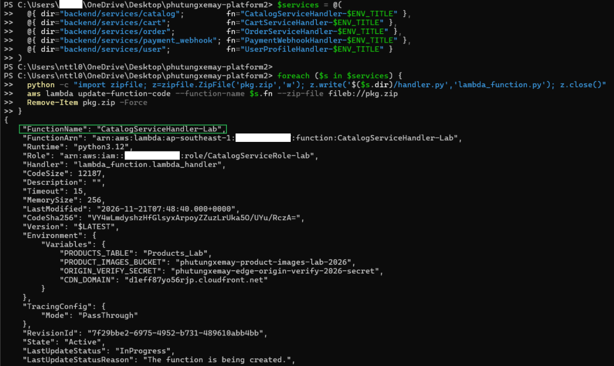
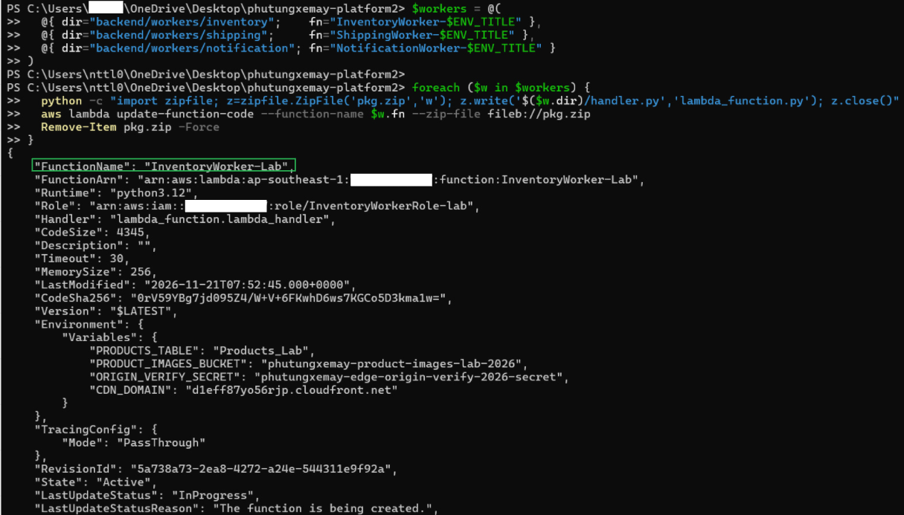
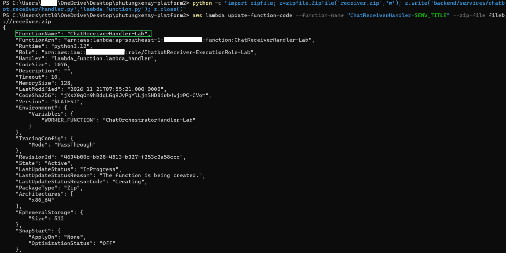
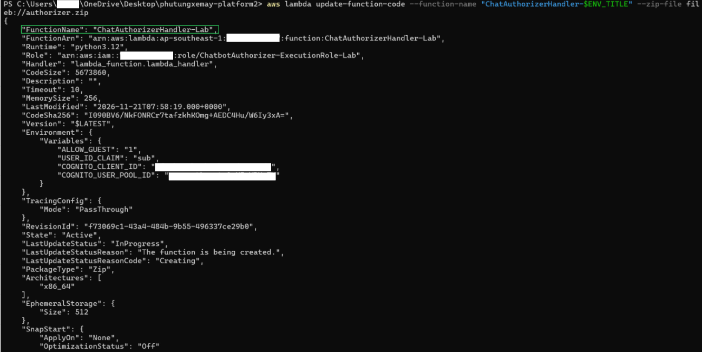
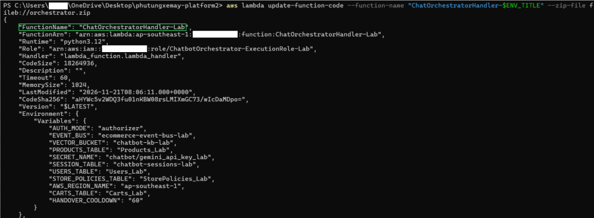
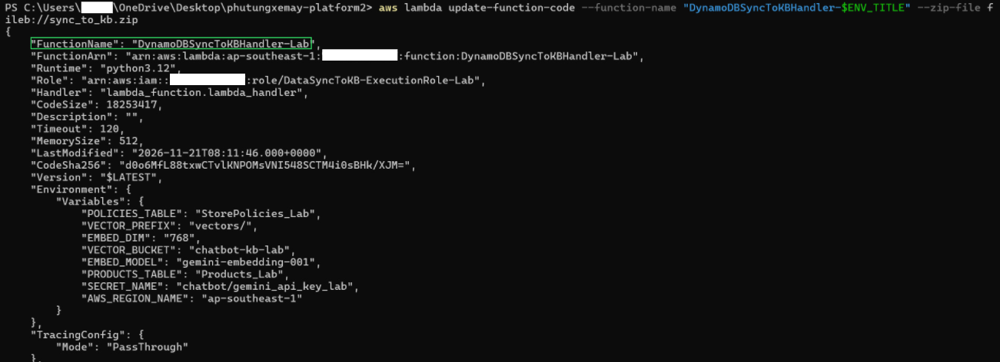
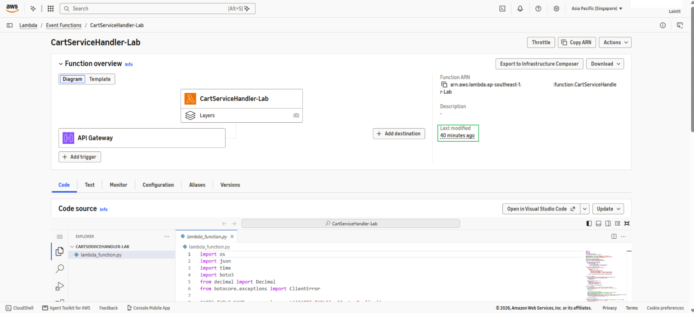

Trong phần này, chúng ta sẽ đóng gói và triển khai toàn bộ **12 hàm AWS Lambda Backend** (bao gồm 5 Microservices REST API, 3 Event-Driven Workers và 4 hàm của cụm Chatbot RAG) lên môi trường AWS đã tạo bằng Terraform, đồng thời cập nhật các khóa bí mật vào **AWS Secrets Manager**.

---

### Yêu cầu tiên quyết

* Đã cài đặt **Python 3.12**, **pip** và **AWS CLI v2** (đã cấu hình `aws configure`).
* Đã clone mã nguồn dự án từ GitHub: [https://github.com/lointt/phutungxemay-platform](https://github.com/lointt/phutungxemay-platform).
* Mở Terminal / PowerShell và di chuyển vào thư mục gốc của dự án:
  ```powershell
  cd <duong-dan-du-an>/phutungxemay-platform
  ```
* Đặt biến môi trường tên hậu tố môi trường (mặc định là `Lab` nếu bạn triển khai theo phần 5.2):
  ```powershell
  # Windows PowerShell
  $ENV_TITLE = "Lab"
  ```
  ```bash
  # macOS / Linux
  export ENV_TITLE="Lab"
  ```

---

### Bước 1: Cập nhật khóa bí mật vào AWS Secrets Manager

Trước khi chạy Backend, hãy cập nhật giá trị thật cho **Google Gemini API Key** (và các khóa VNPay / GHN / SMTP nếu có) vào Secrets Manager:

1. Mở **AWS Console** -> Tìm dịch vụ **Secrets Manager** (Region `ap-southeast-1`).
2. Chọn secret **`chatbot/gemini_api_key_lab`** -> Bấm **Retrieve secret value** -> **Edit**.
3. Thay thế giá trị `GEMINI_API_KEY` bằng API Key thật của bạn từ [Google AI Studio](https://aistudio.google.com/apikey) -> Bấm **Save**.
4. *(Tùy chọn)* Tương tự, kiểm tra hoặc cập nhật các secret:
   * `ecommerce/vnpay_lab` (`VNPAY_TMN_CODE`, `VNPAY_HASH_SECRET`)
   * `ecommerce/shipping_api_key_lab` (`SHIPPING_API_KEY` - GHN Token)
   * `ecommerce/smtp_password_lab` (`SMTP_PASSWORD` - App Password của Gmail)

---

### Bước 2: Đóng gói & Triển khai 5 Microservices REST API

5 dịch vụ cốt lõi (`catalog`, `cart`, `order`, `payment_webhook`, `user`) chỉ dùng thư viện chuẩn của Python & `boto3` (có sẵn trong Lambda Runtime), nên ta đóng gói trực tiếp `handler.py` thành `lambda_function.py`:

* **Trên Windows (PowerShell):**
  ```powershell
  $services = @(
    @{ dir="backend/services/catalog";         fn="CatalogServiceHandler-$ENV_TITLE" },
    @{ dir="backend/services/cart";            fn="CartServiceHandler-$ENV_TITLE" },
    @{ dir="backend/services/order";           fn="OrderServiceHandler-$ENV_TITLE" },
    @{ dir="backend/services/payment_webhook"; fn="PaymentWebhookHandler-$ENV_TITLE" },
    @{ dir="backend/services/user";            fn="UserProfileHandler-$ENV_TITLE" }
  )

  foreach ($s in $services) {
    python -c "import zipfile; z=zipfile.ZipFile('pkg.zip','w'); z.write('$($s.dir)/handler.py','lambda_function.py'); z.close()"
    aws lambda update-function-code --function-name $s.fn --zip-file fileb://pkg.zip
    Remove-Item pkg.zip -Force
  }
  ```

* **Trên macOS / Linux (Bash):**
  ```bash
  for item in "catalog:CatalogServiceHandler" "cart:CartServiceHandler" "order:OrderServiceHandler" "payment_webhook:PaymentWebhookHandler" "user:UserProfileHandler"; do
    dir="${item%%:*}"
    fn="${item##*:}-${ENV_TITLE}"
    python3 -c "import zipfile; z=zipfile.ZipFile('pkg.zip','w'); z.write('backend/services/${dir}/handler.py','lambda_function.py'); z.close()"
    aws lambda update-function-code --function-name "$fn" --zip-file fileb://pkg.zip
    rm -f pkg.zip
  done
  ```

**Kết quả mong đợi:**



---

### Bước 3: Đóng gói & Triển khai 3 Event-Driven Workers

Tương tự, triển khai 3 hàm xử lý nền (`InventoryWorker`, `ShippingWorker`, `NotificationWorker`):

* **Trên Windows (PowerShell):**
  ```powershell
  $workers = @(
    @{ dir="backend/workers/inventory";    fn="InventoryWorker-$ENV_TITLE" },
    @{ dir="backend/workers/shipping";     fn="ShippingWorker-$ENV_TITLE" },
    @{ dir="backend/workers/notification"; fn="NotificationWorker-$ENV_TITLE" }
  )

  foreach ($w in $workers) {
    python -c "import zipfile; z=zipfile.ZipFile('pkg.zip','w'); z.write('$($w.dir)/handler.py','lambda_function.py'); z.close()"
    aws lambda update-function-code --function-name $w.fn --zip-file fileb://pkg.zip
    Remove-Item pkg.zip -Force
  }
  ```

**Kết quả mong đợi:**



---

### Bước 4: Đóng gói & Triển khai Cụm Chatbot RAG (4 Lambdas)

Cụm Chatbot cần đóng gói kèm thư viện ngoài tương thích với môi trường Linux x86_64 của AWS Lambda (`PyJWT`, `cryptography` cho Authorizer và `google-genai` cho Orchestrator & Sync-to-KB).

#### 4.1. Triển khai `ChatReceiverHandler` (Không cần thư viện ngoài)
```powershell
python -c "import zipfile; z=zipfile.ZipFile('receiver.zip','w'); z.write('backend/services/chatbot_receiver/handler.py','lambda_function.py'); z.close()"
aws lambda update-function-code --function-name "ChatReceiverHandler-$ENV_TITLE" --zip-file fileb://receiver.zip
Remove-Item receiver.zip -Force
```

**Kết quả mong đợi:**



#### 4.2. Triển khai `ChatAuthorizerHandler` (Kèm `PyJWT` & `cryptography`)
```powershell
mkdir -Force build_auth
pip install PyJWT cryptography -t build_auth --platform manylinux2014_x86_64 --only-binary=:all: --python-version 3.12
Copy-Item backend/services/chatbot_authorizer/handler.py build_auth/lambda_function.py
Compress-Archive -Path "build_auth\*" -DestinationPath "authorizer.zip" -Force
aws lambda update-function-code --function-name "ChatAuthorizerHandler-$ENV_TITLE" --zip-file fileb://authorizer.zip
Remove-Item -Recurse -Force build_auth, authorizer.zip
```

**Kết quả mong đợi:**



#### 4.3. Triển khai `ChatOrchestratorHandler` & `DynamoDBSyncToKBHandler` (Kèm `google-genai`)
```powershell
mkdir -Force build_genai
pip install google-genai -t build_genai --platform manylinux2014_x86_64 --only-binary=:all: --python-version 3.12

# 1. ChatOrchestratorHandler
Copy-Item backend/services/chatbot_orchestrator/handler.py build_genai/lambda_function.py -Force
Compress-Archive -Path "build_genai\*" -DestinationPath "orchestrator.zip" -Force
aws lambda update-function-code --function-name "ChatOrchestratorHandler-$ENV_TITLE" --zip-file fileb://orchestrator.zip

# 2. DynamoDBSyncToKBHandler
Copy-Item backend/services/sync_to_kb/handler.py build_genai/lambda_function.py -Force
Compress-Archive -Path "build_genai\*" -DestinationPath "sync_to_kb.zip" -Force
aws lambda update-function-code --function-name "DynamoDBSyncToKBHandler-$ENV_TITLE" --zip-file fileb://sync_to_kb.zip

Remove-Item -Recurse -Force build_genai, orchestrator.zip, sync_to_kb.zip
```

**Kết quả mong đợi:**





---

### Bước 5: Kiểm tra trạng thái triển khai

Truy cập **AWS Console** -> **Lambda** -> **Functions** và tìm theo từ khóa `-Lab` (hoặc tên môi trường của bạn). Xác nhận toàn bộ 13 hàm Lambda (1 SSR + 12 Backend) đều đã có thời gian **Last modified** vừa cập nhật và trạng thái **Active**.


