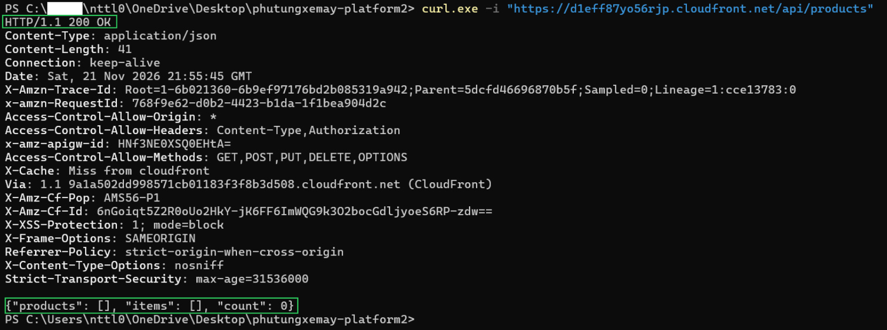
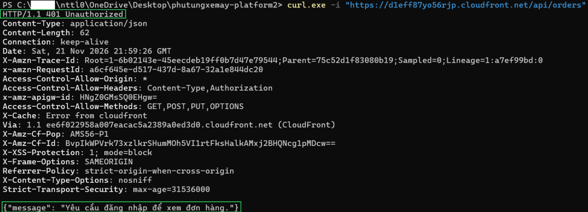
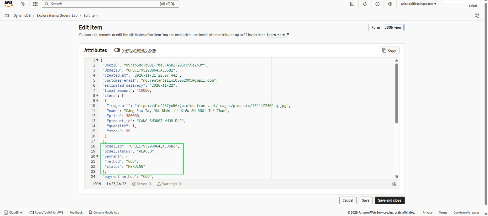
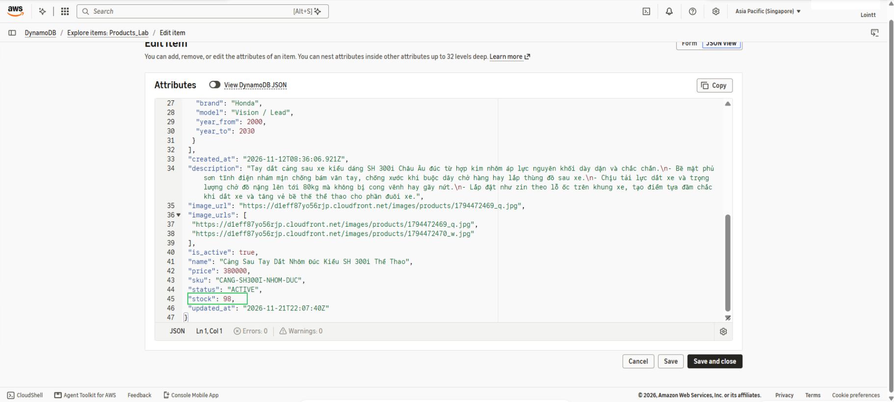
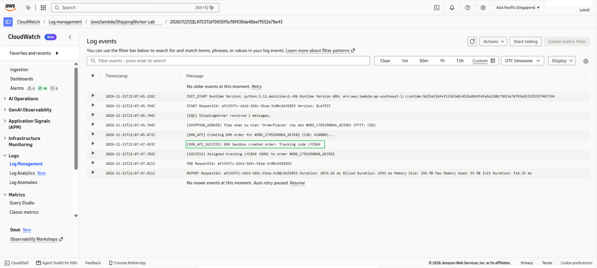
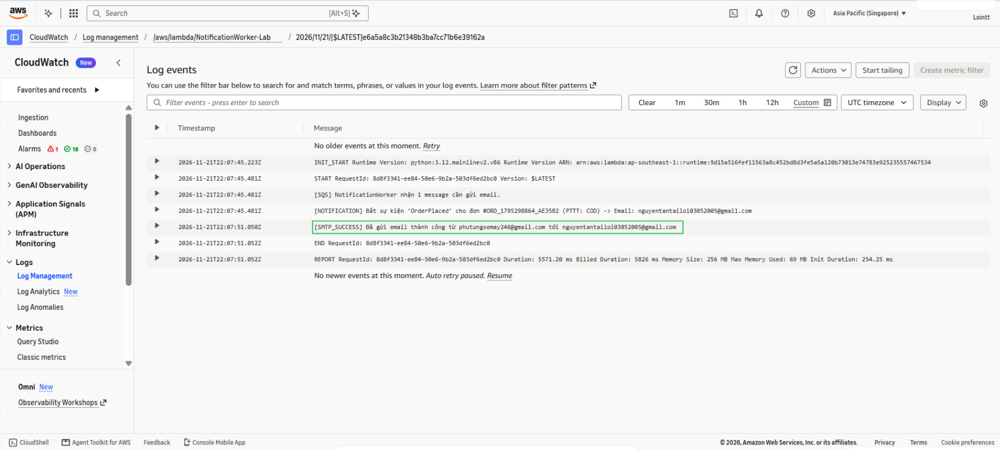

In this section, we will perform end-to-end testing of the **Serverless E-Commerce Backend**: covering the Catalog API, Cognito Authentication, Cart & Order placement, VNPay Sandbox checkout, and the asynchronous **EventBridge -> SQS -> Workers** pipeline.

---

### 1. Test Product Catalog API (Catalog Service)

Verify the public product listing endpoint routed via CloudFront -> API Gateway -> `CatalogServiceHandler` -> DynamoDB:

```powershell
curl.exe -i "https://<cloudfront_domain_name>/api/products"
```

* **Expected Result:** Returns **`HTTP/2 200 OK`** with a JSON list of motorcycle spare parts (or an empty array `[]` if `Products_Lab` has not been seeded yet).



---

### 2. Test Authentication & Authorization (Amazon Cognito + Authorizer)

1. **Verify Unauthorized Access Blocking (Missing JWT Token):**
   ```powershell
   curl.exe -i "https://<cloudfront_domain_name>/api/orders"
   ```
   * **Expected Result:** Returns **`HTTP/2 401 Unauthorized`** (blocked directly by API Gateway Cognito Authorizer before invoking Lambda).

   

2. **Test Registration & Login via Website UI:**
   * Navigate to `https://<cloudfront_domain_name>/register` -> Register a new account with a valid email -> Confirm with the emailed OTP code.
   * Sign in at `/login` -> Verify the user profile appears in the navigation bar.

---

### 3. Test Shopping Cart & Order Checkout (Cart & Order Services)

1. Select a product -> Click **Add to Cart** (`POST /api/cart`).
2. Open the **Cart** page (`/cart`) -> Confirm item quantity and subtotal are accurate.
3. Click **Proceed to Checkout** (`/checkout`) -> Enter shipping details -> Choose **COD** or **VNPay Sandbox** -> Submit order (`POST /api/orders`).
4. **Verify in DynamoDB Console:**
   * Open **AWS Console** -> **DynamoDB** -> **Tables** -> Select `Orders_Lab` -> Click **Explore table items**.
   * Confirm the new order record exists with `OrderID`, customer details, and order status (`PENDING` or `PAID`).



---

### 4. Test Event-Driven Pipeline (EventBridge -> SQS -> Workers)

Immediately upon order placement or payment confirmation, `OrderServiceHandler` (or `PaymentWebhookHandler`) publishes an event (`OrderPlaced` / `PaymentSuccess`) to **Amazon EventBridge**, fanning out to 3 SQS queues and triggering 3 asynchronous workers:

1. **Verify Stock Deduction (`InventoryWorker`):**
   * Inspect `Products_Lab` in DynamoDB -> Confirm the `stock` attribute decreased by the purchased quantity.

   

2. **Verify Shipping Order Creation (`ShippingWorker` - GHN Sandbox):**
   * Open **CloudWatch** -> **Log groups** -> `/aws/lambda/ShippingWorker-Lab` -> Verify successful shipping order creation logs.

   

3. **Verify Email Notification (`NotificationWorker` - Gmail SMTP):**
   * Check your email inbox -> Confirm receipt of the automated **Order Confirmation Email**.
   * Inspect `/aws/lambda/NotificationWorker-Lab` logs to confirm zero runtime errors.

   
