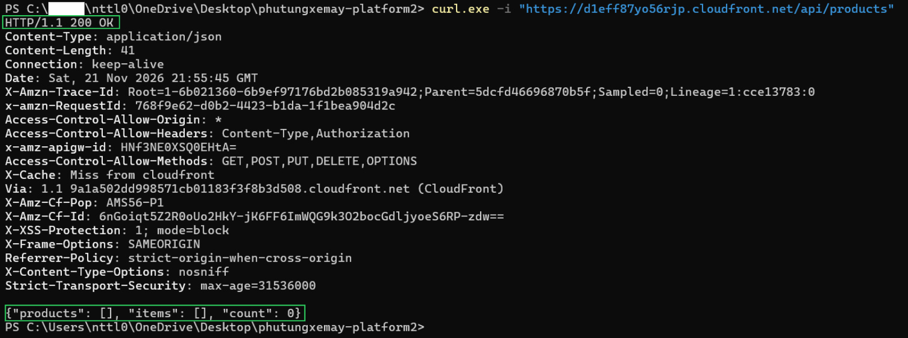
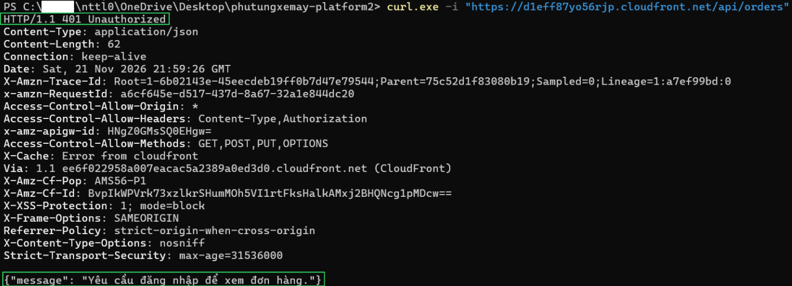
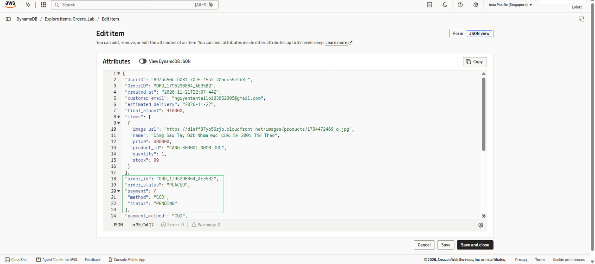
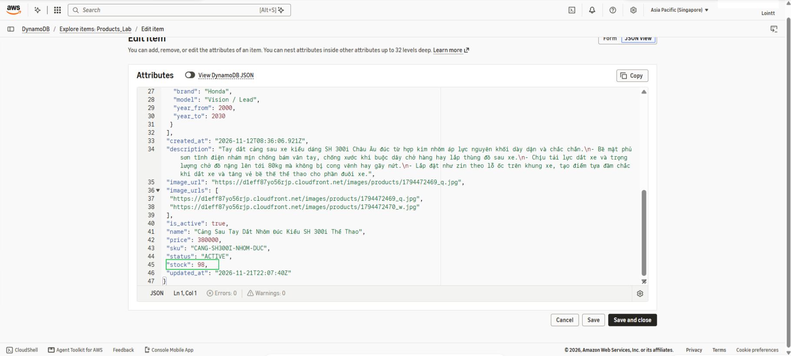
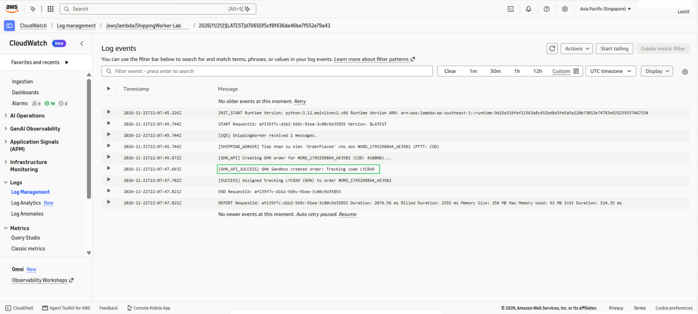
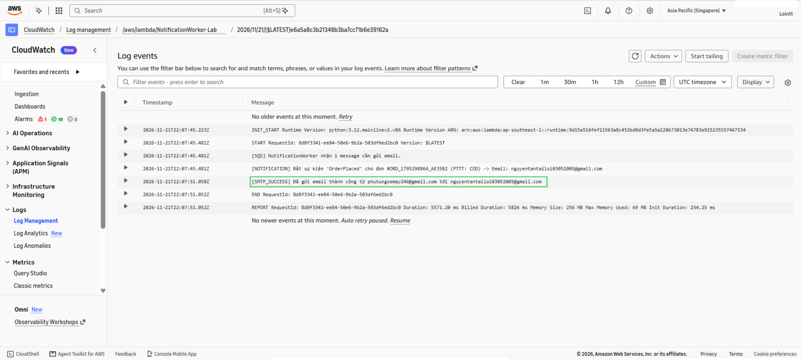

Trong phần này, chúng ta sẽ kiểm thử toàn diện luồng **Serverless E-Commerce Backend**: từ API danh mục sản phẩm, xác thực Cognito, giỏ hàng, đặt hàng, thanh toán VNPay cho đến luồng xử lý bất đồng bộ **EventBridge -> SQS -> Workers**.

---

### 1. Kiểm thử API Danh mục Sản phẩm (Catalog Service)

Kiểm tra API công khai lấy danh sách phụ tùng xe máy đi qua CloudFront -> API Gateway -> `CatalogServiceHandler` -> DynamoDB:

```powershell
curl.exe -i "https://<cloudfront_domain_name>/api/products"
```

* **Kết quả mong đợi:** Trả về **`HTTP/2 200 OK`** cùng danh sách JSON sản phẩm (hoặc mảng rỗng `[]` nếu bảng `Products_Lab` chưa nạp dữ liệu mẫu).


---

### 2. Kiểm thử Xác thực & Phân quyền (Amazon Cognito + API Gateway Authorizer)

1. **Kiểm tra chặn truy cập trái phép (Không có JWT Token):**
   ```powershell
   curl.exe -i "https://<cloudfront_domain_name>/api/orders"
   ```
   * **Kết quả mong đợi:** Trả về **`HTTP/2 401 Unauthorized`** (API Gateway Cognito Authorizer chặn ngay từ cửa ngõ, không gọi vào Lambda).
   

2. **Kiểm tra Đăng ký & Đăng nhập trên giao diện Website:**
   * Truy cập `https://<cloudfront_domain_name>/register` -> Tạo tài khoản mới bằng email thật -> Nhập mã OTP xác nhận gửi về email.
   * Đăng nhập tại `/login` -> Kiểm tra trên trình duyệt đã lưu JWT Token và hiển thị đúng tên tài khoản ở thanh điều hướng.

---

### 3. Kiểm thử Giỏ hàng & Đặt hàng (Cart & Order Services)

1. Chọn một sản phẩm phụ tùng -> Bấm **Thêm vào giỏ hàng** (`POST /api/cart`).
2. Vào trang **Giỏ hàng** (`/cart`) -> Kiểm tra sản phẩm hiển thị đúng số lượng và tổng tiền.
3. Bấm **Tiến hành đặt hàng** (`/checkout`) -> Điền thông tin giao hàng -> Chọn phương thức thanh toán (**COD** hoặc **VNPay Sandbox**) -> Bấm **Đặt hàng** (`POST /api/orders`).
4. **Kiểm tra trong DynamoDB Console:**
   * Vào **AWS Console** -> **DynamoDB** -> **Tables** -> Mở bảng `Orders_Lab` -> Chọn **Explore table items**.
   * Xác nhận đơn hàng mới đã được lưu với `OrderID`, thông tin khách hàng và trạng thái (`PENDING` hoặc `PAID`).

---

### 4. Kiểm thử Luồng Event-Driven (EventBridge -> SQS -> Workers)

Ngay sau khi đặt hàng thành công, `OrderServiceHandler` (hoặc `PaymentWebhookHandler`) sẽ bắn sự kiện (`OrderPlaced` / `PaymentSuccess`) lên **Amazon EventBridge**, tự động phân phối vào 3 hàng đợi SQS và kích hoạt 3 Worker chạy song song:

1. **Kiểm tra trừ tồn kho (`InventoryWorker`):**
   * Mở bảng `Products_Lab` trên DynamoDB -> Xác nhận cột `stock` của sản phẩm vừa mua đã tự động giảm đúng số lượng đặt.
   
2. **Kiểm tra tạo vận đơn (`ShippingWorker` - GHN Sandbox):**
   * Vào **CloudWatch** -> **Log groups** -> `/aws/lambda/ShippingWorker-Lab` -> Xác nhận log hiển thị tạo vận đơn thành công.
   
3. **Kiểm tra gửi Email xác nhận (`NotificationWorker` - Gmail SMTP):**
   * Mở hộp thư Email bạn đã dùng đặt hàng -> Xác nhận đã nhận được **Email xác nhận đơn hàng** tự động.
   * Kiểm tra thêm log tại `/aws/lambda/NotificationWorker-Lab` để chắc chắn không có lỗi runtime.
   
