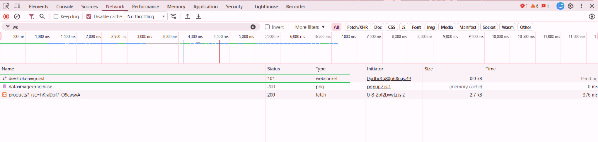
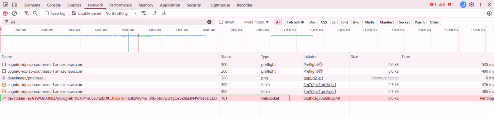
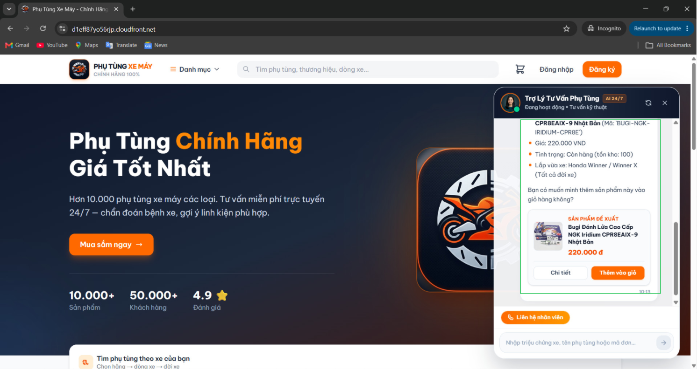
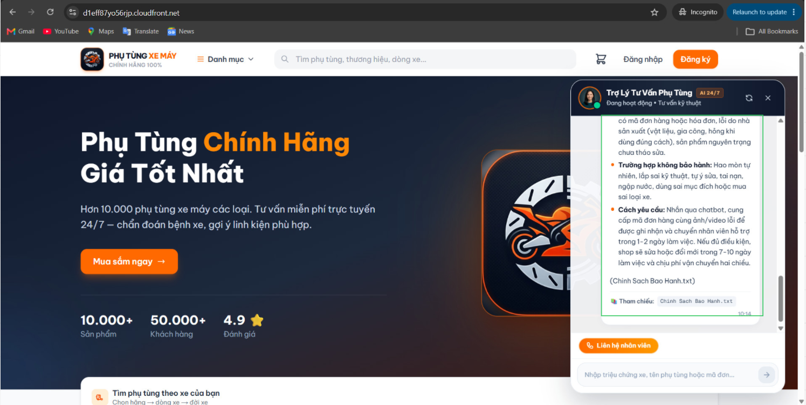
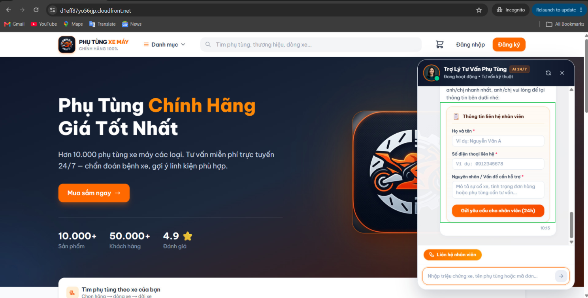
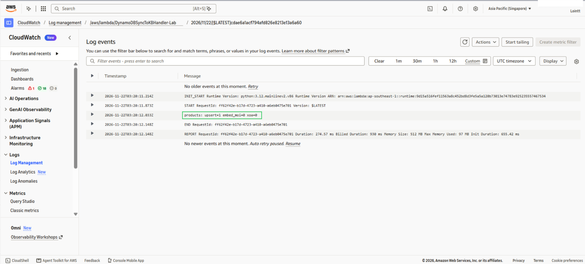

In this section, we will test the complete **Real-Time WebSocket RAG Chatbot** pipeline: Hybrid `$connect` authorization, product & policy consultation using S3 Vector KB + Gemini 2.0 Flash, Human Handover escalation, and CDC synchronization via DynamoDB Streams.

---

### 1. Test WebSocket Connection & Hybrid Authorization (`ChatAuthorizerHandler`)

The WebSocket API attaches a **Lambda Authorizer** on the `$connect` route supporting both guest users (`token=guest`) and authenticated customers (`token=<Cognito_JWT>`).

1. **Test Guest Mode:**
   * Open an Incognito browser window (logged out) -> Visit `https://<cloudfront_domain_name>`.
   * Open **DevTools (`F12`)** -> **Network** tab -> Filter by **`WS` (WebSocket)**.
   * Click the Chatbot widget at the bottom-right corner.
   * **Expected Result:** Connection to `wss://<api-id>.execute-api.ap-southeast-1.amazonaws.com/dev?token=guest` succeeds with **`101 Switching Protocols`**.

   

2. **Test Authenticated Mode (Cognito JWT):**
   * Sign in to your account on the website -> Re-inspect the **WS** tab in DevTools.
   * **Expected Result:** The WebSocket URL automatically appends `?token=eyJ...` (Cognito ID Token), verified via RS256 JWKS by `ChatAuthorizerHandler`, passing the authenticated `user_id` into the session context.

   

---

### 2. Test Spare Parts & Policy Consultation (RAG Vector Search + Gemini)

Enter the following prompts into the chat window to verify retrieval from **S3 (`vectors/products.json`, `vectors/kb.json`)** and generation via **Google Gemini 2.0 Flash**:

1. **Vehicle-Compatible Spare Parts Inquiry:**
   > *"Which spark plug fits a Honda Winner 150?"*
   * **Expected Result:** The bot responds within seconds, recommending matching products from your catalog with real-time prices and stock levels from DynamoDB.

   

2. **Store Policy Retrieval:**
   > *"What is your warranty and return policy for spare parts?"*
   * **Expected Result:** The bot accurately retrieves policy terms from `vectors/kb.json` without hallucinating.

   

---

### 3. Test Human Handover Escalation (EventBridge -> Email)

1. Type into the chat window:
   > *"I want to contact a human support agent"* (or *"Liên hệ nhân viên"*).
2. Fill in **Name**, **Phone Number**, and **Reason** in the handover form -> Click **Submit**.
3. **Expected Result:**
   * `ChatOrchestratorHandler` publishes a `HumanHandoverRequested` event to **EventBridge**.
   * `NotificationWorker` consumes the message from `Notification Queue` and delivers an **alert email** containing the customer's name, phone, and summary to the on-duty staff inbox.

   

---

### 4. Test Automated CDC Synchronization (DynamoDB Streams -> S3 Vector KB)

1. Open **AWS Console** -> **DynamoDB** -> `Products_Lab` table -> Update a product's price or insert a new item.
2. Open **CloudWatch Logs** -> `/aws/lambda/DynamoDBSyncToKBHandler-Lab`.
3. **Expected Result:**
   * DynamoDB Streams automatically triggers `DynamoDBSyncToKBHandler`.
   * The Lambda calls **Google Gemini Embedding** to recompute 768-dimensional vectors and updates `vectors/products.json` inside S3 bucket `chatbot-kb-lab`.
   * Ask the Chatbot about the updated product -> The bot immediately reflects the latest price and stock!

   
