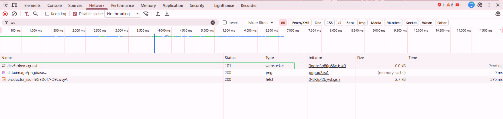
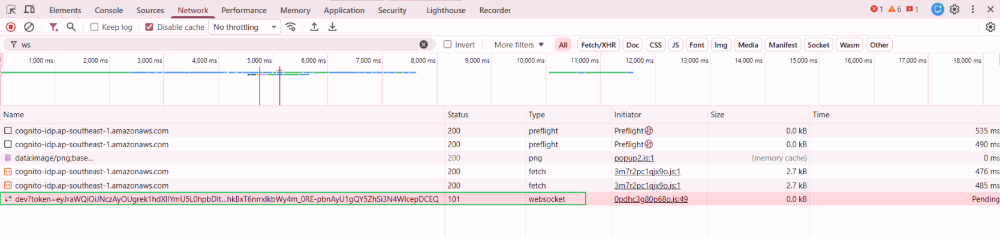
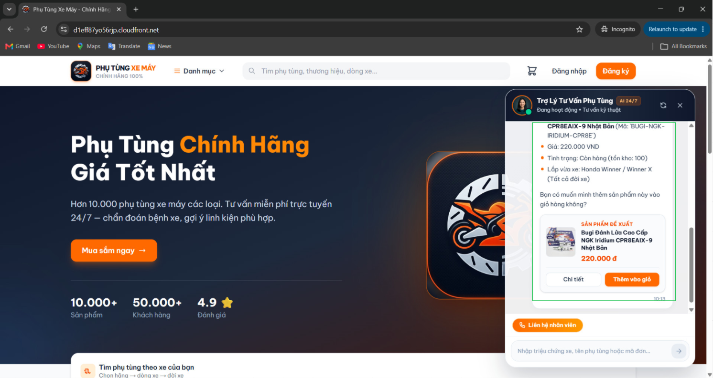
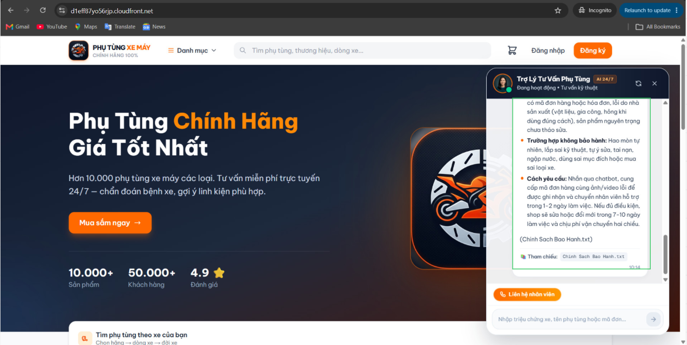
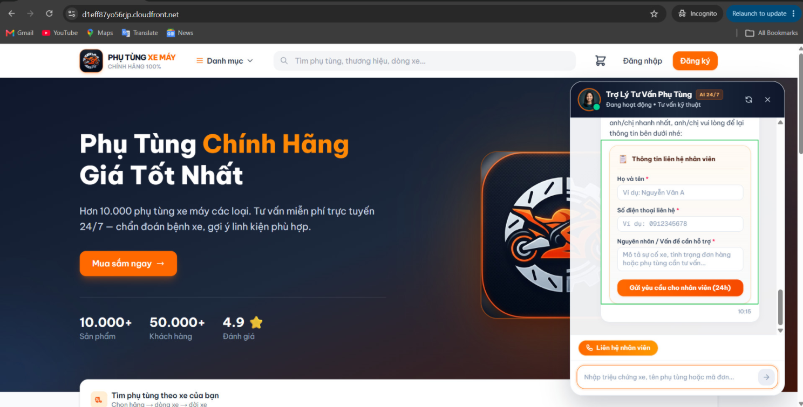
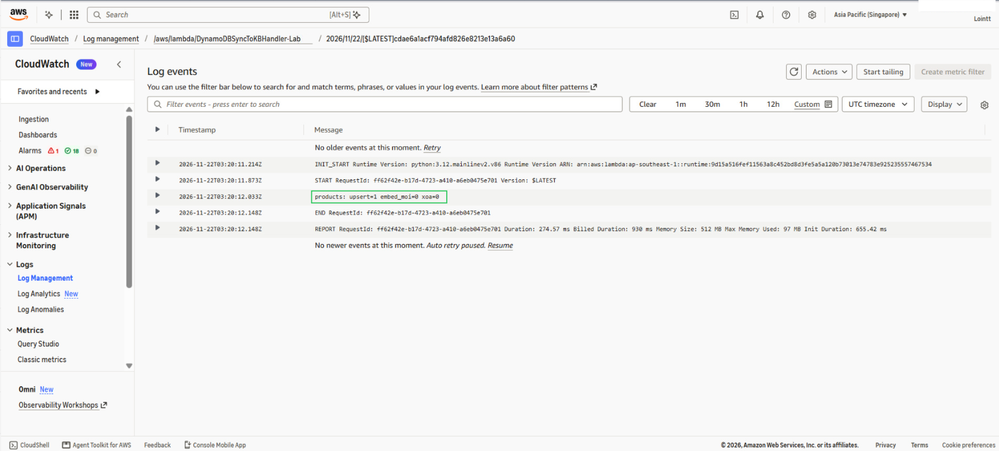

Trong phần này, chúng ta sẽ kiểm thử toàn bộ luồng **Chatbot AI RAG thời gian thực qua WebSocket**, bao gồm: xác thực Hybrid tại `$connect`, tư vấn sản phẩm/chính sách từ S3 Vector KB + Gemini 2.0 Flash, chuyển tiếp nhân viên (Human Handover) và cơ chế đồng bộ CDC từ DynamoDB Streams.

---

### 1. Kiểm thử Kết nối WebSocket & Xác thực Hybrid (`ChatAuthorizerHandler`)

Hệ thống sử dụng **Lambda Authorizer** ở route `$connect` hỗ trợ cả khách vãng lai (`token=guest`) và khách đã đăng nhập (`token=<Cognito_JWT>`).

1. **Kiểm tra chế độ Khách vãng lai (Guest Mode):**
   * Mở trình duyệt ẩn danh (chưa đăng nhập) -> Truy cập `https://<cloudfront_domain_name>`.
   * Mở **DevTools (`F12`)** -> Tab **Network** -> Lọc theo **`WS` (WebSocket)**.
   * Nhấn mở khung Chatbot ở góc dưới bên phải.
   * **Kết quả mong đợi:** Kết nối `wss://<api-id>.execute-api.ap-southeast-1.amazonaws.com/dev?token=guest` trả về trạng thái **`101 Switching Protocols`** (Kết nối thành công).
   

2. **Kiểm tra chế độ Thành viên đã đăng nhập (Cognito JWT):**
   * Đăng nhập tài khoản trên website -> Kiểm tra lại tab **WS** trong DevTools.
   * **Kết quả mong đợi:** URL kết nối tự động đính kèm `?token=eyJ...` (Cognito ID Token), được `ChatAuthorizerHandler` xác thực chữ ký RS256 qua JWKS và gắn `user_id` vào context phiên chat.
   

---

### 2. Kiểm thử Tư vấn Phụ tùng & Chính sách (RAG Vector Search + Gemini)

Nhập lần lượt các câu hỏi sau vào khung chat để kiểm tra khả năng truy xuất tri thức từ **S3 (`vectors/products.json`, `vectors/kb.json`)** và sinh câu trả lời từ **Google Gemini 2.0 Flash**:

1. **Tư vấn tương thích phụ tùng theo dòng xe:**
   > *"Xe Honda Winner 150 thay bugi loại nào tốt?"*
   * **Kết quả mong đợi:** Bot phản hồi trong vài giây, đề xuất đúng mã sản phẩm có trong cửa hàng kèm giá bán và tình trạng tồn kho thực tế từ DynamoDB.
   

2. **Truy xuất chính sách cửa hàng:**
   > *"Chính sách bảo hành và đổi trả phụ tùng của shop như thế nào?"*
   * **Kết quả mong đợi:** Bot trích xuất chính xác nội dung chính sách từ `vectors/kb.json` mà không tự bịa đặt thông tin.
   

---

### 3. Kiểm thử Chuyển tiếp Nhân viên (Human Handover -> EventBridge -> Email)

1. Nhập vào khung chat:
   > *"Tôi muốn liên hệ nhân viên hỗ trợ"*
2. Điền **Họ tên**, **Số điện thoại**, **Lý do cần hỗ trợ** vào form hiển thị trong khung chat -> Bấm **Gửi yêu cầu**.
3. **Kết quả mong đợi:**
   * `ChatOrchestratorHandler` phát sự kiện `HumanHandoverRequested` lên **EventBridge**.
   * `NotificationWorker` nhận sự kiện từ `Notification Queue` và **gửi Email thông báo** chứa đầy đủ Họ tên, SĐT và nội dung yêu cầu của khách tới hộp thư nhân viên trực ca.
   

---

### 4. Kiểm thử Đồng bộ Dữ liệu Tự động (CDC: DynamoDB Streams -> S3 Vector KB)

1. Mở **AWS Console** -> **DynamoDB** -> Bảng `Products_Lab` -> Chỉnh sửa giá hoặc thêm mới 1 sản phẩm phụ tùng.
2. Mở **CloudWatch Logs** -> `/aws/lambda/DynamoDBSyncToKBHandler-Lab`.
3. **Kết quả mong đợi:**
   * DynamoDB Streams tự động kích hoạt `DynamoDBSyncToKBHandler`.
   * Lambda gọi **Google Gemini Embedding** tính lại vector 768 chiều và ghi đè file `vectors/products.json` mới lên S3 bucket `chatbot-kb-lab`.
   * Hỏi lại Chatbot về sản phẩm vừa cập nhật -> Bot lập tức trả lời đúng thông tin giá/tồn kho mới nhất!
   
