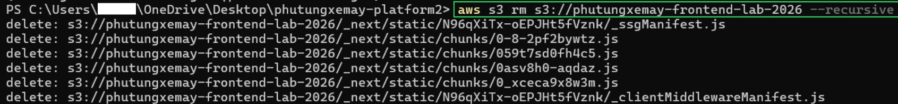
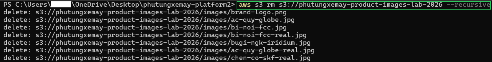
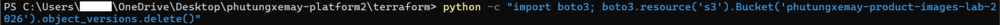
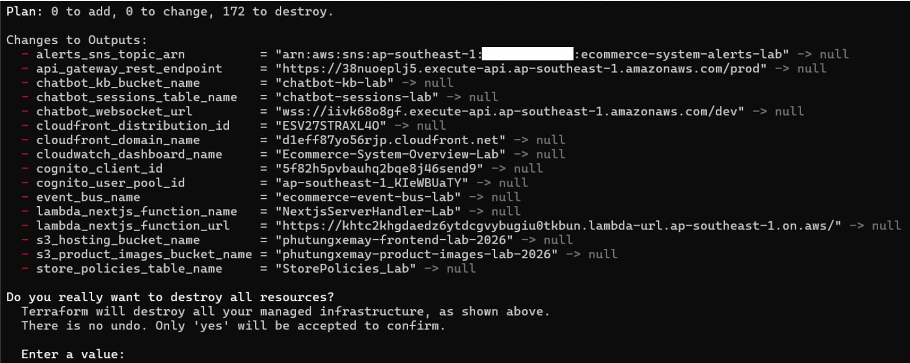
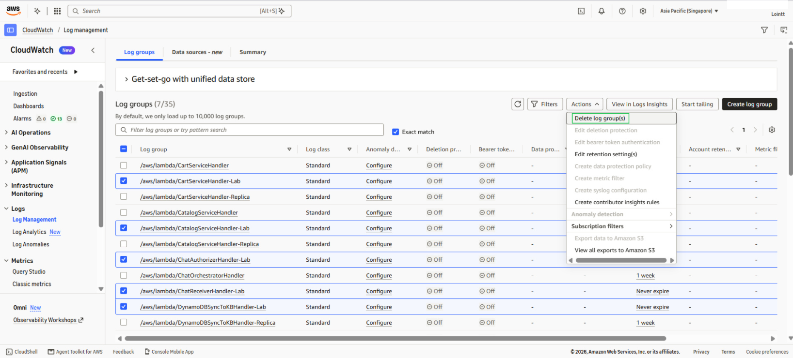
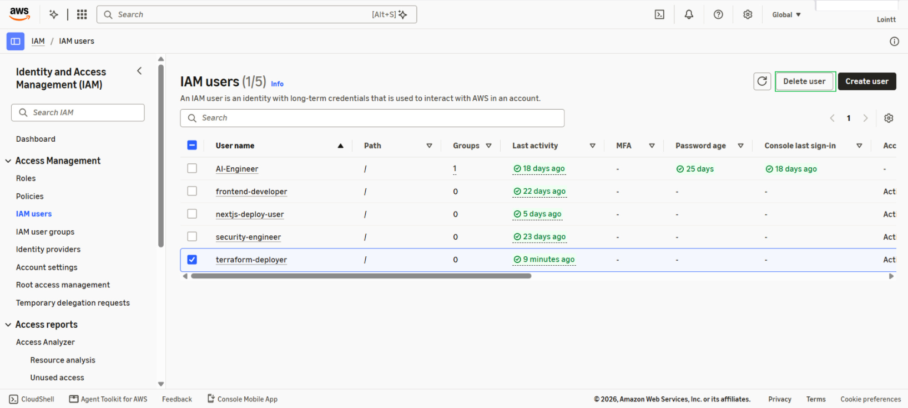
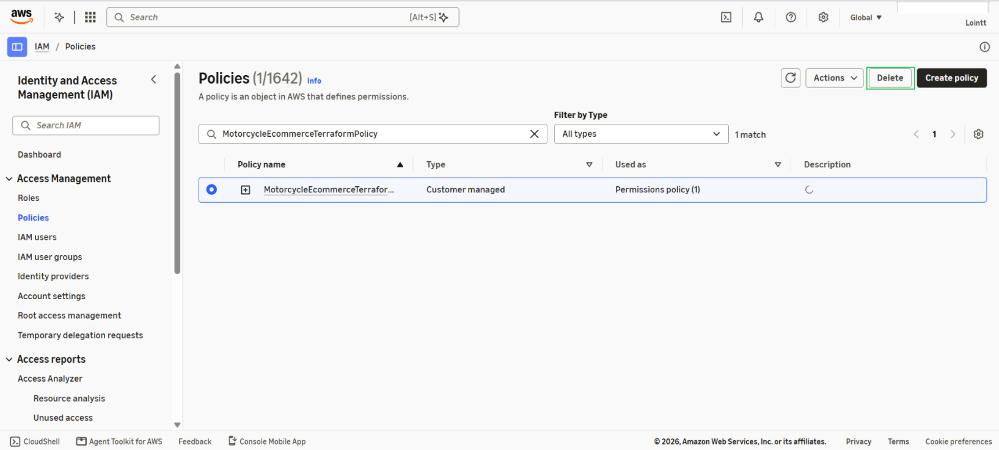

After completing the workshop and verifying all system flows, you should **clean up all provisioned AWS resources** to avoid unexpected ongoing charges.

---

### Step 1: Empty S3 Buckets

AWS does not allow deleting non-empty S3 buckets. Empty all 3 S3 buckets in your `lab` environment before running `terraform destroy`:

```powershell
# 1. Empty S3 Hosting Bucket (Frontend Static Assets)
aws s3 rm s3://<s3_hosting_bucket_name> --recursive

# 2. Empty S3 Product Images Bucket
aws s3 rm s3://<s3_product_images_bucket_name> --recursive

# 3. Empty S3 Chatbot Knowledge Base Bucket (Vector JSON)
aws s3 rm s3://<chatbot_kb_bucket_name> --recursive
```






> **Note (Delete All Versions):** For S3 buckets with **Versioning** enabled (such as `phutungxemay-product-images-lab-2026`), `aws s3 rm` only adds delete markers without permanently removing previous object versions. Run the following Python command to purge all versions and delete markers before running `terraform destroy`:
```powershell
python -c "import boto3; boto3.resource('s3').Bucket('<s3_product_images_bucket_name>').object_versions.delete()"
```
*(Alternatively, open **AWS Console** -> **S3** -> select the bucket -> click **Empty** -> type `permanently delete`.)*



---

### Step 2: Destroy Infrastructure via Terraform

Open Terminal / PowerShell, navigate to the `terraform` directory, and run:

```powershell
cd <project-path>/phutungxemay-platform/terraform
terraform destroy
```

1. Terraform will display the full list of resources scheduled for deletion (CloudFront, REST & WebSocket API Gateways, 13 Lambda Functions, 6 DynamoDB Tables, Cognito User Pool, EventBridge, SQS, SNS, CloudWatch Dashboard/Alarms, Secrets Manager, IAM Roles, etc.).
2. Type **`yes`** and press **Enter** to confirm.
3. Wait approximately **3 – 5 minutes** for deletion to complete (disabling and deleting the CloudFront distribution takes the longest).

*Expected Result:*



---

### Step 3: Delete Remaining CloudWatch Log Groups

**CloudWatch Log Groups** automatically generated by Lambda executions at runtime are not removed by `terraform destroy`. To keep your account clean:

1. Open **AWS Console** -> **CloudWatch** -> **Log groups**.
2. Filter by your environment suffix (e.g., `-Lab`).
3. Select all project log groups (e.g., `/aws/lambda/NextjsServerHandler-Lab`, `/aws/lambda/ChatOrchestratorHandler-Lab`, etc.).
4. Click **Actions** -> **Delete log group(s)** -> Confirm deletion.



---

### Step 4: Remove Deployment IAM User & Policy (Optional)

If you no longer need the `terraform-deployer` account:

1. Open **AWS Console** -> **IAM** -> **Users** -> Select `terraform-deployer` -> Click **Delete** (this also removes its Access Keys).

   

2. Navigate to **Policies** -> Search for `MotorcycleEcommerceTerraformPolicy` -> Click **Delete**.

   
