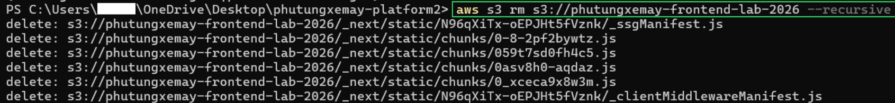
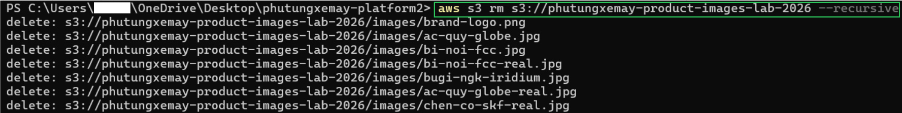
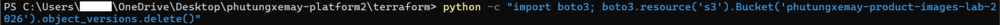
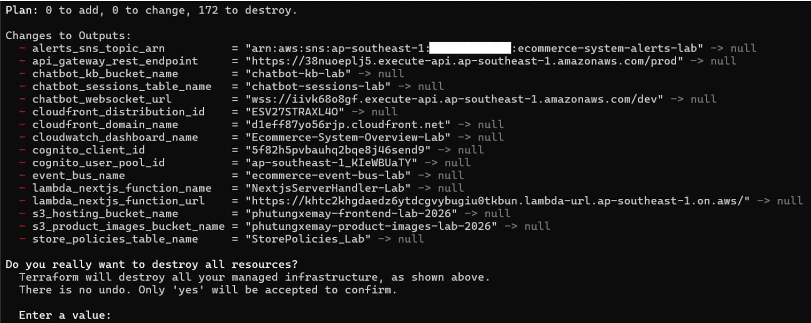
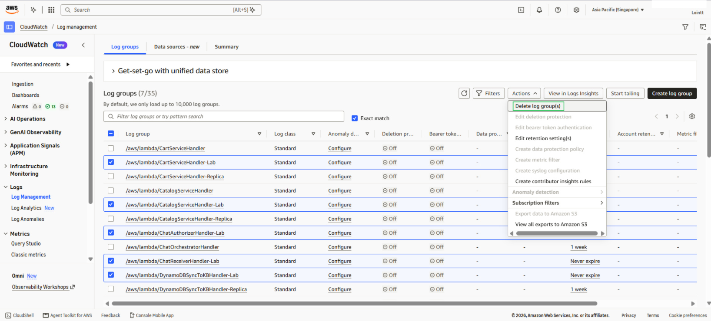
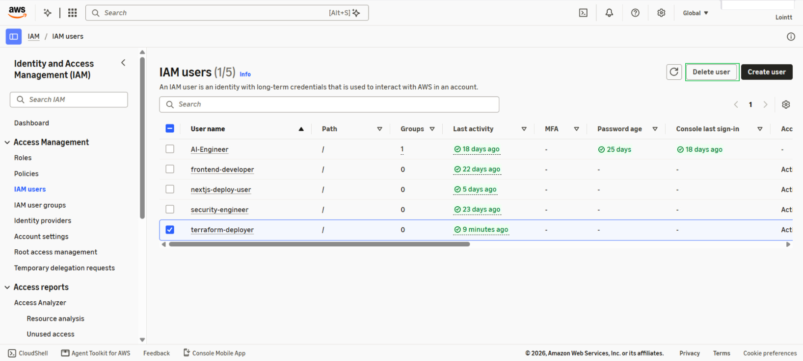
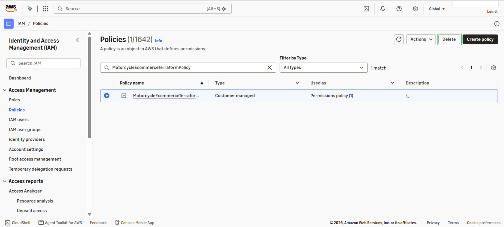

Sau khi hoàn thành bài workshop và kiểm thử toàn bộ hệ thống, bạn nên **dọn dẹp toàn bộ tài nguyên AWS** đã khởi tạo để tránh phát sinh chi phí không mong muốn.

---

### Bước 1: Làm rỗng các S3 Bucket

AWS không cho phép xóa S3 Bucket nếu bên trong vẫn còn chứa tệp tin. Hãy làm rỗng cả 3 S3 Bucket của môi trường `lab` trước khi chạy `terraform destroy`:

```powershell
# 1. Làm rỗng S3 Hosting Bucket (Static Assets Frontend)
aws s3 rm s3://<s3_hosting_bucket_name> --recursive

# 2. Làm rỗng S3 Product Images Bucket (Ảnh sản phẩm)
aws s3 rm s3://<s3_product_images_bucket_name> --recursive

# 3. Làm rỗng S3 Chatbot Knowledge Base Bucket (Vector JSON)
aws s3 rm s3://<chatbot_kb_bucket_name> --recursive
```



> **Lưu ý (Xóa sạch Versioning):** Đối với các S3 Bucket có bật **Versioning** (như `phutungxemay-product-images-lab-2026`), lệnh `aws s3 rm` chỉ tạo delete markers mà không xóa vĩnh viễn các phiên bản cũ. Hãy chạy lệnh Python sau để xóa sạch toàn bộ versions và delete markers trước khi chạy `terraform destroy`:
```powershell
python -c "import boto3; boto3.resource('s3').Bucket('<s3_product_images_bucket_name>').object_versions.delete()"
```
*(Hoặc vào **AWS Console** -> **S3** -> chọn Bucket -> bấm nút **Empty** -> nhập `permanently delete`.)*


---

### Bước 2: Hủy toàn bộ hạ tầng bằng Terraform

Mở Terminal / PowerShell, di chuyển vào thư mục `terraform` và chạy lệnh hủy hạ tầng:

```powershell
cd <duong-dan-du-an>/phutungxemay-platform/terraform
terraform destroy
```

1. Terraform sẽ liệt kê toàn bộ danh sách tài nguyên chuẩn bị xóa (CloudFront, API Gateway REST & WebSocket, 13 Lambda Functions, 6 bảng DynamoDB, Cognito User Pool, EventBridge, SQS, SNS, CloudWatch Dashboard/Alarms, Secrets Manager, IAM Roles...).
2. Gõ **`yes`** và nhấn **Enter** để xác nhận.
3. Chờ khoảng **3 – 5 phút** để quá trình xóa hoàn tất (CloudFront Distribution thường mất thời gian vô hiệu hóa lâu nhất).

*Kết quả mong đợi:*


---

### Bước 3: Xóa các CloudWatch Log Groups còn sót lại

Các **CloudWatch Log Groups** được AWS Lambda tự động tạo ra trong quá trình chạy thực tế sẽ không tự động bị xóa bởi Terraform. Để giữ tài khoản sạch sẽ:

1. Mở **AWS Console** -> **CloudWatch** -> **Log groups**.
2. Tìm kiếm theo hậu tố môi trường của bạn (ví dụ: `-Lab`).
3. Tích chọn toàn bộ các Log groups của dự án (ví dụ `/aws/lambda/NextjsServerHandler-Lab`, `/aws/lambda/ChatOrchestratorHandler-Lab`...).
4. Bấm **Actions** -> **Delete log group(s)** -> Xác nhận xóa.


---

### Bước 4: Xóa IAM User & Policy triển khai (Tùy chọn)

Nếu bạn không còn sử dụng tài khoản triển khai `terraform-deployer` nữa:

1. Mở **AWS Console** -> **IAM** -> **Users** -> Chọn `terraform-deployer` -> Bấm **Delete** (xóa luôn Access Key đi kèm).

2. Chọn **Policies** -> Tìm `MotorcycleEcommerceTerraformPolicy` -> Bấm **Delete**.


